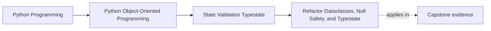
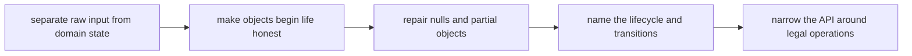

# Refactor Dataclasses, Null Safety, and Typestate

<!-- page-maps:start -->
## Page Maps

<!-- page-maps:end -->

This refactor matters because Module 03 can still collapse into feature trivia if the
learner leaves with only isolated ideas:

- use `@dataclass`
- add `__post_init__`
- avoid too many `Optional`s
- maybe use properties

The real goal is stronger state honesty. This page exists to turn the module into one
repeatable repair route for weak state models.

## The weak starting shape

A weak pre-refactor design usually looks like this:

- raw input becomes domain state too early
- objects are created before they are really valid
- `None` spreads because lifecycle is blurry
- dataclasses are used for convenience without semantic review
- every method stays callable regardless of state

The code may run, but another maintainer cannot tell when the object is legal or which
operations should disappear after a transition.

## The stronger target shape

The target is not "more defensive code." The target is a model that tells the truth:

- boundary input is validated before core object creation
- objects begin life in an honest state
- absence is modeled deliberately instead of by habit
- lifecycle stages are named and enforced
- dataclasses are used only where their generated behavior matches the contract
- the API surface changes with the lifecycle instead of pretending every method always applies

## Use this refactor order

Follow this order on purpose:

1. separate boundary parsing from domain construction
2. identify the real invariants of each core object
3. remove fake optionality from required fields
4. distinguish true absence from earlier lifecycle state
5. name the lifecycle explicitly
6. tighten the API around legal transitions
7. only then keep or add supporting machinery that genuinely helps

This order matters because later improvements depend on earlier clarity.

## Step 1: stop importing uncertainty into the model

Start by separating:

- raw payloads
- parsing and normalization
- domain construction

A common smell is a domain object that accepts:

- strings that still need parsing
- timestamps that might be absent for several different reasons
- caller guesses about state

That uncertainty belongs at the boundary first. The domain model should receive sharper
inputs than the transport surface does.

## Step 2: make the constructor honest

Ask:

- what must be true the moment this object exists?
- which fields are truly required?
- which current constructor arguments are placeholders for a later transition?

Good result:

- the constructor creates a small honest state
- later transitions are named methods instead of optional fields passed "just in case"

This is often the point where the design first becomes easier to trust.

## Step 3: repair overloaded absence

One nullable field often hides several meanings:

- not submitted yet
- not loaded yet
- rejected and reopened
- broken imported state

A stronger refactor splits those meanings by:

- a state value
- clearer timestamps
- a dedicated value object
- smaller explicit transitions

The goal is not fewer `None`s for style reasons. The goal is fewer lies about meaning.

## Step 4: review the dataclass honestly

Once state is sharper, decide whether `@dataclass` still helps.

Ask:

- does generated equality match the contract?
- are defaults honest or only convenient?
- is mutability still safe?
- do `frozen`, `slots`, or post-init checks clarify or distort the design?

The answer may be:

- keep the dataclass
- narrow the dataclass
- replace it with a more explicit class

There is no prize for keeping `@dataclass` if it weakens the model.

## Step 5: name the lifecycle and transitions

The refactor should leave behind a lifecycle table.

| State | What is true | Allowed operations | Illegal operations |
| --- | --- | --- | --- |

If you cannot fill that table, the lifecycle is still too blurry.

Once the states are named, decide:

- which transitions are allowed
- which transitions are forbidden
- which boundary enforces each move

This is where the object stops being a bag of fields and becomes a stateful contract.

## Step 6: narrow the public API

A stronger state model should make misuse less natural.

Questions to ask:

- which methods should exist only in draft-like states?
- which methods belong only after submission or activation?
- which surfaces should become read-only after approval, retirement, or finalization?

Even without static type tricks, runtime state splits and smaller method sets can make
illegal operations feel obviously wrong.

## A worked refactor route

Imagine a `ReportDraft`-like design with:

- `title: str | None`
- `submitted_at: datetime | None`
- `approved_at: datetime | None`
- `status: str`
- methods callable in every state

A safer Module 03 refactor route is:

1. keep raw request parsing outside the domain object
2. make the constructor create only honest drafts
3. replace one overloaded nullable field with explicit state and timestamps
4. move submission, approval, rejection, and reopening into named transition methods
5. narrow the API so edit methods disappear from final states
6. review whether the dataclass still helps after the lifecycle is explicit

The result is not merely "cleaner code." It is a clearer answer to when the object is legal.

## How to review the result

After refactoring, ask:

- can this object exist in this shape?
- what state is it in right now?
- where is invalid input rejected first?
- is this field absent by meaning or by design weakness?
- which operations are no longer legal after the transition?

If those answers are still fuzzy, the refactor is not finished.

## Capstone transfer

Use the capstone immediately:

- where do policy and rule objects begin life valid?
- which transitions are legal for registration, activation, retirement, or incident state?
- where is absence meaningful instead of accidental?
- which APIs should narrow after lifecycle changes?

This page should make the capstone easier to audit, not just easier to describe.

## Exit check

Leave this lesson only when you can do all of these:

- describe the target Module 03 design shape in your own words
- explain an order for refactoring a weak state model into a stronger one
- identify one capstone area that would become clearer if you applied this route
