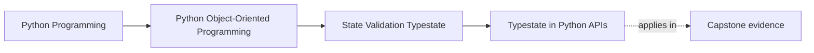

# Typestate in Python APIs

<!-- page-maps:start -->
## Page Maps

<!-- page-maps:end -->

Read the first diagram as a placement map: this page is one concept inside its parent
module, not a detached essay, and the capstone is the pressure test for whether the
idea holds. Read the second diagram as the working rhythm for the page: name the
problem, study the example, identify the boundary, then carry one review question
forward.

## Why this lesson matters

It is not enough to know that an object has states. The API should help callers do the
right thing for the current state.

If callers can ask for every operation all the time, typestate remains only a comment in
the programmer’s head.

This lesson is about making legal and illegal operations visible in ordinary Python, even
without a fancy type system.

## The core design idea

A typestate-aware API tries to make misuse harder by shaping the public surface around
state.

That can mean:

- different methods for different state objects
- explicit transition methods
- narrow runtime guards at the right boundaries
- separate wrappers or types when the states are meaningfully different

The point is not perfection. The point is fewer nonsense calls and clearer reviewable
intent.

## Why one baggy API is weak

A single class with every method always present often creates this problem:

- callers can see and call actions that are currently illegal
- mistakes are discovered late
- state rules are repeated in several places

That design hides the lifecycle contract instead of expressing it.

## Practical enforcement moves in Python

Useful enforcement moves include:

- returning a new state-specific object after a transition
- limiting certain methods to state-specific classes
- placing runtime guards in one clear place instead of everywhere
- designing functions to accept only the right state-bearing abstraction

These are plain design tools, not advanced type theory.

## When runtime guards are enough

Sometimes a strong runtime guard is enough if:

- the lifecycle is simple
- illegal operations are rare and easy to explain
- a heavier state split would add more noise than value

But if misuse is common or the state differences are central, stronger API separation is
usually worth it.

## What to avoid

- one giant class with dozens of "not allowed in this state" branches
- repeating the same guard in many methods
- pretending a status field alone makes the API safe
- adding state-specific types only as labels while keeping the same weak surface

Typestate should reduce ambiguity, not merely rename it.

## Review checklist

| Question | Good sign |
| --- | --- |
| do illegal operations become harder to call by accident? | yes |
| are transition points explicit? | yes |
| is state enforcement concentrated instead of duplicated everywhere? | yes |
| does the API surface reflect real lifecycle differences? | yes |

## Capstone connection

In the capstone, this lesson matters anywhere the state model is important enough that
wrong calls should be hard to make:

- approval flows
- scheduling and execution states
- activation and retirement boundaries
- partially configured versus ready objects

If the capstone API still says "everything is callable, just don’t misuse it," this page
points to the next cleanup.

## Exit check

Leave this lesson only when you can do all of these:

- explain how an API can reflect state instead of only storing it
- name one capstone transition that deserves stronger API enforcement
- explain when a runtime guard is enough and when a state-specific surface is clearer
