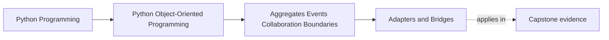

# Adapters and Bridges

<!-- page-maps:start -->
## Page Maps




<!-- page-maps:end -->

Read the first diagram as a placement map: this page is one concept inside its parent
module, not a detached essay, and the capstone is the pressure test for whether the
idea holds. Read the second diagram as the working rhythm for the page: name the
problem, study the example, identify the boundary, then carry one review question
forward.

## Why this lesson matters

Your object model should not learn the dialect of every database, queue, web API, or
framework it touches.

When that dialect leaks inward, you get a design that is hard to test, hard to reason
about, and hard to change. Domain rules start depending on transport details. Error
handling becomes inconsistent. Every replacement of an outer system turns into a
rewrite of inner logic.

Adapters and bridges solve that by keeping translation at the edge.

## The problem they solve

The inner model wants clear concepts such as:

- a rule was activated
- a policy was saved
- an alert was delivered
- a report was loaded

Outer systems usually speak in a different language:

- HTTP responses
- SQL rows
- SDK exceptions
- framework callbacks
- serialized payloads

If you let those outer shapes spread through the core model, the core stops being a
core. It becomes a meeting point for unrelated dependencies.

## What an adapter is

An adapter converts one interface into another interface your code actually wants.

In this course, the usual pattern is:

- the application or domain defines the needed port
- infrastructure implements that port with an adapter
- the adapter translates inputs, outputs, and failures

That translation can include:

- converting framework or SDK data into domain values
- mapping storage rows into object state
- turning external exceptions into stable local failure meanings
- normalizing inconsistent outer naming into domain language

The key point is simple: the adapter absorbs mismatch so the rest of the system does
not have to.

## What a bridge means here

In Python teaching material, "bridge" is often less about ceremony and more about
separation of responsibility.

The core idea is:

- one side owns the abstraction
- another side provides interchangeable implementations

For this module, that usually means:

- the application layer depends on a protocol or port
- infrastructure provides one or more concrete implementations
- the object model keeps its reasoning unchanged while the outer mechanism changes

You can think of it this way:

- the adapter handles translation
- the bridge keeps the inner abstraction from collapsing onto one outer implementation

They often appear together.

## A concrete monitoring example

Suppose a monitoring policy needs recent metric values. The application layer may want
something like:

```python
class MetricHistoryPort(Protocol):
    def recent_samples(self, metric_name: str, limit: int) -> list[float]: ...
```

The external client may instead provide:

- `fetch_timeseries(name: str, count: int) -> dict`
- timestamps you do not need for this decision
- failure types that mention HTTP, auth, or quota details

An adapter should:

- call the client
- extract the values needed for policy decisions
- raise a local, meaningful failure when the source is unavailable

The aggregate or strategy should not need to know whether the data came from HTTP,
SQLite, a file, or a fake used in tests.

## Error translation is part of the boundary

Students often understand data translation first and forget failure translation. That is
where a lot of design damage happens.

If inner layers must handle:

- `Timeout`
- `ClientError`
- `OperationalError`
- `ConnectionResetError`

then the outer system has already leaked inward.

Usually the inner system needs a smaller set of meanings, such as:

- source unavailable
- storage unavailable
- malformed external record
- unsupported response version

The adapter owns the work of turning outer failures into those stable local meanings.

## What should never cross inward

The following should normally stop at the adapter boundary:

- framework request and response objects
- ORM entities used only for persistence mechanics
- transport-specific status codes
- vendor exception trees
- serialization details that matter only at the edge

Once those shapes spread inward, every lesson about aggregates, policies, invariants,
and event reasoning gets harder to preserve.

## Common mistakes

- letting the aggregate call SDK clients directly
- returning raw database rows to the application layer
- handling transport-specific errors inside domain objects
- mixing translation with business decision logic in the same method
- treating one concrete infrastructure implementation as if it were the abstraction

These mistakes usually start as convenience and end as dependency sprawl.

## Review checklist

| Question | Good sign |
| --- | --- |
| is the inner model speaking domain language rather than client or framework language? | yes |
| are outer data shapes translated before they reach core decisions? | yes |
| are vendor and transport errors mapped to local meanings? | yes |
| can a fake or second implementation replace the first without changing the inner model? | yes |

## Capstone connection

In the capstone, this lesson matters anywhere the system touches:

- persistence
- network clients
- message delivery
- CLI or HTTP entrypoints
- reporting or export surfaces

If the capstone core layer already knows too much about one framework or storage shape,
the next improvement is not a naming cleanup. It is a boundary cleanup.

## Exit check

Leave this lesson only when you can do all of these:

- explain why translation belongs at the edge rather than in aggregates
- identify one place where error mapping is as important as data mapping
- describe one capstone dependency that should remain behind a port and adapter
