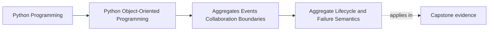

# Aggregate Lifecycle and Failure Semantics

<!-- page-maps:start -->
## Page Maps

<!-- page-maps:end -->

Read the first diagram as a placement map: this page is one concept inside its parent
module, not a detached essay, and the capstone is the pressure test for whether the
idea holds. Read the second diagram as the working rhythm for the page: name the
problem, study the example, identify the boundary, then carry one review question
forward.

## Why this lesson matters

Once an aggregate owns important invariants, failure handling becomes part of the design,
not an afterthought.

You have to answer:

- what counts as a successful aggregate change?
- what must remain atomic together?
- what happens if later side work fails?

If those answers stay vague, the system will look correct only on happy paths.

## The core idea

An aggregate change should leave the aggregate in one clear outcome:

- accepted and internally consistent
- or rejected without a half-applied invariant break

That is the first failure boundary.

After that boundary, further reactions may still fail, but they should not rewrite the
meaning of whether the aggregate itself accepted the change.

## Why lifecycle matters here

Aggregates often have their own lifecycle:

- created
- active
- retired
- cancelled

Failure handling must respect that lifecycle. Some failures mean "stay in the old state."
Others mean "the aggregate state changed, but later notifications or projections still need
repair."

Those are different stories and should not be mixed together.

## Two kinds of failure you should separate

### Boundary failure

The requested change cannot be accepted because it would violate the aggregate’s own
rules.

Result:

- reject the change
- keep the aggregate in its prior valid state

### After-effect failure

The aggregate accepted the change, but later reactions fail.

Result:

- the aggregate’s accepted state should stay meaningful
- recovery, retries, or compensating actions move to later coordination layers

This separation is one of the main reasons Module 04 exists.

## Common mistakes

- treating all failures as one undifferentiated error path
- letting notification or projection failure roll back the meaning of a successful aggregate decision
- updating aggregate members gradually without one clear success point
- making callers guess whether the aggregate changed or not

If the caller cannot tell whether the aggregate accepted the change, the failure semantics
are too muddy.

## Review checklist

| Question | Good sign |
| --- | --- |
| can you tell whether the aggregate accepted the change? | yes |
| are invariant-breaking failures separated from later reaction failures? | yes |
| does lifecycle meaning stay clear across failure paths? | yes |
| is there one clear success boundary for the aggregate change? | yes |

## Capstone connection

In the capstone, use this lesson anywhere an aggregate change can trigger later work:

- persistence follow-up
- event publication
- projection updates
- notifications

The capstone should clearly say whether the core aggregate decision succeeded even when
some later step did not.

## Exit check

Leave this lesson only when you can do all of these:

- explain the difference between an aggregate rejection and an after-effect failure
- explain why the caller should know whether the aggregate changed
- identify one capstone flow where failure semantics still need sharpening
