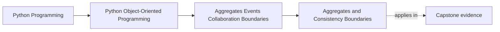

# Aggregates and Consistency Boundaries

<!-- page-maps:start -->
## Page Maps

<!-- page-maps:end -->

Read the first diagram as a placement map: this page is one concept inside its parent
module, not a detached essay, and the capstone is the pressure test for whether the
idea holds. Read the second diagram as the working rhythm for the page: name the
problem, study the example, identify the boundary, then carry one review question
forward.

## Why this lesson matters

Module 03 taught you to make one object honest about its own state. Module 04 raises a
harder question:

- which objects must stay consistent together?
- which changes can be allowed to drift and reconcile later?

Without a clear answer, designs become either too loose to trust or too tightly coupled to
change.

## The core idea

An aggregate is a small cluster of objects treated as one consistency boundary.

Inside that boundary:

- invariants should hold together
- updates should be coordinated together
- one authoritative entry point should guard change

Outside that boundary:

- other objects may reference results
- collaboration may happen later
- strong synchronous consistency is no longer the default

The main design question is not "which objects are related?" It is "which objects must be
kept correct together, right now?"

## Why boundaries matter

If a boundary is too small:

- invariants leak across objects
- callers must coordinate too much themselves
- correctness depends on scattered update order

If a boundary is too large:

- one change drags many objects and dependencies with it
- contention rises
- reasoning and testing get heavier

Good aggregate design is a balance between trust and agility.

## A practical ownership test

Ask:

1. Which rules must hold immediately after a successful change?
2. Which objects must participate for those rules to stay true?
3. Is there one natural authority that should control those changes?

Those answers usually point toward the aggregate boundary.

## What an aggregate is not

An aggregate is not:

- every object that happens to mention the same concept
- the entire domain area for one noun
- a packaging convenience
- a way to avoid making boundary decisions

It is specifically an answer to the consistency question.

## Common mistakes

- treating all related objects as one aggregate because they "belong together"
- splitting objects that share real invariants just to keep classes small
- allowing external code to mutate inner members directly
- letting several services jointly act as the real aggregate authority

The last mistake is especially common: the model pretends to have an aggregate, but the
real consistency boundary is actually spread across application code.

## How learners should think about aggregate roots

An aggregate usually needs one clear authority surface.

That entry point exists so that:

- callers do not reach into internals casually
- invariant enforcement stays central
- the boundary is easy to review

The root is not the "most important class." It is the class that owns safe entry into the
consistency boundary.

## Review checklist

| Question | Good sign |
| --- | --- |
| can you name the invariants that must hold together? | yes |
| is there one clear authority for coordinated change? | yes |
| are unrelated objects kept out of the boundary? | yes |
| would splitting or enlarging the boundary clearly hurt correctness or agility? | yes |

## Capstone connection

In the capstone, use this lesson to decide:

- which objects must change together
- which invariants belong inside one authority surface
- which collaborations can be deferred or separated

If the capstone still updates several related objects from scattered places without a clear
root, this lesson is the next repair.

## Exit check

Leave this lesson only when you can do all of these:

- explain an aggregate as a consistency boundary, not a grouping trick
- name one capstone boundary that should probably become an aggregate
- explain why a too-large or too-small boundary both create design problems
