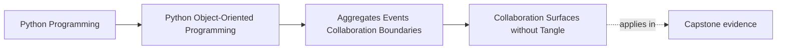

# Collaboration Surfaces without Tangle

<!-- page-maps:start -->
## Page Maps

<!-- page-maps:end -->

Read the first diagram as a placement map: this page is one concept inside its parent
module, not a detached essay, and the capstone is the pressure test for whether the
idea holds. Read the second diagram as the working rhythm for the page: name the
problem, study the example, identify the boundary, then carry one review question
forward.

## Why this lesson matters

Objects have to collaborate, but uncontrolled collaboration turns into tangle quickly.

That usually looks like:

- everyone reaches into everyone else’s internals
- each object knows too many details about the others
- changes ripple because boundaries are blurry

The goal is not zero collaboration. The goal is explicit, narrow collaboration surfaces.

## What a collaboration surface is

A collaboration surface is the part of one object or boundary that another object is
allowed to rely on.

A good collaboration surface is:

- small
- explicit
- stable enough to review
- focused on the real interaction, not internal convenience

If the only way to collaborate is to poke around inside another object’s internals, the
surface is too weak.

## Why tangle appears

Tangle appears when collaboration is designed as access instead of responsibility.

Examples:

- callers mutate child collections directly
- services depend on several internal details of an aggregate
- one object reaches through another just to reach a third

Those are not only code smells. They are signs that ownership is being bypassed.

## The practical design move

Instead of asking "what fields do I need from that object?", ask:

- what authority should that object expose?
- what question or action do I actually need?
- how can the collaboration stay at the right level of meaning?

That shift usually turns low-level access into a clearer domain interaction.

## What a good surface often looks like

Good collaboration surfaces often:

- ask for a decision
- request a state change through an owned method
- publish a small result or event
- expose a clear query that does not leak structure

The point is to collaborate through responsibility, not through accidental data reach.

## Common mistakes

- exposing whole collections just so callers can "help"
- leaking internal child entities for direct mutation
- adding broad helper methods that really just formalize boundary leaks
- letting one service become the place that understands everyone’s internals

That last pattern is especially dangerous because it looks organized while actually
concentrating tangle in one outer layer.

## Review checklist

| Question | Good sign |
| --- | --- |
| can collaborators work without reaching into internals? | yes |
| does the surface expose meaning instead of structure? | yes |
| is the interaction small enough to review clearly? | yes |
| do changes stay mostly local instead of rippling through many objects? | yes |

## Capstone connection

In the capstone, inspect every place where one object reaches deep into another and ask
whether that should become:

- an owned method
- a clearer query
- an event
- or a different boundary altogether

If collaboration still depends on internal reach-through, the model is not yet teaching
good boundaries.

## Exit check

Leave this lesson only when you can do all of these:

- explain a collaboration surface in plain language
- identify one capstone interaction that is currently too tangled
- explain how collaboration through responsibility is stronger than collaboration through internals
