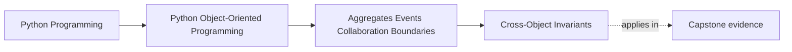

# Cross-Object Invariants

<!-- page-maps:start -->
## Page Maps

<!-- page-maps:end -->

Read the first diagram as a placement map: this page is one concept inside its parent
module, not a detached essay, and the capstone is the pressure test for whether the
idea holds. Read the second diagram as the working rhythm for the page: name the
problem, study the example, identify the boundary, then carry one review question
forward.

## Why this lesson matters

Many important rules do not live inside one object.

Examples:

- one line item may not exceed the order allowance
- one booking may not overlap another controlled booking
- one policy decision may depend on several child records together

Those are cross-object invariants. If you ignore them, the model looks tidy while the real
correctness rules are still leaking into services and scripts.

## What a cross-object invariant is

A cross-object invariant is a rule that depends on more than one object or member inside
one boundary.

It is not enough to validate each piece independently. The relationship between them is
the rule.

That is why aggregate design matters here: someone must own the combined check.

## Why scattered checking fails

If several callers each perform part of the rule, you get:

- duplicated checks
- inconsistent update order
- gaps where one path forgets the full rule
- tests that prove only fragments instead of the whole invariant

Cross-object rules should not depend on lucky calling discipline.

## Where the rule should live

The rule should live with the authority that can see and protect the whole consistency
boundary.

That usually means:

- the aggregate root or another clear boundary authority
- not an unrelated outer utility
- not every caller separately

The question is not only "who can check this?" but "who should be the one trusted to
enforce it every time?"

## A practical test

Ask:

1. Does this rule depend on relationships between several members?
2. Must it hold immediately after a successful change?
3. Is there one authority surface that can see the whole picture?

If yes, the invariant belongs inside that boundary and should be enforced there.

## Common mistakes

- validating each child object while never validating the collection rule
- putting the rule in application code that is easy to bypass
- splitting one real invariant across several methods with no single authority
- pretending eventual cleanup is fine when the rule actually must hold immediately

The last mistake is especially dangerous: some relationships can drift and reconcile
later, but cross-object invariants that define correctness usually cannot.

## What to document clearly

For every cross-object invariant, a learner should be able to answer:

- what is the rule?
- which boundary owns it?
- when is it checked?
- what changes are rejected if it would break?

If those answers are fuzzy, the invariant is probably not yet modeled strongly enough.

## Review checklist

| Question | Good sign |
| --- | --- |
| is the relationship rule named explicitly? | yes |
| is there one authority that protects it? | yes |
| is the rule enforced as part of ordinary change, not as cleanup? | yes |
| can callers avoid re-implementing the same check? | yes |

## Capstone connection

In the capstone, this lesson matters anywhere one decision depends on several related
members together:

- quota and allocation rules
- overlap rules
- total or uniqueness rules
- boundary-wide approval constraints

If the capstone still relies on callers to remember these rules manually, the aggregate is
not yet doing enough.

## Exit check

Leave this lesson only when you can do all of these:

- define a cross-object invariant in plain language
- name the capstone boundary that should own one such rule
- explain why per-object validation alone is not enough
