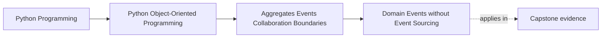

# Domain Events without Event Sourcing

<!-- page-maps:start -->
## Page Maps

<!-- page-maps:end -->

Read the first diagram as a placement map: this page is one concept inside its parent
module, not a detached essay, and the capstone is the pressure test for whether the
idea holds. Read the second diagram as the working rhythm for the page: name the
problem, study the example, identify the boundary, then carry one review question
forward.

## Why this lesson matters

Domain events are useful long before a system commits to full event sourcing.

They help answer:

- what meaningful thing just happened inside the domain?
- which later reactions should know about it?
- how can we decouple those reactions from the aggregate’s core decision?

Without events, later work often gets shoved directly into aggregates or orchestration
code until the model becomes tangled.

## What a domain event is

A domain event is a record that a meaningful domain fact occurred.

It is not:

- every method call
- every technical log message
- a replacement for aggregate authority

It is a named fact that other parts of the system may care about after the aggregate has
made its own decision.

## Why you do not need event sourcing to use them

Event sourcing is one architectural choice for persisting state through events.

Domain events are a smaller idea:

- the aggregate decides something
- the system records or emits that fact
- later reactions can respond without being hard-wired into the aggregate

You can use that pattern while still storing ordinary current state.

## What problem they solve

Domain events help when:

- several later reactions should happen after one core decision
- you want the aggregate to stay focused on its own invariants
- side work should not clutter the authority surface

They are a decoupling tool, not a fashionable requirement.

## Common mistakes

- emitting events for trivial internal noise
- treating events as permission to weaken aggregate authority
- hiding important synchronous invariants in asynchronous event handlers
- using "event" language when the real design still depends on direct tangled calls

Events should follow a meaningful domain fact, not replace one.

## A practical test

Ask:

1. Did something meaningful happen that other parts may care about?
2. Should those reactions remain outside the aggregate’s core invariant logic?
3. Would direct calling make the aggregate or application flow too tangled?

If yes, a domain event may be the right boundary tool.

## Review checklist

| Question | Good sign |
| --- | --- |
| is the event a meaningful domain fact? | yes |
| does aggregate authority stay inside the aggregate? | yes |
| are later reactions allowed to remain decoupled? | yes |
| are you avoiding event noise and fake sophistication? | yes |

## Capstone connection

In the capstone, domain events matter where one accepted decision should inform later
work:

- notifications
- projections
- audits
- downstream workflows

If those reactions are still hard-coded directly into aggregate logic, this lesson points to
the next cleanup.

## Exit check

Leave this lesson only when you can do all of these:

- explain a domain event as a meaningful fact, not a technical detail
- explain why event sourcing is not required to benefit from domain events
- name one capstone decision that could publish a useful event
