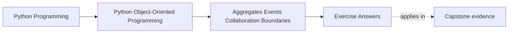
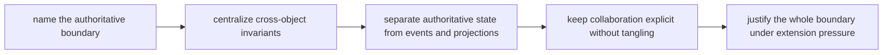

# Exercise Answers

<!-- page-maps:start -->
## Page Maps

<!-- page-maps:end -->

These answers are model explanations, not the only acceptable wording.

## How to use the answer page well

Do not read the model answer first and then reduce the module to "aggregates own the
truth and events are downstream."

A better rhythm is:

1. finish the exercise with your own authority packet
2. name the invariant, authoritative boundary, and derived artifacts
3. compare your reasoning with the model answer
4. revise anywhere your answer still lets projections, policies, or orchestration blur
   into authority

What matters is whether the reasoning makes multi-object authority explicit and auditable.

Strong Module 04 answers usually do five things:

- they identify one authoritative boundary per cross-object rule
- they separate aggregates from manager-object shortcuts
- they keep events and projections downstream of truth
- they use policies and adapters for variation without giving them authority
- they review collaboration surfaces for tangle and leakage

The strongest self-study packets also leave behind six concrete artifacts:

- one authority statement
- one invariant map
- one event-versus-truth review
- one projection review
- one collaboration-surface repair
- one full authority-path review

If your answers rely only on "this feels domain-driven," the reasoning is still too thin.

## Answer 1: Name the authoritative boundary

A strong answer identifies:

- the cross-object behavior
- the one boundary allowed to accept or reject the change
- a nearby object that may observe or help but must not share authority

What goes wrong when authority is split:

- invariants become convention, retries become ambiguous, and no one object can reject an
  inconsistent change cleanly

## Answer 2: Map one cross-object invariant

The important pieces are:

- which objects participate
- where the invariant is enforced
- which workflow or method applies it
- which downstream artifacts only reflect the outcome

The main lesson is that multi-object consistency requires one named home.

## Answer 3: Compare aggregate and manager-object designs

Aggregate-centered design is stronger when:

- the authoritative boundary remains close to the real state it protects
- invariants are visible where change happens

Manager-object design feels tempting because:

- it centralizes knowledge quickly

But it often harms review because:

- it turns domain rules into orchestration scripts and weakens object meaning

## Answer 4: Review one domain event honestly

A domain event should:

- be emitted after an authoritative state change
- describe something that already became true in the aggregate or authority boundary
- inform downstream consumers without giving them permission to rewrite truth

The key review question is:

- what authoritative change happened before this event existed at all

## Answer 5: Distinguish projection from authority

A projection:

- summarizes or reshapes authoritative state
- supports queries, debugging, or reporting
- must never become the place where write decisions originate

Its operational value can be speed, observability, or convenience. Its limitation is that
it inherits truth; it does not own it.

## Answer 6: Place strategy and policy objects carefully

A strong answer distinguishes:

- authority over state
- variation in decision rules

Policy objects are strongest when:

- they encapsulate replaceable decision logic

They become misleading when:

- the team starts treating them as if they own the state boundary instead of influencing a
  decision inside it

## Answer 7: Review a collaboration surface without tangle

Good collaboration means:

- necessary neighbors know each other explicitly
- distant concerns communicate through stable boundaries
- no object must understand the whole subsystem to do local work

A tangle smell appears when:

- objects reach across several layers or roles to mutate or inspect each other directly

## Answer 8: Place adapters and bridges

An adapter may:

- translate storage, transport, or protocol concerns

The aggregate must stay ignorant of:

- connection details
- serialization quirks
- transport-specific error shapes

The bug from leakage is usually domain corruption: storage or transport assumptions begin
deciding domain behavior.

## Answer 9: Review one full authority path

A strong review names:

- the authoritative boundary
- how events flow outward
- which projections remain derived
- where policy variation enters
- where orchestration coordinates without owning truth

The best final note points to one fuzzy boundary that still risks confusion under change.

## Answer 10: Produce an aggregate-boundary decision packet

The packet is strong when another maintainer can answer:

- who owns the main rule
- what is merely derived
- where variation enters
- what boundary still needs repair

If readers guess different authoritative owners, the design or explanation is still too
ambiguous.

## Self-check

If your answers consistently explain:

- which boundary owns one cross-object rule
- why events and projections stay downstream
- how to resist both tangle and manager-object collapse
- where strategies and adapters stop
- what review evidence proves the authority path

then you are using Module 04 correctly.
