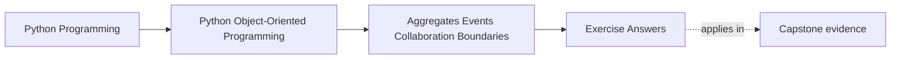
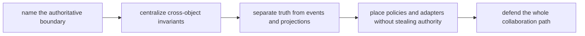

# Exercise Answers

<!-- page-maps:start -->
## Page Maps

<!-- page-maps:end -->

These are model answers for the `WorkshopEnrollment` scenario from the exercise page.
They are not here to give you magic wording. They are here to show what a strong
authority packet sounds like when another maintainer is trying to challenge your
boundary choices.

## How to use this page well

Compare your own packet against this answer page using four checks:

- did I name the authoritative boundary in one sentence?
- did I identify the most tempting wrong owner and say why it is tempting?
- did I keep events and projections visibly downstream of truth?
- did I explain how helpers collaborate without inheriting authority?

If your answer reaches the same verdict but cannot survive those questions, it is still
too soft.

## What strong Module 04 answers have in common

Across the whole packet, strong answers usually show all of these:

- one unmistakable owner of the scarce resource or shared truth
- cross-object invariants enforced at that authority boundary
- events described as reports of completed truth, not negotiations about truth
- projections treated as useful lagging views rather than hidden write models
- policies treated as decision variation, not authority replacement
- adapters and handlers kept outside the aggregate's truth-making role

If your packet sounds like a pattern tour without a source-of-truth sentence, the module
has not landed deeply enough yet.

## Answer 1: Authoritative boundary

A strong answer begins with one sentence:

> The authoritative owner of seat assignment is the `WorkshopEnrollment` aggregate root.

Why not the payment callback handler?

- it knows transport timing, not seat truth
- it may arrive twice
- it should translate external facts, not decide capacity

Why not a broad `EnrollmentManager`?

- it tends to centralize orchestration rather than owned state
- it usually turns the aggregate into passive data

The seat rule belongs next to the state that counts seats.

## Answer 2: Cross-object invariant

A strong invariant map makes the rule, owner, and subordinate helpers explicit.

| Rule | Owner | Helper | Why helper stays subordinate |
| --- | --- | --- | --- |
| confirmed count must stay within seat limit | `WorkshopEnrollment` aggregate | payment adapter, notification handler | helpers do not own seat state |
| waitlisted attendees are not confirmed | `WorkshopEnrollment` aggregate | roster projection | projection is derived output only |
| promoted attendee leaves waitlist before joining confirmed list | `WorkshopEnrollment` aggregate | promotion policy | policy suggests order; aggregate applies it |

The key lesson is not that several objects participate. It is that one boundary still decides.

## Answer 3: Aggregate versus manager object

Aggregate-centered design wins here because:

- seat count and attendee lists live with the code that mutates them
- invariants are visible at the moment of change
- reviewers can inspect one authority boundary first

The manager-object design feels tempting because it gathers all workflow steps together.
Its cost is that state and authority drift apart:

- the manager decides rules for objects it does not own
- the aggregate becomes a passive data container
- maintainers must understand orchestration scripts before they can verify truth

That is usually a worse trade.

## Answer 4: Domain event

Take `attendee_confirmed`.

What must already be true before the event exists:

- seat count has been updated
- attendee state is already confirmed
- the aggregate has already accepted the change

What downstream consumers may do:

- update a roster projection
- send an email
- record an audit entry

What they must never do:

- decide that the attendee counts as confirmed before the aggregate did
- modify seat ownership directly

The event reports truth. It does not negotiate truth.

## Answer 5: Projection versus truth

A roster projection may:

- show confirmed attendees
- show current waitlist order
- power read-heavy pages and operator views

It must not:

- be edited directly to "fix" capacity
- become the write path for promotion decisions
- override the aggregate because it is easier to query

Its convenience is speed and readability. Its cost is that it can lag. That lag is
acceptable precisely because the projection is not authoritative.

## Answer 6: Policy placement

Suppose VIP attendees should be promoted before standard attendees.

Good split:

- policy object decides ordering strategy among waitlisted candidates
- aggregate applies the chosen candidate only if a seat is truly available

Why policy is not authority:

- it influences which candidate is preferred
- it does not decide whether the system may exceed capacity

The aggregate still owns the invariant. Policy only shapes one internal decision.

## Answer 7: Collaboration surface

A clean collaboration path looks like this:

1. command handler calls `WorkshopEnrollment.request_seat(...)`
2. aggregate consults a promotion or priority policy if needed
3. aggregate mutates confirmed or waitlisted state
4. aggregate emits an event
5. outbound handlers update projection or notifications

Tangle smells:

- notification handler calls back into attendee internals
- projection writer changes aggregate-owned state
- payment adapter reaches into seat collections directly

When objects start skipping the aggregate to "help," the authority surface is breaking.

## Answer 8: Adapter boundary

The payment callback adapter may:

- parse external payloads
- normalize transaction identifiers
- map remote statuses into a small internal result

The aggregate should receive something like:

- `payment_confirmed_for(attendee_id, transaction_id)`

It should not see:

- webhook header quirks
- vendor retry formats
- raw transport status codes

The domain bug from leakage is simple: transport oddities start influencing enrollment rules.

## Answer 9: Full authority path

A compact review of the path is:

- registration request enters the command boundary
- `WorkshopEnrollment` decides confirm versus waitlist
- aggregate emits `attendee_confirmed` or `attendee_waitlisted`
- roster projection updates from the event
- notification handler sends the email

Authority exists only in the aggregate step.

Derivation begins at the event.

Failure should be most visible first where:

- the aggregate cannot preserve capacity
- event handling fails after truth already changed

That split tells operators whether they are facing a domain rejection or a downstream delivery failure.

## Answer 10: Authority packet

A strong closing packet includes:

- one sentence naming the aggregate root as authoritative owner
- one invariant table proving where capacity is enforced
- one event/projection table showing what is derived
- one collaboration review note warning against manager-object collapse

A strong final note might sound like this:

> `WorkshopEnrollment` owns seat truth. Payment callbacks, projections, and notifications
> are all subordinate boundaries. Priority policy influences selection but never capacity.
> The main remaining risk is downstream duplication under retries, so event handling must
> be idempotent and clearly separated from seat ownership.

That note helps the next maintainer because it answers who owns the scarce resource
without guessing.

## What a strong packet sounds like overall

A strong final packet usually sounds like this:

> This aggregate owns the shared truth. Events follow committed truth. Projections remain
> downstream. Policies vary choices without replacing authority. Adapters translate
> external systems without redefining the invariant.

That is the level of explicitness a missed-class learner should be aiming for.

## Exit check

Leave this answer page only when you can say:

> My answers now survive challenge: I can name the authoritative boundary, say why the
> tempting nearby owner is wrong, explain which artifacts are derived, and show how helpers
> collaborate without owning truth.
