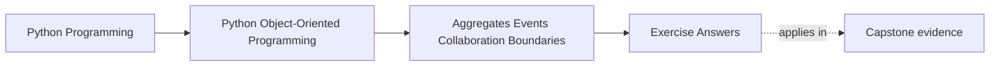
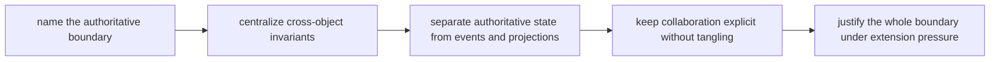

# Exercise Answers

<!-- page-maps:start -->
## Page Maps

<!-- page-maps:end -->

These are model answers for the `WorkshopEnrollment` scenario from the exercise page.
They are meant to show what an honest authority packet looks like when the learner has to
follow one scarce-resource decision all the way from command to projection.

## Running scenario recap

`WorkshopEnrollment` manages:

- a seat limit
- confirmed attendees
- a waitlist
- payment confirmation from outside the aggregate
- downstream notifications and roster projections

The central invariant is simple but non-negotiable:

> confirmed attendees must never exceed available seats

Everything in the answers should make that rule easier to enforce and easier to review.

## Answer 1: Authoritative boundary

A strong answer begins with one sentence:

> The authoritative owner of seat assignment is the `WorkshopEnrollment` aggregate root.

Why not the payment callback handler?

- it knows transport timing, not seat truth
- it may arrive twice
- it should translate external facts, not decide capacity

Why not a broad `EnrollmentManager`?

- it usually centralizes orchestration, not owned state
- it tends to blur aggregate responsibilities into scripts

The rule "who gets a seat" belongs next to the state that counts seats.

## Answer 2: Cross-object invariant

A useful invariant map looks like this:

| Rule | Owner | Helper | Why helper stays subordinate |
| --- | --- | --- | --- |
| confirmed count must stay within seat limit | `WorkshopEnrollment` aggregate | payment adapter, notification handler | helpers do not own seat state |
| waitlisted attendees are not confirmed | `WorkshopEnrollment` aggregate | roster projection | projection is derived output only |
| promoted attendee must leave waitlist before joining confirmed list | `WorkshopEnrollment` aggregate | promotion policy | policy suggests order; aggregate applies it |

The key lesson is that several objects participate, but one boundary still decides.

## Answer 3: Aggregate versus manager object

Aggregate-centered design wins here because:

- the seat count and attendee lists live with the code that mutates them
- invariants are visible at the moment of change
- reviewers can inspect one authority boundary first

A manager-object design feels tempting because it gathers all workflow steps together.
Its cost is that state and authority drift apart:

- the manager starts deciding rules for objects it does not own
- the aggregate becomes a passive data container
- future maintainers must understand orchestration scripts before they can verify truth

That is usually a worse trade.

## Answer 4: Domain event

Good event:

- `attendee_confirmed`

What must be true before it exists:

- seat count has already been updated
- attendee state is already confirmed
- the aggregate has already accepted the change

What downstream consumers may do:

- update a roster projection
- send an email
- record an audit entry

What they must not do:

- decide that the attendee counts as confirmed before the aggregate did
- modify seat ownership directly

The event reports truth. It does not negotiate truth.

## Answer 5: Projection versus truth

A roster projection may:

- show confirmed attendees
- show current waitlist order
- power read-heavy pages

It must not:

- be edited directly to "fix" capacity
- become the write path for promotion decisions
- override the aggregate because it looks easier to query

The convenience it provides is speed and operator readability. The price is that it can
lag. That lag is acceptable precisely because the projection is not the authority.

## Answer 6: Policy placement

Suppose VIP attendees should be promoted before standard attendees.

Good split:

- policy object: decides ordering strategy among waitlisted candidates
- aggregate: applies the chosen candidate only if a seat is truly available

Why policy is not authority:

- it influences *which* candidate to choose
- it does not decide whether the system may exceed capacity

The aggregate still owns the invariant. The policy only shapes one internal decision.

## Answer 7: Collaboration surface

A clean collaboration path:

1. command handler calls `WorkshopEnrollment.request_seat(...)`
2. aggregate consults a promotion or priority policy if needed
3. aggregate mutates confirmed or waitlisted state
4. aggregate emits event
5. outbound handlers update projection or notifications

Tangle smell:

- notification handler calls back into attendee internals
- projection writer changes aggregate-owned state
- payment adapter reaches into seat collections directly

When objects start skipping the aggregate to "help," the authority surface is breaking.

## Answer 8: Adapter boundary

Payment callback adapter may:

- parse external payloads
- normalize transaction identifiers
- map remote statuses into a small internal result

Aggregate should receive something like:

- `payment_confirmed_for(attendee_id, transaction_id)`

It should not see:

- webhook header quirks
- vendor retry formats
- raw transport status codes

The bug from leakage is simple: transport oddities start influencing enrollment rules.

## Answer 9: Full authority path

A compact review of the path:

- registration request enters the command boundary
- `WorkshopEnrollment` decides confirm versus waitlist
- aggregate emits `attendee_confirmed` or `attendee_waitlisted`
- roster projection updates from the event
- notification handler sends the email

Authority exists only in the aggregate step.

Derivation begins at the event.

Failure should be most visible first where:

- the aggregate cannot preserve capacity
- event handling fails after truth already changed

That split tells operators whether they are facing a domain rejection or a downstream
delivery problem.

## Answer 10: Authority packet

A strong closing packet includes:

- one sentence naming the aggregate root as the authoritative owner
- one invariant table proving where capacity is enforced
- one event/projection table showing what is derived
- one collaboration review note warning against manager-object collapse

A compact final note might read:

> `WorkshopEnrollment` owns seat truth. Payment callbacks, projections, and
> notifications are all subordinate boundaries. Priority policy influences selection but
> never capacity. The main remaining risk is downstream duplication under retries, so the
> event-handling path must be idempotent and clearly separated from seat ownership.

That is the level of reasoning another maintainer should be able to review without
guessing who really owns the scarce resource.

## Self-check

You are using Module 04 correctly when another maintainer can answer all three of these
without hesitation:

- who can reject an over-capacity enrollment
- which event happened only after truth was already decided
- which collaborator helps without owning authority
