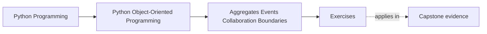
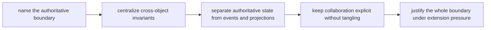
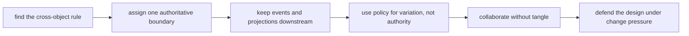

# Exercises


<!-- page-maps:start -->
## Page Maps




<!-- page-maps:end -->

Use these exercises to practice authority-boundary judgment, not only event vocabulary.

The goal of the day is to make multi-object authority explicit. By the end, you should be
able to say which boundary owns truth, which artifacts are derived, which collaborators
only coordinate, and how the design resists both object tangle and manager-object collapse.

## How to work through this set

Treat the ten exercises as one full lab day on aggregates and collaboration authority.

Before each answer:

1. name the cross-object rule under review
2. name the boundary that should own it
3. say which artifact or collaborator must stay derived or subordinate

Do the exercises in order. The day is one progression:

- Exercises 1-3 define authority, aggregates, and cross-object invariants
- Exercises 4-5 separate domain events, projections, and strategies from source-of-truth
  boundaries
- Exercises 6-8 review collaboration surfaces, adapters, and event-routing pressure
- Exercises 9-10 package the full boundary as a reviewable authority design

Keep one collaboration packet as you go. By the end of the day it should contain:

- one authoritative-boundary statement
- one cross-object invariant map
- one derived-versus-authoritative artifact distinction
- one event or projection review
- one collaboration-surface repair
- one full aggregate-boundary review note

If those six artifacts are missing, you are probably still naming patterns instead of
governing authority.

## Recommended working layout

If you want one lab tree that can support the whole day, use something like:

```text
module04-lab/
├── artifacts/
├── notes/
├── scratch/
└── tests/
```

Keep one authority table while you work:

| Rule or invariant | Authoritative boundary | Derived artifact or helper | Why the helper must not own truth |
| --- | --- | --- | --- |

Also keep one event table:

| Event or projection | Source of truth it depends on | What it may do | What it must never do |
| --- | --- | --- | --- |



Use that route on purpose. It keeps the day centered on authority and invariants instead
of on message-passing style.

## Exercise 1: Name the authoritative boundary

Take one capstone behavior involving more than one object and explain:

- which aggregate or boundary is authoritative
- which nearby object is tempting but should not own the rule
- what could go wrong if authority is split

Study note:
The first job in aggregate design is to decide who may reject a change, not who merely
hears about it.

## Exercise 2: Map one cross-object invariant

Choose one invariant spanning multiple objects and list:

- the objects involved
- the boundary that should enforce the invariant
- the method or workflow where the check belongs
- one derived artifact that may observe the change but not decide it

Study note:
This is where collaboration stops being "objects talking to each other" and becomes a
coherent rule boundary.

## Exercise 3: Compare aggregate and manager-object designs

Take one design and compare:

- an aggregate-centered version
- a manager-object version

Explain:

- which one keeps invariants easier to audit
- which one makes neighboring roles blur
- one reason the manager-object version feels tempting

Study note:
The wrong centralization often looks attractive because it gathers everything in one
place, even when it weakens the model.

## Exercise 4: Review one domain event honestly

Pick one event and explain:

- what authoritative state change produced it
- which boundary owns that state
- what downstream consumers may infer from it
- what they must never change in response

Study note:
Events are downstream evidence, not floating permissions.

## Exercise 5: Distinguish projection from authority

Take one projection, read model, or debug view and explain:

- what source-of-truth boundary it depends on
- what it is allowed to summarize
- why it must not become a write model in disguise
- one operational benefit it provides without gaining authority

Study note:
Projections are useful precisely because they are cheaper than authority, not because they
replace it.

## Midday self-check

Before you move into collaboration surfaces, policies, and adapters, make sure your
packet can already answer these questions clearly:

- which boundary is authoritative for one cross-object rule
- why a nearby projection or event consumer must stay derived
- how an aggregate differs from a manager object
- where an invariant is actually enforced

If you cannot answer those four questions in plain language, return to Exercises 1-5 and
make the packet more explicit before continuing.

## Exercise 6: Place strategy and policy objects carefully

Choose one variation point and explain whether it belongs in:

- the aggregate
- a policy object
- orchestration
- or an adapter

Explain what becomes confusing if variation is mistaken for authority.

Study note:
Policies shape decisions, but they do not automatically become the source of truth.

## Exercise 7: Review a collaboration surface without tangle

Take one subsystem and explain:

- which collaborators must know about each other
- which relationship should be indirect through events, policies, or interfaces
- what coupling smell would show the surface is tangling

Study note:
The goal is explicit collaboration without turning every role into everyone else’s friend.

## Exercise 8: Place adapters and bridges

Take one external dependency and decide:

- what the adapter may translate
- what the aggregate must stay ignorant of
- where storage or transport assumptions must stop

Explain one bug that appears when the adapter boundary leaks inward.

Study note:
Adapters exist to protect the model from foreign concerns, not to smuggle them in.

## Exercise 9: Review one full authority path

Take one meaningful workflow and write a short review that names:

- the authoritative boundary
- the event path
- the projections
- the policy seams
- the orchestration boundary
- one place the design is still too fuzzy

Study note:
This review should sound like an architecture audit, not like a message-passing diagram.

## Exercise 10: Produce an aggregate-boundary decision packet

Assemble:

- one authority table
- one event table
- one collaboration review paragraph
- one recommendation for boundary repair

Ask another learner which object they think owns the main rule. If they guess differently,
repair the packet until the boundary is unmistakable.

Study note:
This final exercise matters because authority design is only durable when another
maintainer can infer it from the evidence.

## Mastery check

You have a strong grasp of this module if your answers consistently keep five ideas
visible:

- cross-object rules need one authoritative boundary
- aggregates differ from clusters and from manager objects
- events and projections are downstream of truth
- strategies and adapters shape variation without owning authority
- collaboration should stay explicit without dissolving into tangle
