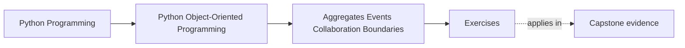
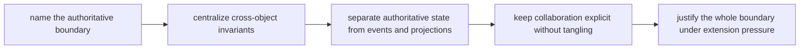

# Exercises

<!-- page-maps:start -->
## Page Maps

<!-- page-maps:end -->

Use these exercises as one full lab on aggregate authority. The goal is not to name a
pattern and move on. The goal is to prove that a learner studying alone can look at a
multi-object workflow and say exactly which boundary owns truth, which collaborators are
derived, and which seams exist only for policy or integration.

## Running lab scenario

Use one scenario throughout the day so the authority decisions compound:

`WorkshopEnrollment`

The system has:

- a workshop with a seat limit
- attendees with registration state
- a waitlist
- payment confirmation arriving from outside the aggregate
- email notifications and roster projections downstream

Rules:

- no more than the seat limit may be confirmed
- waitlisted attendees are not confirmed participants
- roster projections may lag but must never invent authority
- payment callbacks may inform enrollment, but they do not decide seat ownership by
  themselves

If you prefer your own scenario, keep the same pressure: one scarce resource, multiple
objects, external callbacks, and derived read models.

## What to keep open while you work

Build one authority packet as you go. By the end it should contain:

- one authoritative-boundary statement
- one cross-object invariant map
- one event-versus-truth table
- one projection review
- one collaboration-surface repair note
- one full authority-path review

Use these tables directly:

| Rule or behavior | Boundary that owns it | Helpful collaborator | Why the collaborator must stay subordinate |
| --- | --- | --- | --- |

| Event or projection | Authoritative source | What it may do | What it must never do |
| --- | --- | --- | --- |

## Exercise 1: Name the authoritative boundary

For `WorkshopEnrollment`, decide:

- what aggregate or boundary owns seat allocation
- what nearby object is tempting but should not own it
- what contradiction appears if authority is split

End with one sentence that starts:

> "The authoritative owner of seat assignment is ..."

## Exercise 2: Map the main cross-object invariant

Write down the invariant:

> confirmed attendees must never exceed available seats

Then explain:

- which objects participate
- where the invariant is enforced
- which method or transaction path applies it
- which other object may observe the outcome but not decide it

If you cannot point to one enforcing home, the model is still too vague.

## Exercise 3: Compare aggregate and manager-object designs

Compare:

- a `WorkshopEnrollment` aggregate-root design
- a broad `EnrollmentManager` service that owns all state decisions

For each design, answer:

- what becomes easier to audit
- what becomes blurrier
- where hidden coupling will probably appear first

Do not answer with style preferences. Answer with reviewability and invariant control.

## Exercise 4: Review one domain event honestly

Pick one event such as:

- `attendee_confirmed`
- `attendee_waitlisted`
- `seat_released`

Explain:

- what authoritative state change happened first
- what consumers may infer from the event
- what consumers must not change directly because of the event

If the event feels like the place where truth is decided, redesign the authority path.

## Exercise 5: Distinguish projection from truth

Take one read model, such as a roster summary or waitlist dashboard, and explain:

- what source-of-truth boundary it depends on
- what lag or simplification is acceptable
- why it must never become the write path for enrollment decisions
- one operator convenience it still provides

This exercise is about resisting the very common "the dashboard knows the real answer"
trap.

## Exercise 6: Place policy objects carefully

Introduce one policy variation, such as:

- VIP seat reservation
- late cancellation handling
- priority waitlist promotion

Decide whether the rule belongs in:

- the aggregate
- a policy object consulted by the aggregate
- orchestration
- or an adapter boundary

Then explain why policy does not automatically become authority.

## Exercise 7: Review one collaboration surface

Draw a short interaction path involving:

- the aggregate
- one policy or collaborator
- one outbound adapter or event handler

Name:

- who calls whom directly
- what should stay indirect
- one coupling smell that would show the surface is tangling

The goal is explicit cooperation without letting every object know every other object.

## Exercise 8: Place one adapter boundary

Use the payment callback in the scenario and explain:

- what the adapter may translate
- what data the aggregate should receive after translation
- what transport-specific detail must stop at the boundary
- one domain bug that appears if the callback shape leaks inward

This is where many designs accidentally let external protocols redefine domain behavior.

## Exercise 9: Review one full authority path

Write a short review of the path:

- registration request arrives
- aggregate decides confirm versus waitlist
- event is emitted
- projection updates
- notification is sent

For each step, name:

- where authority exists
- where derivation begins
- where failure should be visible first

## Exercise 10: Produce the authority packet

Finish the lab by assembling:

- one authority table
- one event/projection table
- one collaboration review paragraph
- one recommendation for boundary repair

The packet is done only when another learner can answer:

- who owns the scarce resource
- which events are downstream facts
- which components are helpers rather than truth owners

## Done means the boundary is unmistakable

You are done with the exercise day when your packet can survive three review questions:

- "Who can reject the over-capacity enrollment?"
- "Which event happened only after truth was already decided?"
- "What collaborator helps without owning authority?"

If those answers are still fuzzy, keep tightening the packet before you open the answer
page.
