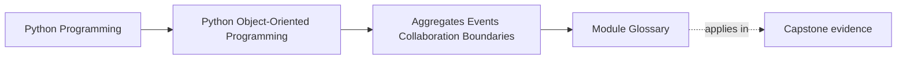

# Module Glossary

<!-- page-maps:start -->
## Page Maps

<!-- page-maps:end -->

This glossary belongs to **Module 04: Aggregates, Events, and Collaboration
Boundaries** in **Python Object-Oriented Programming**. Use it when you need to decide
which object owns a rule, when to emit an event, and how to keep collaboration readable
instead of tangled.

## How to use this glossary

Return here when a use case touches several objects and you can no longer tell where the
transactional boundary should be. Most design mistakes in this module start as ownership
mistakes.

## Terms that matter in this module

| Term | Meaning in this module | Review question |
| --- | --- | --- |
| Aggregate | A cluster of objects treated as one consistency boundary for a change. | Which object graph must stay valid together when one command succeeds or fails? |
| Aggregate root | The entry point through which callers modify the aggregate. | Are outside callers reaching into internals that should only change through the root? |
| Consistency boundary | The line that says "inside this boundary, related rules must hold together now." | Which invariants require one atomic decision rather than eventual repair? |
| Cross-object invariant | A rule involving multiple objects, not just one field or one entity. | If one object changes, what else must still be checked before the operation is complete? |
| Collaboration surface | The messages, method calls, and return values that let objects cooperate. | Does this interaction reveal a clear contract, or only shared confusion? |
| Policy object | A dedicated object for evaluating rules or strategies without burying them inside entities. | Is this decision logic stable enough to deserve its own named collaborator? |
| Domain event | A recorded fact that something meaningful already happened in the domain. | Are you using an event to report a completed fact, not to ask permission? |
| Event dispatch | The mechanism that forwards events to interested handlers. | Have you kept the dispatch path small enough that a reader can still trace it? |
| Projection | A read-oriented view derived from richer domain state or emitted events. | Are you simplifying access for readers without polluting the core model? |
| Adapter | A wrapper that translates between your model and an external interface. | Is this boundary code absorbing outside awkwardness so the domain stays clean? |
| Bridge | A separation between an abstraction and interchangeable implementations behind it. | Are you decoupling two axes of change, or just adding one more layer of indirection? |
| Object graph | The linked set of objects participating in one domain structure. | Can you inspect this graph and explain ownership, traversal, and update rules? |

## Fast distinctions

- An **aggregate** owns consistency, not just grouping.
- An **event** reports something finished; it does not replace core command flow.
- A **projection** helps readers; it should not become the source of truth.
- An **adapter** protects your model from foreign shapes and APIs.

## Exit check

Leave this glossary only when you can do all of these:

- explain why aggregate size should be driven by consistency rules rather than convenience
- identify when an event is clearer than a direct dependency and when it is not
- describe one collaboration surface that is explicit and one that is tangled
