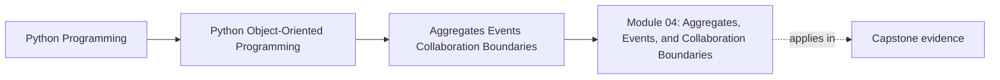
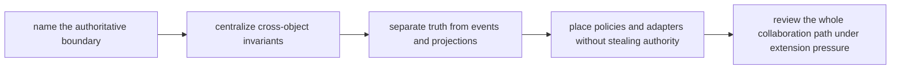

# Module 04: Aggregates, Events, and Collaboration Boundaries

<!-- page-maps:start -->
## Page Maps

<!-- page-maps:end -->

Systems fail when invariants are scattered. Module 04 is where the course stops asking
"what does this object mean?" and starts asking:

> Which boundary is authoritative once more than one object participates in the same rule?

That question separates an aggregate from a cluster of objects that merely happen to call
each other.

## What this module must settle

By the end of this module, you should be able to do all of these with reasons:

- define aggregate boundaries that centralize cross-object invariants
- distinguish authoritative state, domain events, projections, policies, and adapters
- explain how collaboration can stay explicit without turning every object into everybody else's friend
- defend extension seams without weakening the source-of-truth boundary

If those differences still sound like pattern vocabulary rather than placement judgment,
stay here longer.

## Session outcome

Treat Module 04 as one serious study day with four stages.

| Stage | Main pressure | What you should produce |
| --- | --- | --- |
| authority naming | who decides the shared rule | one sentence beginning with `The authoritative boundary is...` |
| invariant mapping | which facts must change together | one cross-object invariant map |
| derivation split | what is truth versus downstream view | one event-versus-projection note |
| collaboration review | which helpers assist without owning truth | one collaboration-path review |

The module is not complete if you only remember "aggregate" or "event." It is complete
when you can follow one multi-object workflow and say exactly where truth lives.

## Recommended study route

Use this route unless you are returning to one narrow collaboration problem:

1. [Aggregates and Consistency Boundaries](aggregates-and-consistency-boundaries.md)
2. [Cross-Object Invariants](cross-object-invariants.md)
3. [Aggregate Lifecycle and Failure Semantics](aggregate-lifecycle-and-failure-semantics.md)
4. [Domain Events without Full Event Sourcing](domain-events-without-event-sourcing.md)
5. [Projections, Read Models, and Debug Views](projections-read-models-and-debug-views.md)
6. [Strategy and Policy Objects](strategy-and-policy-objects.md)
7. [In-Process Event Bus](in-process-event-bus.md)
8. [Collaboration Surfaces without Tangle](collaboration-surfaces-without-tangle.md)
9. [Adapters and Bridges](adapters-and-bridges.md)
10. [Refactor 3: Aggregates, Events, and Strategies](refactor-aggregates-events-and-strategies.md)

Do not start with projections or handlers before you can point to the authoritative
write boundary.

## Lesson map by pressure

| If your current question is... | Start here | Then do this |
| --- | --- | --- |
| what must stay consistent together | aggregates and consistency boundaries | write the scarce resource or shared truth in one sentence |
| where should the cross-object rule be enforced | cross-object invariants | point to one mutation path that owns the check |
| when should an event exist | domain events without full event sourcing | explain what had to become true before the event was emitted |
| what is only derived and what is truth | projections, read models, and debug views | compare one projection with one aggregate output |
| where does decision variation belong | strategy and policy objects | explain why policy is not authority |
| how do external edges collaborate safely | adapters and bridges | say which external detail must stop at the boundary |

## What a missed-class learner should do

If you are studying alone, use this rhythm:

1. read one lesson
2. name the authoritative boundary in your own words
3. name one derived artifact that must stay subordinate
4. say what would go wrong if those two were swapped
5. move on only after the authority split sounds explicit

This replaces the classroom question: "who can actually reject the change?"

## First capstone route for this module

Use the capstone in this order:

1. read [Capstone Architecture Guide](../capstone/capstone-architecture-guide.md)
2. inspect `src/service_monitoring/model.py`
3. inspect `src/service_monitoring/read_models.py` and `src/service_monitoring/projections.py`
4. use `make inspect` or the lifecycle tests only after the authoritative boundary is already visible

The capstone should confirm your authority judgment, not create it from scratch.

## If the module still feels blurry

- ask which boundary may reject the change rather than which boundary hears about it
- compare the aggregate with one projection and explain why only one of them may change truth
- compare a policy seam with orchestration and explain why variation is not the same as authority

## Support surfaces

Use the practice pages as the second half of the module:

- [Exercises](exercises.md)
- [Exercise Answers](exercise-answers.md)

Keep these nearby when useful:

- `../guides/proof-matrix.md`
- `../capstone/capstone-map.md`
- `../reference/self-review-prompts.md`
- [Glossary](glossary.md)

## Common ways learners leave too early

- emitting events from objects that do not own the underlying invariant
- letting projections become write models in disguise
- mixing orchestration concerns into aggregates because it feels convenient
- adding strategies without a stable contract, turning extension into guesswork
- reading collaboration as a network of calls instead of as a map of authority

## Closing criteria

You are ready to leave Module 04 only when you can do all of these in plain language:

- point to the authoritative boundary for one multi-object workflow
- explain which artifact is derived and why it must stay subordinate
- show where decision variation belongs without replacing authority
- review one collaboration path without turning it into a manager-object story
