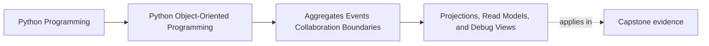

# Projections, Read Models, and Debug Views

<!-- page-maps:start -->
## Page Maps

<!-- page-maps:end -->

Read the first diagram as a placement map: this page is one concept inside its parent
module, not a detached essay, and the capstone is the pressure test for whether the
idea holds. Read the second diagram as the working rhythm for the page: name the
problem, study the example, identify the boundary, then carry one review question
forward.

## Why this lesson matters

Authoritative write models and convenient read views should not be confused.

If they are confused, you usually get one of two bad outcomes:

- read convenience leaks back into the authoritative domain model
- write authority gets duplicated in reporting and debug code

Projections and read models help you serve visibility needs without weakening the real
consistency boundary.

## What a projection is

A projection is a derived view built from authoritative facts.

It exists to make something easier to:

- read
- search
- display
- debug

It is not the same thing as the source of truth.

## Why read models are useful

Aggregates are often optimized for safe writes and invariants, not for every reporting or
inspection task.

Read models help by:

- flattening complex object graphs
- summarizing derived information
- making debug and operational inspection simpler

That keeps the aggregate from carrying every presentation concern directly.

## Why they must stay subordinate

A projection should not quietly become the authority for business decisions.

If it does, you get:

- duplicated logic
- stale or inconsistent decision making
- confusion about which model can truly approve a change

Read convenience is valuable, but it should not outrank the authoritative boundary.

## Debug views are useful too

Not every projection is customer-facing.

Some exist mainly to help:

- operators inspect state
- developers understand event flow
- reviewers verify boundary behavior

Those debug views are still derived views, not alternate authorities.

## Common mistakes

- letting reporting models become the place where real write decisions happen
- overloading aggregates with every read concern instead of deriving views
- assuming a projection is always current enough for authoritative decisions
- making debug views so ad hoc that they quietly encode new business behavior

The important distinction is still: source of truth versus helpful picture.

## Review checklist

| Question | Good sign |
| --- | --- |
| is the authoritative write model still clearly separate? | yes |
| does the projection exist for reading, display, or debugging? | yes |
| can stale or delayed views be understood as views, not truth? | yes |
| is business authority kept out of the projection? | yes |

## Capstone connection

In the capstone, this lesson matters wherever you need:

- dashboards
- summaries
- trace or audit views
- object-graph inspection

If the capstone is forcing the core aggregate to serve every read shape directly, it is
probably carrying too much presentation responsibility.

## Exit check

Leave this lesson only when you can do all of these:

- explain the difference between an authoritative model and a projection
- explain why debug views can be valuable without becoming decision authorities
- identify one capstone read surface that should remain derived, not authoritative
