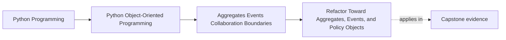
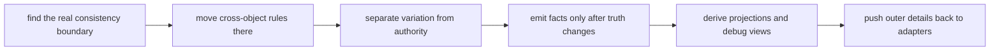

# Refactor Toward Aggregates, Events, and Policy Objects

<!-- page-maps:start -->
## Page Maps

<!-- page-maps:end -->

This refactor matters because Module 04 can still remain fragmented even after a learner
understands the parts:

- aggregate
- policy
- event
- projection
- adapter

The hard part is using them together without hollowing out the aggregate or turning the
rest of the system into a manager-object script. This page exists to show one safe route.

## The weak starting shape

A weak starting design usually looks familiar:

- one service method loads everything
- rule variation piles up in long conditionals
- cross-object invariants are checked inconsistently
- side effects happen in the same method that mutates core state
- reporting needs push extra query logic back into the write model

The design may work for a while. It becomes hard to extend honestly because every new
feature adds one more branch, one more side effect, and one more hidden dependency.

## The stronger target shape

The target is not "more patterns." The target is clearer authority:

- one aggregate owns authoritative mutation and invariants
- policy objects hold decision variation
- domain events announce completed business facts
- projections and debug views stay derived
- adapters isolate outer systems from inner reasoning

The final question is simple:

> If a new rule arrives tomorrow, is there one obvious place where truth should change first?

## Use this refactor order

Follow this order on purpose:

1. find the real consistency boundary
2. move cross-object rules into that boundary
3. separate decision variation from authority
4. emit events only after successful authority changes
5. move secondary reactions behind handlers
6. build projections and debug views for reading
7. push infrastructure details back to the edge

This order matters because events and policies become confusing fast if the source of
truth is still blurry.

## Step 1: find the real consistency boundary

Start by asking:

- what facts must change together?
- which objects participate in the same decision?
- where does a broken invariant cause real damage?

That gives you the aggregate boundary.

If you skip this step, later event and policy work will float without an authority model.

## Step 2: move cross-object rules into the aggregate

Once the boundary is clear, collect rules such as:

- no duplicate active rule for the same scope
- no retirement of a rule that is already retired
- no activation when the policy is closed

Put those checks where authoritative mutation happens.

At this step, the code should become stricter before it becomes more abstract.

## Step 3: separate decision variation from authority

Not every decision belongs as an `if` ladder inside the aggregate.

If the system supports multiple evaluation styles, escalation rules, or threshold
policies, move the variation into policy objects while keeping authority in the
aggregate.

This gives you a clean split:

- the aggregate decides what changes are allowed
- policy objects help determine which option applies

If the policy object starts deciding whether the invariant itself can be broken, it has
stolen authority.

## Step 4: emit events only after truth changes

Once authoritative mutation is clear, emit domain events for completed business facts:

- rule activated
- rule retired
- threshold policy changed

These events should describe what happened, not request side effects directly.

This step separates:

- deciding and committing the business fact
- reacting elsewhere to the business fact

## Step 5: move secondary reactions out of the aggregate

After events exist, move secondary work out of the authority method:

- send notifications
- refresh summaries
- update audit or debug views
- trigger external delivery flows

This does not make side effects disappear. It makes their relationship to core
authority visible and reviewable.

## Step 6: derive read and debug views

Once you have events and authoritative write models, stop forcing every read concern into
the aggregate.

Build derived views for:

- dashboards
- operator summaries
- audit trails
- reviewer-friendly debug snapshots

The projection is not a second authority. It is a readable picture of authoritative
state and change.

## Step 7: push infrastructure back to the edge

At this stage, the remaining mess usually comes from leakage:

- repositories returning raw storage shapes
- SDK exceptions escaping inward
- transport objects appearing in orchestration code

That is the time to tighten ports and adapters.

The result should be a codebase where inner reasoning is legible without reading the
database driver or network client first.

## A worked refactor route

Imagine a system where one `Coordinator`:

- loads all collaborators
- decides activation and retirement rules
- updates reports
- sends notifications
- talks directly to storage and transport code

A safer Module 04 refactor route is:

1. identify the aggregate that really owns the mutable truth
2. move cross-object invariant checks there
3. extract policy variation from the long conditional ladder
4. emit events only after the aggregate accepts the change
5. move reporting and notification behind handlers and projections
6. isolate outer protocols behind adapters

The success signal is not that the code sounds more advanced. It is that the authority
path becomes easier to point at.

## How to review the result

After refactoring, ask:

- is there one clear aggregate owning authoritative mutation?
- are cross-object invariants enforced there?
- are policies varying decisions without replacing authority?
- do events describe completed facts?
- are projections clearly derived?
- are infrastructure details pushed behind adapters?

If those answers are still fuzzy, the refactor is not finished.

## Capstone transfer

Use the capstone immediately:

- where is the real consistency boundary?
- where do policy objects vary evaluation without owning truth?
- where do projections remain useful but subordinate?
- where do outer adapters stop being allowed to redefine the model?

This page should make the capstone's architecture easier to audit, not just easier to name.

## Exit check

Leave this lesson only when you can do all of these:

- explain the role of aggregates, policies, events, projections, and adapters in one story
- describe a safe order for refactoring a tangled collaboration path toward this shape
- identify one capstone boundary that would become clearer if you applied this route
