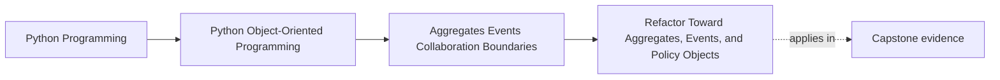

# Refactor Toward Aggregates, Events, and Policy Objects

<!-- page-maps:start -->
## Page Maps

<!-- page-maps:end -->

Read the first diagram as a placement map: this page is one concept inside its parent
module, not a detached essay, and the capstone is the pressure test for whether the
idea holds. Read the second diagram as the working rhythm for the page: name the
problem, study the example, identify the boundary, then carry one review question
forward.

## Why this lesson matters

By the end of this module, you have several tools:

- aggregates
- cross-object invariants
- policy or strategy objects
- domain events
- projections and debug views
- adapters at the edge

Students often understand each tool in isolation and still struggle when a real codebase
contains all of them at once. This lesson is the integration lesson. Its job is to show
how these ideas combine into one readable refactor path.

## The starting shape

The weak starting design usually looks familiar:

- one service method loads everything
- conditionals for every rule type pile up in one place
- cross-object invariants are checked inconsistently
- side effects happen in the same method that mutates core state
- reporting needs push extra query and display logic back into the write model

This design may work for a while, but it is hard to extend honestly. Every new feature
adds another branch, another exception path, and another invisible dependency.

## The target shape

The stronger design aims for a simpler set of responsibilities:

- an aggregate owns authoritative changes and invariants
- policy or strategy objects hold decision variation
- domain events announce completed business facts
- projections and debug views serve reading and inspection
- adapters isolate outer systems from inner reasoning

This is not about adding patterns for style points. It is about reducing mixed
responsibility so students can predict where a change belongs.

## A practical refactor route

Do not try to jump from the weak shape to the final shape in one rewrite. Move in a
sequence that keeps the system understandable.

### 1. Find the real consistency boundary

Start by asking:

- what facts must change together?
- which objects participate in the same decision?
- where does a broken invariant cause real damage?

That gives you the aggregate boundary.

If you skip this step, later event and policy work will float without an authority model.

### 2. Move cross-object rules into the aggregate

Once the boundary is clear, collect rules such as:

- no duplicate active rule for the same scope
- no retirement of a rule that is already retired
- no activation when a policy is closed

Put those checks where authoritative mutation happens.

At this step, your code should become stricter before it becomes more abstract.

### 3. Separate decision variation from authority

Not every decision belongs as a long `if` ladder inside the aggregate.

If the system supports multiple evaluation styles, escalation rules, or threshold
policies, move the variation into policy or strategy objects while keeping authority in
the aggregate.

That gives you a useful division:

- the aggregate decides what changes are allowed
- policy objects help determine which option applies

### 4. Emit events after successful authority changes

Once the authoritative mutation is owned clearly, emit domain events for the completed
business facts:

- rule activated
- rule retired
- threshold policy changed

These events should describe what happened, not request side effects directly.

This step matters because it separates:

- deciding and committing the business fact
- reacting elsewhere to the business fact

### 5. Move secondary reactions behind event handlers

After events exist, move secondary work out of the authority method:

- send notifications
- refresh summaries
- update audit or trace views
- trigger external delivery flows

This does not make side effects disappear. It makes their relationship to core
authority visible and reviewable.

### 6. Build projections and debug views for reading

Once you have events and authoritative write models, stop overloading the aggregate with
every read concern.

Build derived views for:

- dashboards
- operator summaries
- trace or audit inspection
- reviewer-friendly debug snapshots

The projection is not a second authority. It is a readable picture of authoritative
state and changes.

### 7. Push infrastructure details back to the edge

At this stage, remaining mess usually comes from infrastructure leakage:

- repositories returning raw storage shapes
- SDK exceptions escaping inward
- transport objects appearing in application code

That is the moment to add or tighten ports and adapters.

The result should be a codebase where inner reasoning is legible without reading the
database driver or network client first.

## How to know the refactor is actually better

A refactor is not successful because it mentions several good patterns. It is successful
when future changes become easier to place correctly.

Good signs include:

- a new business rule has one obvious aggregate home
- a new policy variation can be added without rewriting old authority code
- a new notification path does not require editing the mutation logic itself
- a new read surface can be derived without polluting the write model
- a new infrastructure implementation can be swapped at the edge

If those things are still hard, the design is still mixing responsibilities somewhere.

## Common mistakes

- introducing events before authority is clear
- moving every decision into strategy objects and leaving the aggregate hollow
- letting projections become operational sources of truth
- creating handlers that quietly re-enforce invariants already owned elsewhere
- keeping framework and storage details in application orchestration after the refactor

These mistakes produce the appearance of structure without the benefit of structure.

## Review checklist

| Question | Good sign |
| --- | --- |
| is there a clear aggregate owning authoritative mutation? | yes |
| are cross-object invariants enforced at that authority boundary? | yes |
| are policy or strategy objects used for variation rather than authority replacement? | yes |
| do events describe completed business facts? | yes |
| are projections and debug views clearly derived? | yes |
| are infrastructure details pushed behind adapters? | yes |

## Capstone connection

Use this page as the review route for the capstone.

If the capstone feels tangled, inspect it in this order:

1. locate the real consistency boundary
2. move invariants there
3. separate decision variation from authority
4. emit facts as events
5. derive read and debug views
6. clean the edge with adapters

That sequence is more reliable than chasing symptoms in random order.

## Exit check

Leave this lesson only when you can do all of these:

- explain the role of aggregates, policies, events, projections, and adapters in one story
- describe a safe order for refactoring a tangled service toward this shape
- identify the next capstone boundary weakness using that order instead of guesswork
