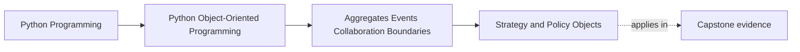

# Strategy and Policy Objects

<!-- page-maps:start -->
## Page Maps

<!-- page-maps:end -->

Read the first diagram as a placement map: this page is one concept inside its parent
module, not a detached essay, and the capstone is the pressure test for whether the
idea holds. Read the second diagram as the working rhythm for the page: name the
problem, study the example, identify the boundary, then carry one review question
forward.

## Why this lesson matters

Some decisions belong inside an aggregate. Others vary by context, rule set, or mode of
operation.

If every variation is hard-coded into one class, you get:

- giant conditionals
- mixed decision rules with unclear ownership
- change that spreads through core classes

Strategy and policy objects are ways to separate variable decision logic without erasing
aggregate authority.

## The basic distinction

### Strategy

A strategy is a swappable way of performing a kind of evaluation or selection.

The emphasis is on variation in how something is done.

### Policy

A policy object captures a rule or decision standard that the rest of the system can ask
about.

The emphasis is on declared decision criteria.

The two ideas are close, but both are more useful when they represent real variation,
not simply an excuse to split code.

## Why they matter in Module 04

Aggregates should not absorb every changing rule variation if:

- the rule set changes independently
- several contexts may need different decision standards
- the aggregate should stay focused on boundary ownership

At the same time, the aggregate should not become passive while outside policy code
makes every important decision for it.

The right balance is:

- aggregates own invariants and authority
- strategy or policy objects supply controlled decision variation

## What not to do

- do not create a strategy object for one trivial branch that will never vary
- do not push core invariant ownership out of the aggregate just to "be flexible"
- do not create policy objects that are really just bags of constants with no decision meaning

Variation should be real, not ceremonial.

## A practical test

Ask:

1. Is this decision rule likely to vary meaningfully across contexts?
2. Does separating it keep the aggregate clearer without weakening authority?
3. Would inlining the rule make the boundary harder to evolve or review?

If yes, a strategy or policy object may help.

If no, keeping the rule close to the aggregate may be cleaner.

## Review checklist

| Question | Good sign |
| --- | --- |
| is there real rule variation to justify the extra object? | yes |
| does aggregate authority remain intact? | yes |
| is the strategy or policy named by decision meaning, not code motion? | yes |
| would removing it clearly make the model harder to evolve? | yes |

## Capstone connection

In the capstone, this lesson matters where:

- evaluation rules may vary
- authorization or eligibility criteria may differ by mode
- decision standards should be replaced or compared without rewriting the aggregate

If the capstone still has one large decision class full of branching logic, this lesson
points toward the next cleanup.

## Exit check

Leave this lesson only when you can do all of these:

- explain the difference between aggregate authority and rule variation
- name one capstone decision that could merit a strategy or policy object
- explain one case where introducing such an object would be unnecessary ceremony
