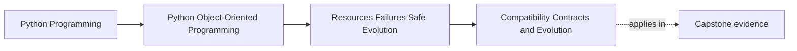

# Compatibility Contracts and Evolution

<!-- page-maps:start -->
## Page Maps

<!-- page-maps:end -->

Read the first diagram as a placement map: this page is one concept inside its parent
module, not a detached essay, and the capstone is the pressure test for whether the
idea holds. Read the second diagram as the working rhythm for the page: name the
problem, study the example, identify the boundary, then carry one review question
forward.

## Why this lesson matters

Every useful system evolves. The dangerous question is whether it evolves honestly.

Compatibility pressure appears when other code, stored data, or published behavior
already depends on what exists today. At that point, change is no longer only a local
editing problem. It is a contract problem.

This lesson teaches students to ask not just "can I improve this?" but also "who is
already depending on it, and what exactly did I promise them?"

## A compatibility contract is narrower than the whole codebase

Not every line of code is a compatibility promise.

Usually the contract lives in specific surfaces:

- public imports
- serialized formats
- command or request shapes
- persistent data expectations
- observable behavior relied on by callers or tests

If you cannot name the contract surface, you cannot evolve it responsibly.

## Compatibility is about expectations, not nostalgia

You do not preserve old behavior because old behavior is sacred. You preserve it because
someone may rely on it.

That reliance may come from:

- downstream code importing a stable facade
- existing stored data being read by new code
- users expecting a command to keep accepting the same input
- tests capturing promised behavior

The teaching shift is important: compatibility is not resistance to improvement. It is
respect for already-supported expectations.

## There are different kinds of compatible change

Some changes extend a contract safely:

- adding an optional field
- adding a new supported strategy without changing old ones
- exposing a new stable entrypoint while preserving the old one

Other changes are riskier:

- removing or renaming a public surface
- changing the meaning of an existing field
- changing behavior that callers may have normalized around

Students need this vocabulary so "compatible" stops meaning only "the tests still ran."

## Evolution starts with naming the supported surface

Before changing anything, answer:

- which exact surface is public?
- which callers or data shapes depend on it?
- what behavior is intentionally stable?
- what may change freely because it is internal?

Once that is clear, the change can be designed instead of improvised.

This is why the public-versus-internal lesson comes before this one.

## Use translation and migration instead of denial

When the old and new shapes differ, the honest options are usually:

- preserve the old shape
- translate the old shape into the new meaning
- version the contract and migrate deliberately
- deprecate with a visible removal plan

The weak option is pretending the change is internal when it is not.

That weak option creates surprise breakage and forces callers to discover the contract
change by accident.

## Tests should guard the promise

Compatibility work needs evidence.

Good evidence can include:

- tests that import through the public surface
- stored-shape tests that prove old data still loads
- approval or golden tests that capture stable behavior
- migration tests when versioned representations change

The point is not just "more tests." The point is tests that correspond to the contract
you claim to preserve.

## Common mistakes

- changing a public name because an internal rename felt cleaner
- editing serialized meaning without a translation plan
- treating compatibility as a persistence-only issue
- assuming a passing unit suite proves public stability
- failing to distinguish extension from silent behavioral breakage

These mistakes usually come from not naming the supported promise before changing it.

## Review checklist

| Question | Good sign |
| --- | --- |
| can you point to the supported surface being preserved? | yes |
| do you know which changes are extensions and which are contract breaks? | yes |
| is there a migration, translation, or deprecation story where needed? | yes |
| do tests correspond to the actual compatibility promise? | yes |

## Capstone connection

Use the capstone to ask:

- which import paths or data shapes would an external caller rely on?
- what would break if you renamed or removed them today?
- if you add a new feature, which old behavior must still load and behave the same way?

That exercise is the bridge between this lesson and the final refactor page.

## Exit check

Leave this lesson only when you can do all of these:

- explain why compatibility starts with naming the supported surface
- distinguish a safe extension from a contract break
- identify one capstone surface that would require translation, migration, or deprecation discipline if changed
