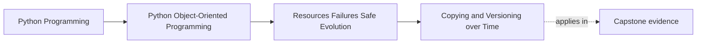

# Copying and Versioning over Time

<!-- page-maps:start -->
## Page Maps

<!-- page-maps:end -->

Read the first diagram as a placement map: this page is one concept inside its parent
module, not a detached essay, and the capstone is the pressure test for whether the
idea holds. Read the second diagram as the working rhythm for the page: name the
problem, study the example, identify the boundary, then carry one review question
forward.

## Why this lesson matters

Students usually meet copying early and versioning later, but long-lived systems force
those ideas together.

The real question is not only "how do I duplicate this object?" It is also:

- what meaning is preserved in the copy?
- what identity should not be duplicated blindly?
- what happens when yesterday's representation meets today's code?

That is why this lesson belongs in the evolution part of the course.

## Copying is about semantics, not mechanics

Two objects can contain similar fields and still have different copying rules.

For example:

- a value object may be copied freely
- an entity may need a new identity if it becomes a separate domain instance
- a resource owner may not be safe to clone at all

If the code copies by habit rather than by meaning, version drift and identity mistakes
become much more likely over time.

## Shallow versus deep is not enough

Students often stop at the vocabulary of shallow and deep copy. That is incomplete.

You also need to ask:

- which parts should remain shared?
- which parts must be rebuilt rather than copied?
- which fields represent historical version state?
- which references would become invalid if duplicated directly?

The right copy rule depends on the object's contract, not on the convenience of a helper
function.

## Time changes the meaning of representations

Versioning pressure appears when:

- stored data outlives one code revision
- published payloads survive into later readers
- configuration created under one contract must still be interpreted later

At that point, the question is no longer only "can I copy this?" It becomes:

- what version am I copying from?
- what shape does the new code expect?
- what migration, translation, or reconstruction is required?

## Prefer explicit reconstruction over magical duplication

When an object's meaning depends on current invariants, it is often safer to reconstruct
it through a controlled path rather than duplicating raw internal state.

That controlled path can:

- validate assumptions
- normalize old representation
- assign new identity deliberately
- preserve only the fields that still belong in the current contract

This is more honest than pretending every historical shape can be duplicated directly
without interpretation.

## Version-aware copying questions

Ask these questions before designing a copy or clone path:

- is the copy meant to preserve identity or create a new one?
- does the target code expect the same version contract?
- are there fields whose meaning has changed over time?
- should this be a literal copy, a migration, or a domain-level recreation?

Those questions help students avoid the trap of treating all duplication as a technical
primitive instead of a semantic decision.

## Common mistakes

- copying entities as if they were plain records
- using raw deep copy where a reconstructed object is safer
- duplicating versioned state without checking contract changes
- preserving identifiers that should have been reassigned
- assuming old serialized shapes can always be read by new code unchanged

These mistakes often stay hidden until data survives long enough to meet a changed model.

## Review checklist

| Question | Good sign |
| --- | --- |
| does the copy preserve the right semantics rather than just the same fields? | yes |
| is identity handled deliberately? | yes |
| are historical or versioned shapes interpreted rather than blindly duplicated? | yes |
| is reconstruction preferred when invariants need revalidation? | yes |

## Capstone connection

Use the capstone to inspect one state shape and ask:

- if you had to duplicate it for a new rule or configuration path, what should stay the same?
- what should receive new identity?
- if the stored representation changed next month, would this still be a copy or would it become a migration?

That line of questioning turns copying into a design exercise instead of a helper call.

## Exit check

Leave this lesson only when you can do all of these:

- explain why copying rules depend on object meaning, not only on structure
- identify one case where reconstruction is safer than direct duplication
- describe how time and version drift change the copying problem
