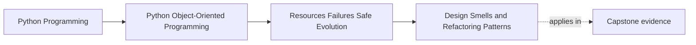

# Design Smells and Refactoring Patterns

<!-- page-maps:start -->
## Page Maps

<!-- page-maps:end -->

Read the first diagram as a placement map: this page is one concept inside its parent
module, not a detached essay, and the capstone is the pressure test for whether the
idea holds. Read the second diagram as the working rhythm for the page: name the
problem, study the example, identify the boundary, then carry one review question
forward.

## Why this lesson matters

Students often hear "watch for smells" without being taught what a smell is for.

A smell is not a moral judgment. It is a clue that the current structure may be hiding:

- unclear ownership
- mixed responsibilities
- brittle extension paths
- compatibility pressure in the wrong place

The point of smell reading is not to collect buzzwords. The point is to locate the next
honest refactor move.

## Smells are signals, not proofs

One long method is not automatically wrong. One extra parameter is not automatically a
design failure.

What matters is what the signal suggests:

- is one function carrying too many boundaries?
- is a class managing policy, persistence, and transport at once?
- is the code difficult to extend without editing many unrelated places?

A smell should lead to a design question, not a reflex rewrite.

## Smells that matter in this module

For Module 05, the highest-value smells usually point to survivability and change
pressure.

Examples:

- cleanup logic scattered across unrelated branches
- retries hidden in helpers instead of owned by a workflow boundary
- public import surfaces leaking implementation details
- compatibility obligations spread across many files with no deliberate contract
- new features requiring edits in many unrelated places

These smells matter because they predict long-term pain, not just local ugliness.

## Smell to refactor move

Smell reading is only useful if it leads to a bounded response.

Examples:

- mixed ownership smell -> introduce or tighten a unit-of-work or context boundary
- duplicated translation smell -> move conversion into one adapter or boundary helper
- accidental public API smell -> add a facade or explicit export surface
- repeated conditional extension smell -> extract a strategy or policy object
- compatibility scatter smell -> centralize the supported contract and version policy

This is the teaching move students need most: smell recognition should point toward a
specific structural correction.

## Avoid cosmetic refactors

Weak refactoring work often changes the shape of code without changing the ownership
problem underneath.

Examples:

- renaming modules while leaving the same accidental public surface
- splitting a long method while preserving the same mixed responsibilities
- adding helper functions instead of fixing the boundary that causes duplication

These are cosmetic improvements. They may help readability a little, but they do not
solve the design tension the smell was signaling.

## Choose the smallest durable move

Good refactoring discipline means:

- identify the real pressure
- choose the smallest move that addresses that pressure
- keep tests and behavior contracts visible

The smallest durable move is not always the smallest diff. It is the move that leaves a
clearer ownership story after the change.

## Refactoring should preserve meaning

A refactor is safer when you can say what must not change:

- public behavior
- domain invariants
- compatibility promises
- failure semantics

If you cannot say what is supposed to stay the same, you are not refactoring yet. You
are redesigning in the dark.

That is why this page belongs so close to compatibility and feature-safe evolution.

## Common mistakes

- treating every awkward line as a high-priority smell
- refactoring for visual tidiness instead of boundary clarity
- making broader changes than the signal justified
- rewriting before naming the stable behavior that must survive
- calling a design "cleaner" when the ownership problem is still there

These mistakes produce churn without trust.

## Review checklist

| Question | Good sign |
| --- | --- |
| does the smell point to a real ownership or extension problem? | yes |
| can you name the smallest durable refactor move? | yes |
| do you know what behavior must stay unchanged? | yes |
| will the move improve boundary clarity rather than just appearance? | yes |

## Capstone connection

Use the capstone to practice one honest smell-reading route:

1. identify the pressure point
2. describe the ownership problem it reveals
3. choose one structural move
4. state which behavior must remain stable

That route is more valuable than any generic smell checklist memorized out of context.

## Exit check

Leave this lesson only when you can do all of these:

- explain why a smell is a signal rather than a verdict
- map one smell to one likely refactor move
- identify one capstone smell that points to a real ownership or extension problem
