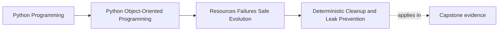

# Deterministic Cleanup and Leak Prevention

<!-- page-maps:start -->
## Page Maps

<!-- page-maps:end -->

Read the first diagram as a placement map: this page is one concept inside its parent
module, not a detached essay, and the capstone is the pressure test for whether the
idea holds. Read the second diagram as the working rhythm for the page: name the
problem, study the example, identify the boundary, then carry one review question
forward.

## Why this lesson matters

Owning a resource is only half the story. You also need a trustworthy answer to "when
does cleanup definitely happen?"

If cleanup timing is vague, leaks become intermittent and hard to prove:

- files remain open longer than expected
- locks stay held after failure
- sessions survive across requests
- temporary state accumulates because nobody can prove the end of its lifetime

Deterministic cleanup is the difference between "the program probably releases this"
and "the design guarantees release at this boundary."

## Deterministic versus eventual cleanup

Eventual cleanup means the runtime may release something later.

Deterministic cleanup means the design defines a specific moment when the resource is
released, even if the body of work raises an exception.

For this module, deterministic cleanup is the standard to prefer whenever correctness
depends on the release.

That is why explicit lifetime boundaries matter more than hoping reference counts,
garbage collection, or process shutdown will rescue the design.

## Leak prevention starts at design time

Students often treat leaks as a debugging topic. That is too late.

Most leaks begin when code is structured so that one of these is true:

- the creator of a resource is not the clearer of the resource
- the cleanup path exists only on the happy path
- error handling branches skip the release logic
- ownership transfer is implicit rather than explicit

Leak prevention starts by removing those design shapes before runtime evidence appears.

## The boundary should close on every exit path

A good cleanup boundary handles:

- normal completion
- domain rejection
- infrastructure failure
- early return
- raised exception

If one of those paths bypasses cleanup, the design is still partial.

This is why `try/finally`, context managers, and boundary-scoped helpers matter so much:
they make the cleanup promise survive more than one exit path.

## What counts as a leak

A leak is not only memory growth.

In object-oriented systems, a leak can also mean:

- a file descriptor not closed
- a lock not released
- a transaction-like session not ended
- a subscription or callback left attached
- a temporary directory or buffer retained past its usefulness

The general rule is broader: if a lifetime outlasts the contract that justified it, you
have a leak or a near-leak.

## Cleanup should be visible in the interface

If an object's safety depends on cleanup, its interface should help readers see that.

Good signs include:

- context-manager support
- boundary methods that clearly open and close a session
- unit-of-work scope that makes release timing obvious
- explicit helper names such as `close`, `shutdown`, or `release` when a context manager is not practical

Poor signs include:

- cleanup hidden in a separate "maybe later" utility
- callers needing tribal knowledge to avoid leaks
- release logic scattered across many branches

## When cleanup itself fails

This case is often skipped in shallow notes, but real systems must still answer it.

If cleanup fails, you should know:

- which resource may still be live
- whether the failure should propagate
- what compensating step or escalation is required

Silently swallowing cleanup failure creates the illusion of safety while preserving the
operational risk.

## Leak prevention review habits

Ask these questions while reading code:

- where is the resource created?
- where is the last guaranteed release point?
- which exceptional paths still pass through that release point?
- if cleanup fails, who now owns the damage?

Those questions turn leak prevention into a review discipline instead of postmortem work.

## Common mistakes

- depending on destructors for important cleanup timing
- releasing resources only on the happy path
- creating resources in constructors with no matching lifetime boundary
- hiding ownership transfer between layers
- swallowing cleanup exceptions because they are inconvenient during tests

These mistakes often remain invisible until the system runs under repeated load or
failure pressure.

## Review checklist

| Question | Good sign |
| --- | --- |
| does the design define a specific cleanup moment? | yes |
| do all exit paths pass through the same release boundary? | yes |
| is leak prevention visible in the interface and call structure? | yes |
| is cleanup failure treated as a real contract question? | yes |

## Capstone connection

Use the capstone runtime and repository code to ask whether:

- resource-like objects end their lifetime at a clear boundary
- tests exercise failure paths as well as success paths
- the in-memory design still teaches the same leak-prevention habits the persistent version will need later

Even without sockets or database drivers, the capstone can still teach good or bad
lifetime habits.

## Exit check

Leave this lesson only when you can do all of these:

- explain the difference between eventual cleanup and deterministic cleanup
- identify one leak shape caused by poor ownership structure rather than by syntax
- point to one capstone boundary where cleanup timing is now explicit
