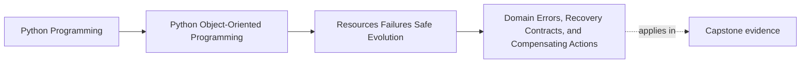

# Domain Errors, Recovery Contracts, and Compensating Actions

<!-- page-maps:start -->
## Page Maps

<!-- page-maps:end -->

Read the first diagram as a placement map: this page is one concept inside its parent
module, not a detached essay, and the capstone is the pressure test for whether the
idea holds. Read the second diagram as the working rhythm for the page: name the
problem, study the example, identify the boundary, then carry one review question
forward.

## Why this lesson matters

A system becomes hard to use and hard to repair when every failure becomes "something
went wrong."

Students need a stronger distinction than that. They need to know:

- which failures are part of the business contract
- which failures come from the surrounding workflow
- which failures come from the outer system boundary
- what the caller can safely do next

Without those distinctions, retries become reckless, logs become noisy, and repair work
has no stable owner.

## Domain errors are not generic exceptions

A domain error means the requested change is not allowed by the model's own rules.

Examples:

- a rule cannot be activated twice
- a policy cannot be retired from the wrong state
- a threshold value is outside the supported contract

These failures belong to the meaning of the system itself. They are not incidental
infrastructure accidents.

That is why domain errors should be named and limited, not buried in ad hoc strings or
flattened into generic `ValueError` branches all over the codebase.

## Workflow failures are different

A request may be valid in the domain and still fail as part of a larger operation.

Examples:

- state was changed in memory but later persistence failed
- a durable write succeeded but follow-up publication did not
- an operation needs retry, delay, or repair after a boundary failure

These are not usually aggregate-level rules. They belong to the application or
orchestration boundary where multi-step work is coordinated.

If you push them down into the wrong object, the model starts carrying repair policy
instead of business meaning.

## Infrastructure failures are different again

Sometimes the real problem is outside the model:

- storage unavailable
- network timeout
- dependency quota failure
- serialization or transport corruption

These may still affect the public experience, but they should not be confused with
business rejection.

The user asked for something legitimate. The boundary failed to carry it out.

## A recovery contract answers the next question

Good failure design does not stop at naming the failure. It also answers:

- what remains authoritative now?
- what did not happen?
- what may be retried safely?
- what requires explicit compensation or human repair?

That set of answers is the recovery contract.

If a caller receives an error but still cannot tell whether the system changed, the
contract is incomplete.

## Compensating action is for escaped effects

Rollback is only useful while work is still contained.

Once a side effect has escaped, such as:

- a message being sent
- a record being published externally
- a visible notification already leaving the system

you may not be able to "undo" the world back to silence.

That is where compensating action matters. A compensating action is the deliberate
follow-up step that restores coherence as much as possible after an escaped effect.

This is not a fancy extra topic. It is the honest answer to the limits of rollback.

## Keep compensation policy out of entities

Entities and aggregates should usually not own operational compensation choreography.

Their job is to:

- accept or reject valid business changes
- emit facts about accepted changes

The surrounding application boundary should decide:

- whether to retry
- whether to compensate
- whether to escalate for repair

This keeps the model readable and keeps repair ownership where the workflow actually
exists.

## What callers need from the error surface

A useful public-facing failure surface is:

- smaller than the raw dependency exception tree
- meaningful in domain or workflow terms
- explicit about what can be retried
- honest about whether authoritative state changed

If callers need to understand an SDK's internal exception taxonomy to recover safely,
the boundary is leaking.

## Common mistakes

- treating business-rule rejection and dependency failure as the same kind of error
- throwing generic exceptions with no stable meaning
- retrying because a call failed without checking whether the effect is idempotent
- assuming rollback erases already-escaped side effects
- scattering compensation logic across entities, handlers, and adapters with no clear owner

These mistakes make the system harder to operate because they erase the shape of the
failure.

## Review checklist

| Question | Good sign |
| --- | --- |
| can callers distinguish business rejection from boundary failure? | yes |
| does the failure surface say what remains authoritative? | yes |
| is retry safety explicit rather than guessed? | yes |
| are compensating actions owned by the workflow boundary rather than random objects? | yes |

## Capstone connection

In the capstone, review one change path and ask:

- which errors come from the domain model itself?
- which errors would come from persistence or runtime boundaries?
- if an effect escaped early, where would compensation or repair policy live?

That review is more important than adding more exception classes for appearance.

## Exit check

Leave this lesson only when you can do all of these:

- explain the difference between domain, workflow, and infrastructure failures
- describe what a recovery contract tells the caller beyond the exception name
- identify one situation where compensation is needed because rollback is no longer enough
