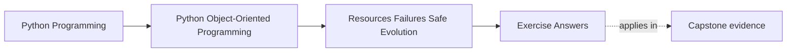
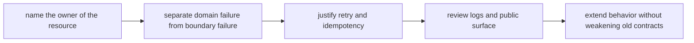

# Exercise Answers

<!-- page-maps:start -->
## Page Maps

<!-- page-maps:end -->

These are model answers for the `CertificateIssuanceService` scenario from the exercise
page. They are meant to show how to turn resource ownership and failure reasoning into a
packet that another maintainer can review without guessing who owns cleanup or retries.

## Running scenario recap

`CertificateIssuanceService`:

- reads a template from disk
- fills certificate data
- writes a PDF to object storage
- records issuance in a repository
- sends a confirmation email
- may be retried by a job runner

The design question is not "can this work?" The design question is "who owns each
resource, what happens after partial failure, and what can callers safely assume?"

## Answer 1: Resource owner

A clean ownership split looks like this:

| Resource | Owner | Why |
| --- | --- | --- |
| template file handle | template-loading boundary | it opens and closes the file in one place |
| temporary rendered PDF | issuance workflow boundary | it creates and deletes the temp artifact |
| object storage client session | storage adapter | transport client lifetime should not leak to callers |
| database transaction or unit of work | repository or application boundary | commit and rollback authority must stay explicit |

Callers should not need to know:

- where temp files live
- how storage sessions are cleaned up
- whether the email adapter reuses connections

The bug when ownership is split is usually either leaked resources or duplicate cleanup
that fails in confusing ways.

## Answer 2: Context-manager boundary

A good `with` boundary surrounds the lifetime of the temporary rendered PDF:

- create temp file
- write rendered bytes
- upload from the temp path or stream
- always delete temp file on exit

Why not higher?

- callers would now own cleanup knowledge they should never need

Why not lower?

- cleanup would scatter across success and failure branches

The point is visible lifetime, not just fewer lines.

## Answer 3: Unit-of-work boundary

One coherent unit of work might include:

- persist "certificate issued" record
- persist storage object key
- persist external issuance identifier if one exists

That unit should either:

- succeed together
- or fail together with no visible "issued" record

The email send should usually happen after the authoritative persistence step, because a
notification can be retried more safely than a corrupted issuance record can be repaired.

Operator evidence on failure should say:

- whether persistence committed
- whether upload succeeded
- whether email was attempted

Without that evidence, recovery is guesswork.

## Answer 4: Domain errors versus boundary failures

Example split:

- "certificate already issued" is a domain error
- "template file missing" is a boundary failure
- "object storage timeout" is a boundary failure
- "SMTP unavailable" is a boundary failure

Caller meaning:

- domain error tells the caller their request contradicts current truth
- boundary failure tells the caller the request may be valid but the environment failed

Flattening them together harms both recovery and review:

- callers cannot tell whether to retry
- operators cannot tell whether the model or the environment is broken

## Answer 5: Retry policy

Suppose the workflow crashes after the issuance record is stored but before the email is
sent.

Safe retry requires:

- issuance record creation to be idempotent by a stable issuance key
- upload path to tolerate same-key replacement or detect existing object safely
- email send to be deduplicated or intentionally tolerant of repeat sends

Retry policy belongs near the workflow boundary, not inside callers, because callers
should not need to reconstruct partial failure semantics themselves.

## Answer 6: Logging and propagation

Good logging split:

- storage adapter logs transport details only where those details are actionable
- workflow boundary logs one high-level failure summary with issuance identifiers
- propagated exception is translated into a caller-meaningful boundary failure

Bad pattern:

- file loader logs
- storage adapter logs
- workflow logs
- caller logs again

That produces four noisy records for one fault and still leaves the caller unclear on
what happened.

## Answer 7: Public surface

Stable public surface:

- `issue_certificate(attendee_id)`
- maybe `reissue_certificate(attendee_id)` if the business supports it

Internal details:

- temp-file handling
- storage bucket naming
- raw SMTP client behavior
- retry loop implementation

If callers start depending on internal adapters directly, future changes such as moving
from temp-file rendering to in-memory streaming become breaking changes for no good
reason.

## Answer 8: Failure-shaped smell

A common smell is copied retry logic:

- workflow retries upload one way
- caller retries email another way
- scheduled job retries the whole thing a third way

Why it survives green tests:

- happy-path tests do not expose contradictory retry ownership

Repair:

- move retry rules to the workflow boundary
- give adapters simpler contracts
- document which side effects are idempotent and which are not

That narrows responsibility and makes review possible.

## Answer 9: Safe extension

Add requirement:

- also generate a PNG preview for the certificate

Safe extension path:

- attach preview generation inside the issuance workflow boundary
- reuse the same cleanup owner for temp artifacts
- keep issuance record semantics unchanged

Unsafe shortcut:

- let a caller generate preview separately and hope it remembers the same cleanup,
  logging, and retry rules

The proof should show that:

- old issuance behavior still works
- cleanup still happens once
- retries do not duplicate externally visible success

## Answer 10: Survivability packet

A strong final packet says something like:

> `CertificateIssuanceService` owns the workflow contract. File and temp-artifact
> lifetimes are hidden behind explicit cleanup boundaries. Persistence of the issuance
> record is authoritative; email delivery is downstream and retryable. Domain errors are
> separated from transport failures. The main remaining risk is duplicate outward
> notification, so retry policy and idempotency keys must be reviewed together.

That note is useful because it tells the next maintainer:

- who owns cleanup
- where truth is committed
- what can be retried
- what still deserves pressure testing

## Self-check

You are using Module 05 correctly when another maintainer can answer all of these from
your packet:

- who cleans up temp artifacts
- whether a rerun can duplicate visible work
- which failures mean "bad request" versus "bad environment"
- which API callers can depend on without learning storage or email internals
