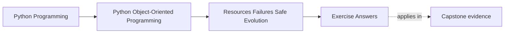
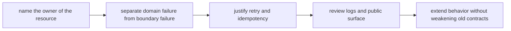

# Exercise Answers

<!-- page-maps:start -->
## Page Maps

<!-- page-maps:end -->

These answers are model explanations, not the only acceptable wording.

## How to use the answer page well

Do not read the model answers first and then reduce Module 05 to "use context managers,
log carefully, and avoid broad exceptions."

A better rhythm is:

1. finish the exercise with your own survivability packet
2. name the owner of cleanup, failure visibility, retry, and compatibility cost
3. compare your reasoning with the model answer
4. revise anywhere your answer still leaves ownership scattered or callers guessing

What matters is whether the reasoning makes operational cost attach to a clear design
owner.

Strong Module 05 answers usually do five things:

- they assign one explicit owner to every meaningful resource lifetime
- they separate domain meaning from runtime or infrastructure trouble
- they justify retry with idempotency rather than habit
- they treat logs and public modules as contracts, not decoration
- they extend behavior without bypassing invariants or publishing internals

The strongest self-study packets also leave behind six concrete artifacts:

- one resource-ownership table
- one failure-boundary note
- one retry review
- one propagation and logging decision
- one public-surface boundary note
- one compatibility-safe extension review

If your answers rely mostly on "handle errors better," the reasoning is still too vague.

## Answer 1: Name the resource owner

A strong answer identifies:

- the resource being acquired
- the boundary that acquires and releases it
- the caller that should stay free of cleanup obligations

What goes wrong when ownership is split:

- resources leak, cleanup is duplicated, and callers become responsible for details they
  cannot verify consistently

## Answer 2: Review one context-manager boundary

The important pieces are:

- which lifetime the context manager governs
- what setup must already be valid before entry
- what cleanup must happen on both success and failure
- why the chosen boundary is the most reviewable place for that lifetime

The main lesson is that context managers should make lifetime visible, not merely concise.

## Answer 3: Map one unit-of-work failure path

A strong answer names:

- the set of changes that must succeed or fail together
- the owner of commit and rollback authority
- the partial state that must never escape
- the proof surface that should fail if the boundary is incoherent

The key review question is:

- who is allowed to say "nothing happened" after an interrupted workflow

## Answer 4: Separate domain errors from boundary failures

A strong answer distinguishes:

- failures that change the domain meaning callers must handle
- failures caused by storage, transport, runtime, or environment trouble

Flattening them together is harmful because:

- callers lose recovery guidance, operators lose signal, and review cannot tell which
  faults belong to the model versus the boundary

## Answer 5: Justify one retry policy honestly

A strong answer explains:

- whether the operation is idempotent
- which side effect repeats if retry is unsafe
- where retry policy belongs so domain meaning does not drift

Retry is strongest when:

- the boundary can prove repeated execution preserves the same contract

Retry is weakest when:

- the system duplicates publication, writes, or externally visible actions

## Answer 6: Review logging and propagation together

Good answers usually show:

- one layer logging the evidence operators truly need
- upstream layers propagating or translating errors intentionally
- no duplicated noise across every layer

The main lesson is:

- a log line should support diagnosis, while the propagated error should support the caller

## Answer 7: Draw a real public-surface boundary

A strong answer names:

- which modules are stable import contracts
- which modules remain internal implementation detail
- what accidental import pattern would publish internals

The maintenance cost of leaking internals is:

- future refactors become breaking changes because callers now depend on hidden structure

## Answer 8: Diagnose one design smell under failure pressure

A strong answer identifies a smell such as:

- scattered cleanup
- generic exception flattening
- retry logic copied across callers
- translation concerns leaking into the model

The repair is strong when:

- ownership becomes narrower, proof gets clearer, and fewer layers must remember the same
  rule

## Answer 9: Extend behavior without bypassing invariants

The important pieces are:

- where the new behavior attaches
- which existing invariant remains central
- which shortcut would bypass the old contract
- what proof surface demonstrates that the extension preserved prior behavior

The main lesson is that evolution should deepen the boundary, not route around it.

## Answer 10: Produce a survivability decision packet

The packet is strong when another maintainer can answer:

- who owns each resource lifetime
- who may retry and under what condition
- what callers are promised after failure
- which modules are safe to depend on
- how new behavior can land without weakening the old promise

If different readers infer different owners, the packet is still too ambiguous.

## Self-check

If your answers consistently explain:

- who owns cleanup for one meaningful path
- where domain errors stop and boundary failures begin
- why one retry is safe or unsafe
- how logging and propagation serve different audiences
- how public surface and safe extension fit the same contract story

then you are using Module 05 correctly.
