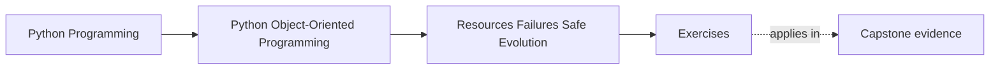
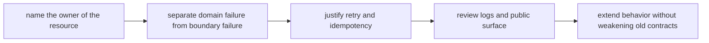
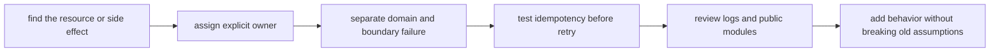

# Exercises


<!-- page-maps:start -->
## Page Maps




<!-- page-maps:end -->

Use these exercises to make survivability reviewable.

The day is not about memorizing `with` blocks, exception taxonomies, or retry slogans.
It is about proving that object-oriented design still has clear owners when the system
opens files, commits work, propagates failures, exposes public modules, and evolves under
existing callers.

## How to work through this set

Treat the ten exercises as one full lab day on resource ownership, failure boundaries,
and safe extension.

Before each answer:

1. name the behavior under review
2. name the owner of cleanup, retry, and compatibility cost
3. state what callers are allowed to assume afterward

Do the exercises in order. The day is one progression:

- Exercises 1-3 make resource ownership and cleanup explicit
- Exercises 4-6 separate domain errors, retry policy, and propagation discipline
- Exercises 7-8 review public surface and smell pressure
- Exercises 9-10 test safe evolution under extension and compatibility pressure

Keep one survivability packet as you go. By the end of the day it should contain:

- one resource-ownership table
- one failure-boundary note
- one retry and idempotency review
- one propagation and logging decision
- one public-surface boundary note
- one compatibility-safe extension review

If those six artifacts are missing, you are probably still discussing style instead of
design ownership.

## Recommended working layout

If you want one lab tree that can support the whole day, use something like:

```text
module05-lab/
├── artifacts/
├── notes/
├── scratch/
└── tests/
```

Keep one ownership table while you work:

| Operation or surface | Resource owner | Failure owner | Retry owner | Compatibility promise |
| --- | --- | --- | --- | --- |

Keep one error table:

| Failure case | Domain meaning or boundary fault | Caller-visible contract | Cleanup required | Retry safe |
| --- | --- | --- | --- | --- |



Use that route on purpose. It keeps the day centered on ownership and safe evolution
instead of on exception folklore.

## Exercise 1: Name the resource owner

Take one capstone operation that touches a runtime, repository, file, or connection and
explain:

- which object or boundary owns acquiring the resource
- which object or boundary owns releasing it
- which caller must stay free of cleanup trivia
- what leak or confusion appears if ownership is split

Study note:
If no one clearly owns release, then every caller becomes responsible by accident.

## Exercise 2: Review one context-manager boundary

Pick one place where a context manager could appear and explain:

- what lifetime it should govern
- what state must exist before entering
- what must be true after exit, even on failure
- why putting the context manager deeper or higher would make review harder

Study note:
Context managers are boundary tools. Their real value is lifetime clarity.

## Exercise 3: Map one unit-of-work failure path

Choose one workflow with more than one change and list:

- which steps belong to the same unit of work
- where commit or rollback authority lives
- what partial state must never escape
- one proof surface that should fail if the boundary is wrong

Study note:
A unit of work is a promise about coherent failure, not just a coding pattern.

## Exercise 4: Separate domain errors from boundary failures

Take one failure path and explain:

- which failure is part of the domain meaning
- which failure is only transport, storage, or runtime trouble
- what callers should be told in each case
- what becomes misleading if both are flattened into one generic exception

Study note:
Not every exception deserves equal semantic weight.

## Exercise 5: Justify one retry policy honestly

Pick one operation and explain:

- whether retry is safe
- what makes it idempotent or unsafe
- which side effect would duplicate if the retry story is wrong
- where retry policy should live so the domain meaning stays stable

Study note:
Retry is a contract decision, not a reflex.

## Exercise 6: Review logging and propagation together

Choose one error path and explain:

- what should be logged
- what should be propagated unchanged
- what should be translated into a clearer contract
- what noise appears if every layer logs the same failure independently

Study note:
Logs are evidence for operators, not a substitute for error design.

## Midday self-check

Before moving into public surface and evolution pressure, make sure your packet already
answers these questions clearly:

- who owns one resource lifetime
- what makes one retry safe or unsafe
- where commit or rollback authority lives
- how one domain error differs from one boundary failure

If you cannot answer those four questions in plain language, return to Exercises 1-6 and
make the packet more explicit before continuing.

## Exercise 7: Draw a real public-surface boundary

Take one module cluster and explain:

- which modules belong to the supported public contract
- which modules must stay internal
- what import habit would blur the boundary
- one maintenance cost of accidentally publishing internals

Study note:
Every import path teaches callers what they are allowed to depend on.

## Exercise 8: Diagnose one design smell under failure pressure

Review one design and explain:

- which smell appears when cleanup, retries, or translation are scattered
- why the smell survives even if tests are green today
- what boundary repair would make ownership clearer
- what proof would show the repair actually helped

Study note:
Failure pressure reveals smells that happy-path examples hide.

## Exercise 9: Extend behavior without bypassing invariants

Take one proposed feature addition and explain:

- where the new behavior should be attached
- which existing invariant must remain central
- what tempting shortcut would bypass the current contract
- how you would prove old behavior still holds after the extension

Study note:
Safe extension preserves an old promise before it adds a new one.

## Exercise 10: Produce a survivability decision packet

Assemble:

- one resource-ownership table
- one error table
- one retry decision note
- one public-surface review paragraph
- one compatibility-safe extension recommendation

The packet is strong when another maintainer can answer:

- who owns cleanup
- who owns retries
- what contract callers may trust
- which surface is public
- how the next feature can land without weakening old behavior

## Done means more than finishing the page

You are done with the exercise day when your packet can survive three kinds of review:

- a code review asking who owns cleanup and retries
- an incident review asking where failure should have been visible first
- a maintenance review asking how to extend behavior without publishing internals

If the packet cannot survive those reviews, keep tightening the ownership language.
