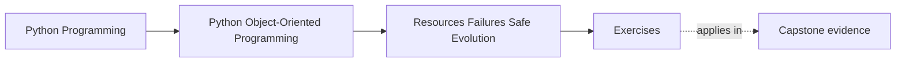
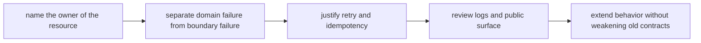

# Exercises

<!-- page-maps:start -->
## Page Maps

<!-- page-maps:end -->

Use these exercises as one full lab day on survivable design. The goal is not to repeat
"use context managers" or "log carefully." The goal is to prove that you can inspect one
workflow and explain:

- who owns cleanup
- what callers are promised after failure
- whether retry is safe
- which internal details must stay off the public surface
- how new behavior can be added without weakening the old contract

## Running lab rule

Use one workflow for the whole day so the pressure accumulates instead of resetting every
exercise. If you do not already have one, use this scenario:

`CertificateIssuanceService`

The workflow:

- loads a certificate template from disk
- fills it with attendee data
- writes a PDF to object storage
- records issuance in a repository
- sends a confirmation email
- may be retried by a job runner if the process dies halfway through

Pressure points:

- file handles and temporary files must be cleaned up
- the repository write and storage upload must tell a coherent story
- sending the email twice may be harmful or merely noisy depending on the design
- public callers should not need to know about temp files, storage clients, or retry loops

If you use your own scenario, keep the same pressure: at least one finite resource, one
persisted change, one external side effect, and one evolution question.

## What to keep open while you work

Build one survivability packet as you go. By the end it should contain:

- one resource-ownership table
- one failure-boundary note
- one retry and idempotency review
- one logging and propagation decision
- one public-surface note
- one safe-extension recommendation

Use these tables directly:

| Operation | Resource owner | Cleanup owner | Caller-visible contract after failure |
| --- | --- | --- | --- |

| Failure case | Domain or boundary fault | Retry safe | Required cleanup | Log here or propagate |
| --- | --- | --- | --- | --- |

## Exercise 1: Name the resource owner

For the certificate workflow, decide:

- who opens the template file
- who owns the temporary output file
- who closes or deletes each resource
- what callers are deliberately spared from knowing

Then name one leak or double-cleanup bug that appears if ownership is split.

## Exercise 2: Review one context-manager boundary

Choose one resource lifetime and explain:

- where the `with` boundary should live
- what must be true before entering
- what cleanup must happen on both success and failure
- why moving the boundary higher or lower would weaken reviewability

This exercise is about lifetime clarity, not syntax preference.

## Exercise 3: Map one unit-of-work boundary

Decide which steps belong in the same coherent unit:

- storing the issuance record
- recording the generated object key
- marking the certificate as available

For that unit, explain:

- where commit or rollback authority lives
- what partial state must never escape
- what operator-visible evidence should exist if the unit fails mid-path

## Exercise 4: Separate domain errors from boundary failures

Distinguish:

- certificate already issued for this attendee
- template file missing
- object storage timeout
- SMTP service unavailable

For each one, say:

- whether it is domain meaning or boundary trouble
- what callers should be told
- whether retry is reasonable
- what wrong action a caller might take if the distinction were blurred

## Exercise 5: Justify one retry policy

Pick one restart point, such as:

"job reruns after upload succeeded but before email sent"

Explain:

- whether retry is safe
- what must be idempotent
- what duplicate side effect must be prevented or tolerated
- where the retry policy should live

The goal is to replace retry folklore with a contract.

## Exercise 6: Review logging and propagation together

Choose one failure path and decide:

- what operators genuinely need logged
- what callers genuinely need propagated
- which layer should translate raw infrastructure errors into clearer contracts
- what duplicated noise appears if every layer logs the same fault

This exercise is about audience and contract, not verbosity.

## Exercise 7: Draw the public surface

Explain which API you want downstream callers to depend on.

For example:

- `issue_certificate(attendee_id)`

Then explain which details stay internal:

- temp-file implementation
- storage client choice
- raw email transport
- retry loop mechanics

Name one breaking-change risk if callers start depending on the internal pieces anyway.

## Exercise 8: Diagnose one failure-shaped smell

Find one design smell in the workflow, such as:

- cleanup scattered across several call sites
- retry logic copied into callers
- public methods returning transport-specific errors
- generic helper modules owning too much failure policy

Explain:

- why the smell survives even if happy-path tests pass
- what structural repair would narrow ownership
- what evidence would show the repair actually worked

## Exercise 9: Extend behavior without bypassing the contract

Add one new requirement:

- also upload a PNG preview
- also notify an internal audit queue
- also support bulk issuance

Explain:

- where the new behavior should attach
- which old promise must remain intact
- what tempting shortcut would bypass current cleanup or retry rules
- what proof should show the extension did not weaken the old design

## Exercise 10: Produce the survivability packet

Finish the lab by assembling:

- one resource table
- one failure table
- one retry decision note
- one public-surface review
- one extension recommendation

The packet is done only when another maintainer can answer:

- who owns cleanup
- who may retry and under what conditions
- what callers are promised after failure
- which surfaces are stable to depend on

## Done means the workflow can survive pressure

You are done with the exercise day when your packet can survive these review questions:

- who cleans up if the job fails after writing the temp file?
- can this path be retried without duplicating visible side effects?
- what can a caller rely on without learning storage or email internals?

If those answers are still fuzzy, keep tightening the packet before you open the answer page.
