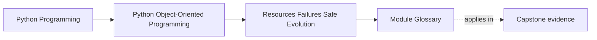

# Module Glossary

<!-- page-maps:start -->
## Page Maps

<!-- page-maps:end -->

This glossary belongs to **Module 05: Resources, Failures, and Safe Evolution** in
**Python Object-Oriented Programming**. Use it when an object owns something costly,
fallible, or long-lived and you need a design that cleans up safely and evolves without
surprising callers.

## How to use this glossary

Return here when a design has to answer hard questions about retries, cleanup,
compatibility, or failure reporting. This module is where "works on the happy path"
stops being enough.

## Terms that matter in this module

| Term | Meaning in this module | Review question |
| --- | --- | --- |
| Resource owner | An object responsible for acquiring, releasing, or guarding access to something finite or external. | Can you name exactly who owns cleanup, or are several layers assuming someone else will do it? |
| Context manager | A Python protocol for deterministic setup and teardown around a block of work. | Would `with` make lifecycle boundaries clearer here than manual cleanup calls? |
| Deterministic cleanup | Releasing resources at a known point rather than hoping garbage collection eventually helps. | What happens if this code exits early because of an exception? |
| Domain error | A failure expressed in business terms that callers can reason about and handle intentionally. | Does the error explain what rule failed, not just which library exploded? |
| Recovery contract | The documented promise about what a caller may retry, compensate, or report after failure. | After this exception, what is still safe to do next? |
| Compensating action | A follow-up action that repairs or offsets previously completed work. | If part of the workflow already succeeded, how will you restore a coherent state? |
| Idempotent operation | An operation that can be repeated without causing additional unintended effects. | If a caller retries after uncertainty, will the system stay correct? |
| Unit of work | A boundary that groups related changes and coordinates commit or rollback behavior. | Which state changes must succeed or fail together? |
| Compatibility contract | The promise that existing callers or stored data can continue working across change. | What exactly are you preserving when the design evolves? |
| Facade | A stable, simpler public surface that hides more volatile internal structure. | Are you giving callers one durable entry point instead of making them depend on internals? |
| Design smell | A recurring sign that the structure is making correctness harder, such as feature envy or shotgun surgery. | Which maintenance pain is this code already predicting? |
| Versioned object | An object or snapshot whose meaning changes across revisions and must be interpreted carefully. | Are you copying data safely, or creating several live meanings with no migration story? |

## Fast distinctions

- A **domain error** is for callers; a raw traceback is for debugging.
- A **context manager** defines lifecycle ownership, not just syntax convenience.
- **Idempotent** means safe under repetition, not merely "probably okay twice."
- A **facade** protects callers from churn in internal modules.

## Exit check

Leave this glossary only when you can do all of these:

- explain why cleanup belongs to a clearly named owner
- identify one operation that must be idempotent and why
- explain the difference between internal refactoring freedom and an external compatibility contract
