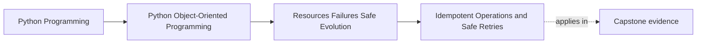

# Idempotent Operations and Safe Retries

<!-- page-maps:start -->
## Page Maps

<!-- page-maps:end -->

Read the first diagram as a placement map: this page is one concept inside its parent
module, not a detached essay, and the capstone is the pressure test for whether the
idea holds. Read the second diagram as the working rhythm for the page: name the
problem, study the example, identify the boundary, then carry one review question
forward.

## Why this lesson matters

Many systems retry work automatically. That does not make retries safe.

The dangerous shortcut is:

- the operation failed
- therefore we should just run it again

That shortcut ignores whether the first attempt already changed the world. If it did,
retrying may duplicate writes, messages, notifications, charges, or state transitions.

This lesson exists so students stop treating retry as a networking reflex and start
treating it as a contract decision.

## What idempotent means

An operation is idempotent when repeating the same request leaves the authoritative
result in the same state as one successful application.

That does not mean "nothing happened." It means repeated application of the same intent
does not keep producing new authoritative changes.

Examples:

- setting a rule to retired when it is already retired may be idempotent if the contract allows it
- recording the same event twice is usually not idempotent
- sending the same notification twice is often visibly not idempotent

The key question is always: what counts as the stateful effect?

## Why failure does not imply no effect

Retries become dangerous because failure can happen after partial success.

Examples:

- the state write succeeded but the response never reached the caller
- a message was sent but the logging step failed
- a durable save completed but a later projection update crashed

From the caller's perspective, the operation "failed." From the system's perspective,
some effect may already be real.

That is why retry policy must be designed with effect boundaries in mind.

## Safe retry needs a contract

A safe retry policy usually answers:

- which input defines "the same request"?
- which effects are allowed at most once?
- how does the system detect or absorb duplicates?
- what happens if the first attempt may have committed but the caller cannot tell?

Without those answers, retry is guesswork disguised as resilience.

## Patterns that help

Common approaches include:

- making the operation itself naturally idempotent
- using request or operation identifiers to deduplicate repeated attempts
- separating authoritative state changes from follow-up side effects
- publishing only after the durable boundary is known

These are not free features. They are design choices that narrow the ambiguity after
partial failure.

## Patterns that do not help enough

Weak retry stories often rely on:

- "the timeout probably happened before anything important"
- "the downstream system can handle duplicates somehow"
- "we have logs if something weird happens"
- "users do not click twice very often"

Those are operational hopes, not contracts.

## Where retry policy should live

Retry policy is rarely a pure domain concern.

The domain may say:

- repeating this command is illegal
- repeating it is harmless
- repeating it should return the existing result

But the workflow or boundary layer usually decides:

- whether to retry at all
- how many times
- with what delay
- under which failure kinds

That split keeps business meaning separate from transport and availability policy.

## Side effects are the real pressure point

If an operation changes authoritative state and also sends something outward, retry
safety depends on keeping those responsibilities readable.

The more side effects are mixed together, the harder it becomes to know whether a retry:

- repairs a missing result
- duplicates an external effect
- corrupts later reasoning with conflicting history

This is one reason outbox-style thinking and explicit unit-of-work boundaries matter so
much in surrounding lessons.

## Common mistakes

- retrying every exception the same way
- assuming a timeout means no effect escaped
- confusing command idempotency with read idempotency
- making retries safe only by accident rather than by explicit boundary design
- duplicating external effects because state and publication were not separated clearly

These mistakes make systems noisier and less trustworthy at the moment they are meant to
be more resilient.

## Review checklist

| Question | Good sign |
| --- | --- |
| can you define what counts as the same request? | yes |
| does the design explain whether repeating it is safe? | yes |
| are duplicate side effects detected, absorbed, or prevented deliberately? | yes |
| does retry policy live in the right boundary rather than everywhere? | yes |

## Capstone connection

In the capstone, inspect one operation and ask:

- if the caller repeats it, what is the authoritative result supposed to be?
- if the first attempt partly succeeded, how would the second attempt behave?
- which part of the design currently makes that answer trustworthy or untrustworthy?

This is the right level of pressure for a self-learning course: not abstract theory, but
an explicit contract question attached to a real code path.

## Exit check

Leave this lesson only when you can do all of these:

- explain why a failed request may still be unsafe to retry
- describe one mechanism that can make repeated requests safe
- identify one capstone operation whose retry story should be reviewed before automation is added
