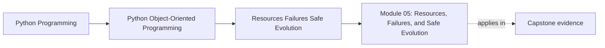
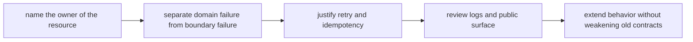

# Module 05: Resources, Failures, and Safe Evolution

<!-- page-maps:start -->
## Page Maps

<!-- page-maps:end -->

Correct object models still fail if they leak resources, blur failure handling, or cannot
evolve safely. Module 05 treats survivability as part of design quality, not as a later
operational concern.

Keep one question in view while you study:

> Who owns the cost when this behavior fails, retries, leaks, or needs to evolve under an
> existing contract?

That question keeps operational pressure attached to ownership instead of dissolving into
generic "infrastructure" language.

## What this module must settle

By the end of this module, you should be able to do all of these with reasons:

- assign cleanup, failure handling, retries, and compatibility pressure to explicit owners
- distinguish domain errors from boundary failures without flattening them into one exception story
- evaluate idempotency, unit-of-work boundaries, and public-surface discipline as long-term contracts
- add new behavior without bypassing invariants or widening the accidental public API

If those ideas still sound like implementation details rather than design decisions, stay here longer.

## Session outcome

Treat Module 05 as one serious study day with four stages.

| Stage | Main pressure | What you should produce |
| --- | --- | --- |
| ownership | who opens, closes, commits, and cleans up | one resource-ownership table |
| failure meaning | what callers are told after trouble | one domain-versus-boundary failure note |
| retry discipline | which paths may rerun safely | one retry and idempotency review |
| safe evolution | how to add capability without widening contracts | one extension note |

The module is not complete if you only remember "use context managers" or "avoid broad exceptions."
It is complete when you can explain who pays for failure and what promise survives it.

## Recommended study route

Use this route unless you are returning to one narrow survivability issue:

1. [Resources and Context Managers](resource-ownership-and-context-managers.md)
2. [Unit of Work and Failure Handling](unit-of-work-and-failure-handling.md)
3. [Deterministic Cleanup and Leak Prevention](deterministic-cleanup-and-leak-prevention.md)
4. [Domain Errors, Recovery Contracts, and Compensating Actions](domain-errors-recovery-contracts-and-compensating-actions.md)
5. [Idempotent Operations and Safe Retries](idempotent-operations-and-safe-retries.md)
6. [Logging and Error Propagation](logging-and-error-propagation.md)
7. [Public versus Internal Modules](public-versus-internal-modules.md)
8. [Design Smells and Refactoring Patterns](design-smells-and-refactoring-patterns.md)
9. [Copying and Versioning over Time](copying-and-versioning-over-time.md)
10. [Compatibility Contracts and Evolution](compatibility-contracts-and-evolution.md)
11. [Refactor 4: New Feature without Breaking Behavior](refactor-new-feature-without-breaking-behavior.md)

Do not start with compatibility or retries before you know who owns cleanup and commit authority.

## Lesson map by pressure

| If your current question is... | Start here | Then do this |
| --- | --- | --- |
| who opens, closes, or deletes the resource | resources and context managers | draw the cleanup owner explicitly |
| what commits together and what must roll back together | unit of work and failure handling | name the authoritative change boundary |
| what kind of failure this is | domain errors, recovery contracts, and compensating actions | explain what callers should be told |
| whether a rerun is safe | idempotent operations and safe retries | say what visible side effect must be prevented or tolerated |
| what callers may depend on | public versus internal modules | draw the stable surface and the internal details beneath it |
| how to add behavior without breaking old promises | compatibility contracts and evolution | state the promise that must survive first |

## What a missed-class learner should do

If you are studying alone, use this rhythm:

1. read one lesson
2. name the owner of the resource or failure under discussion
3. say what callers are promised after trouble
4. say whether a retry is safe and why
5. move on only after those answers sound explicit

This replaces the classroom question: "who pays when this goes wrong?"

## First capstone route for this module

Use the capstone in this order:

1. read [Capstone Architecture Guide](../capstone/capstone-architecture-guide.md) and [Capstone File Guide](../capstone/capstone-file-guide.md)
2. inspect `src/service_monitoring/runtime.py` and `src/service_monitoring/repository.py`
3. inspect the unit-of-work and runtime test surfaces
4. use stronger proof routes only after the cleanup and failure boundaries are already visible

The capstone should confirm your survivability judgment, not substitute for it.

## If the module still feels blurry

- ask who must clean up if the workflow fails halfway through
- ask whether a caller can tell "bad request" from "bad environment"
- ask what side effect would duplicate first under retry
- ask which internal detail would become a breaking change if callers started depending on it

## Support surfaces

Use the practice pages as the second half of the module:

- [Exercises](exercises.md)
- [Exercise Answers](exercise-answers.md)

Keep these nearby when useful:

- `../guides/proof-matrix.md`
- `../guides/pressure-routes.md`
- `../reference/self-review-prompts.md`
- [Glossary](glossary.md)

## Common ways learners leave too early

- making callers responsible for cleanup details they cannot reliably remember
- flattening all failures into generic exceptions with no recovery meaning
- retrying operations that are not idempotent and duplicating visible side effects
- logging everywhere without deciding what contract the logs actually support
- exposing internal modules as accidental public API

## Closing criteria

You are ready to leave Module 05 only when you can do all of these in plain language:

- name the cleanup owner for one workflow
- explain where retry policy may live without redefining domain meaning
- distinguish one domain failure from one boundary failure
- state which compatibility promise belongs to the public surface rather than the internals
