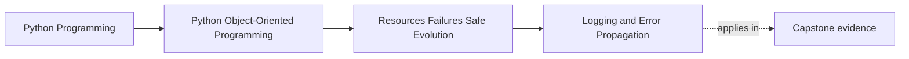

# Logging and Error Propagation

<!-- page-maps:start -->
## Page Maps

<!-- page-maps:end -->

Read the first diagram as a placement map: this page is one concept inside its parent
module, not a detached essay, and the capstone is the pressure test for whether the
idea holds. Read the second diagram as the working rhythm for the page: name the
problem, study the example, identify the boundary, then carry one review question
forward.

## Why this lesson matters

Systems become harder to repair when errors are both logged everywhere and explained
nowhere.

Two bad patterns often appear together:

- the same failure is logged repeatedly at many layers
- the exception still propagates upward with no clearer contract than before

That creates noise without understanding. This lesson is about deciding where meaning is
added, where context is attached, and where propagation should stop or continue.

## Logging is not recovery

Logging records that something happened. It does not decide:

- whether the caller can retry
- whether the state changed
- whether compensation is needed
- whether the operation should continue

If the code uses logging as a substitute for failure design, the logs become a graveyard
of unresolved questions.

## Propagation needs a purpose

An error should keep propagating only while the next layer can do something useful with
it, such as:

- attach boundary context
- translate it into a smaller public contract
- decide retry or compensation
- terminate the request cleanly

If a layer cannot add meaning or action, it should not usually wrap the error just to
make the stack deeper.

## Add context where the boundary changes

The best place to enrich an error is often the place where the system changes boundary:

- repository to application
- adapter to orchestration
- request handler to public API

At those points, you can explain:

- what operation was being attempted
- what remained authoritative
- what category of failure now matters to the caller

That is more useful than logging raw internals repeatedly at every level.

## Avoid duplicate logging

One failure should usually have one primary observability owner.

For example:

- the boundary that will decide the public response may log the failure
- inner layers may raise named failures without logging them again

Duplicate logging creates three problems:

- noisy incident trails
- false counts for one real failure
- confusion about which layer truly owned the response

The student should leave this page knowing that "log everywhere" is not a serious
observability strategy.

## Translate, then propagate

Sometimes propagation should continue, but not in the original form.

For example:

- a database exception may become `storage_unavailable`
- a timeout may become `dependency_unreachable`
- a malformed external response may become `boundary_contract_violation`

This translation step is not hiding reality. It is making the outward contract smaller
and more teachable.

## What good logs contain

Useful logs usually help answer:

- what operation failed?
- which owned boundary failed?
- what identifiers or correlation data matter?
- what category of failure was this?
- what next action is expected, if any?

Useful logs do not need to dump every implementation detail. They need to make incident
triage and repair easier.

## What to avoid

Avoid logs that:

- repeat the same stack trace three times
- expose internal exception trees directly to users
- report failure with no operation context
- log normal domain rejection as if it were an infrastructure emergency
- hide the true owner by making every layer look equally responsible

These patterns make failure review harder exactly when clarity matters most.

## Common mistakes

- logging at every catch site
- swallowing the exception after logging without a recovery policy
- wrapping errors repeatedly without adding new meaning
- treating domain rejection as an operational incident
- propagating raw dependency exceptions past the boundary that should translate them

These mistakes blur both observability and contract design.

## Review checklist

| Question | Good sign |
| --- | --- |
| does each failure have a clear observability owner? | yes |
| does propagation continue only while a higher layer can act meaningfully? | yes |
| are boundary translations reducing noise and clarifying contract? | yes |
| do logs help repair work instead of duplicating stack traces? | yes |

## Capstone connection

Choose one capstone failure path and inspect:

- where it is first raised
- where it is translated
- where it is logged
- where the public response meaning is decided

If those steps are scattered without purpose, the design is still teaching propagation
as accident rather than policy.

## Exit check

Leave this lesson only when you can do all of these:

- explain why logging alone does not solve failure handling
- identify where an error should gain new context instead of new noise
- describe one capstone path where duplicate logging should be avoided
