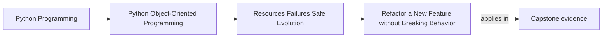
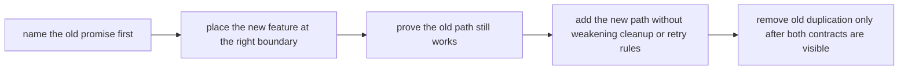

# Refactor a New Feature without Breaking Behavior

<!-- page-maps:start -->
## Page Maps

<!-- page-maps:end -->

This refactor matters because real maintenance work is rarely "start fresh." It is
usually:

> Add a new capability without betraying the promises that older callers, operators, and
> data already depend on.

Module 05 becomes practical only when a learner can do that under pressure from:

- cleanup obligations
- partial failure
- retry safety
- public-surface stability
- compatibility with already-running paths

## The weak starting shape

A weak feature addition often begins like this:

- a new requirement arrives
- someone edits the nearest conditional ladder
- cleanup and retry rules are copied awkwardly
- public and internal boundaries blur
- old behavior is assumed to still work because the tests stayed green enough

This is how "small internal changes" quietly become compatibility and operability problems.

## The stronger target shape

The target is not "never change anything." The target is change with visible promises:

- the old contract is named before the refactor starts
- the new capability is attached at the correct boundary
- cleanup and retry ownership remain explicit
- the public surface does not widen by accident
- old and new behavior are both proven before dead code is removed

The final question is simple:

> Could another maintainer explain what promise was preserved and how the new feature was added without guessing?

## Use this refactor order

Follow this order on purpose:

1. name the old promise that must survive
2. identify the real boundary where the new feature belongs
3. add proof for the preserved behavior
4. introduce the new capability alongside the old path
5. keep cleanup, failure, and retry rules visible while the feature grows
6. remove old duplication only after both contracts are clear

This order matters because eager cleanup often hides whether the change was an extension
or an accidental rewrite.

## Step 1: name the promise before touching the code

Before writing the feature, list what must remain stable.

That usually includes:

- public imports or entrypoints
- existing domain behavior
- stored data or configuration formats
- operational guarantees such as cleanup and retry discipline

If this step is skipped, the refactor becomes guesswork. One surface improves while
another quietly breaks.

## Step 2: find the real boundary for the new capability

A safe feature addition starts by asking:

- is this a new policy variation?
- a new boundary field?
- a new persistence concern?
- a new outward side effect?

Examples:

- a new evaluation mode belongs in policy or strategy
- a new config field belongs at the translation boundary first
- a new output path belongs behind an adapter or publication boundary

This keeps the feature from being bolted into the most convenient file.

## Step 3: prove the old path before extending it

One reliable sequence is:

1. identify the stable behavior that must remain
2. add tests or proof for that behavior
3. introduce the new capability beside the old path
4. route the new behavior through the correct boundary
5. remove old duplication only after the preserved behavior is still proven

This matters because eager deletion often hides whether the feature addition preserved the
important contract or merely replaced it with something new.

## Step 4: keep cleanup, failure, and retry discipline visible

As the feature grows, keep checking:

- who cleans up new resources?
- what partial state must never escape?
- what side effect can duplicate under retry?
- what caller-visible failure meaning must stay stable?

If the new feature forces you to weaken one of those to "just get it working," the
structure is still too weak.

## Step 5: keep compatibility visible while you extend

As you add the feature, keep asking:

- does old input still load?
- do existing imports still work?
- does previous behavior still pass the same proof route?
- did any internal refactor accidentally become a public break?

The point is to evolve with awareness, not to hope the current tests happened to cover
the right surface.

## A worked change route

Imagine a stable issuance workflow and a new requirement:

- also generate a PNG preview

A safer Module 05 refactor route is:

1. state the old promise: issuing the certificate remains authoritative and cleanup-safe
2. prove the existing certificate path still works
3. attach preview generation inside the same workflow boundary that already owns temp artifacts
4. reuse the existing cleanup owner instead of inventing a second one
5. decide whether preview upload is part of the authoritative unit or a downstream side effect
6. prove retries do not duplicate visible success in a harmful way

The result should be "new capability, same promises," not "new capability, hidden new risks."

## How to review the result

After refactoring, ask:

- is the preserved contract named before the change?
- does the new feature enter through the right boundary?
- are cleanup and retry rules still visible?
- is the public surface still stable?
- was old structure removed only after preserved behavior was proven?

If those answers are vague, the refactor is not finished.

## Capstone transfer

Use the capstone immediately:

- what old promise must remain true?
- where does the new behavior belong?
- which proof route demonstrates the old behavior still survives?
- what cleanup, failure, retry, or compatibility rule could the extension accidentally weaken?

This page should make the capstone easier to extend safely, not just easier to discuss.

## Exit check

Leave this lesson only when you can do all of these:

- describe a safe order for adding a feature under compatibility pressure
- identify which Module 05 contracts must be protected during the change
- point to one capstone feature extension and explain how you would add it without breaking old behavior
