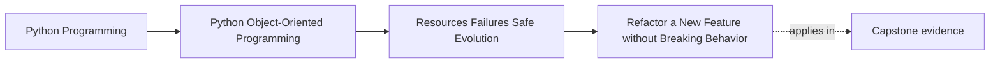

# Refactor a New Feature without Breaking Behavior

<!-- page-maps:start -->
## Page Maps

<!-- page-maps:end -->

Read the first diagram as a placement map: this page is one concept inside its parent
module, not a detached essay, and the capstone is the pressure test for whether the
idea holds. Read the second diagram as the working rhythm for the page: name the
problem, study the example, identify the boundary, then carry one review question
forward.

## Why this lesson matters

This is the page where Module 05 becomes practical.

The course has already taught:

- ownership boundaries
- cleanup discipline
- failure contracts
- retry safety
- public versus internal surfaces
- compatibility-aware evolution

The real test is whether you can now add something new without silently damaging what
already works.

That is the standard self-learners need most. Real maintenance work is rarely "start
fresh." It is usually "extend the system without betraying its existing promises."

## Start by naming the promise you must keep

Before writing the new feature, list what must remain stable.

That usually includes:

- public imports or entrypoints
- existing domain behavior
- stored data or configuration formats
- operational guarantees such as cleanup and retry discipline

If you skip this step, the refactor becomes guesswork. You may improve one surface while
breaking another because the preserved contract was never named.

## Choose one feature and locate its real boundary

A safe feature addition starts by asking:

- is this a new policy variation?
- a new boundary field?
- a new persistence concern?
- a new outward behavior?

The answer tells you where the feature belongs.

For example:

- a new rule evaluation mode may belong in a strategy or policy object
- a new config field may belong at the translation boundary first
- a new output path may belong behind an adapter or publication boundary

This keeps the new feature from being bolted into the most convenient file.

## Add capability before deleting old structure

One reliable sequence is:

1. identify the stable behavior that must remain
2. add tests or proofs for that behavior
3. introduce the new capability alongside the old path
4. route new behavior through the right boundary
5. remove old duplication only after the preserved behavior is still proven

This sequence matters because eager deletion often hides whether the feature addition was
an extension or an accidental rewrite.

## Keep compatibility visible while you extend

As you add the new feature, keep checking:

- does old input still load?
- do existing imports still work?
- does previous behavior still pass the same proof route?
- did any internal refactor accidentally become a public break?

The point is to evolve with awareness, not to hope the test suite happened to cover the
right surface.

## Use the module tools together

This final page is not about one pattern. It is about combining the module's ideas:

- resource owners still need deterministic cleanup
- unit-of-work boundaries still decide what becomes authoritative
- failures still need named recovery meaning
- retries still need explicit safety
- public modules still need surface discipline
- compatibility contracts still need evidence

If the new feature forces you to violate one of those to "just get it working," the
structure is still too weak.

## A practical change route

Use this route when the system feels risky to change:

1. state the old promise
2. identify the new capability
3. choose the correct boundary for the new behavior
4. add proof for the preserved behavior
5. extend through the boundary rather than bypassing it
6. remove the obsolete path only after the old and new contracts are both clear

That route is intentionally boring. Boring is good when compatibility pressure is real.

## Common mistakes

- starting with internal rearrangement before naming the behavior that must survive
- stuffing a new feature into an old conditional ladder because it seemed faster
- changing public surfaces while claiming the refactor was internal
- weakening failure, cleanup, or retry discipline to make the feature fit
- deleting old code before proving the replacement preserves the important promise

These mistakes create exactly the kind of regressions this module is supposed to prevent.

## Review checklist

| Question | Good sign |
| --- | --- |
| is the preserved contract named before the refactor starts? | yes |
| does the new feature enter through the right boundary? | yes |
| are compatibility and operational guarantees still visible during the change? | yes |
| is old structure removed only after preserved behavior is proven? | yes |

## Capstone connection

Use the capstone as the pressure test for this full module.

Pick one plausible feature extension and walk it through these questions:

- what old promise must remain true?
- where does the new behavior belong?
- which proof route demonstrates you preserved the old behavior?
- what cleanup, failure, retry, or compatibility rule could this extension accidentally weaken?

If you can answer those clearly, Module 05 has become actionable rather than decorative.

## Exit check

Leave this lesson only when you can do all of these:

- describe a safe order for adding a feature under compatibility pressure
- identify which Module 05 contracts must be protected during the change
- point to one capstone feature extension and explain how you would add it without breaking old behavior
