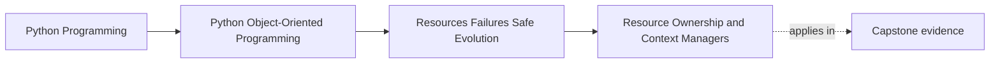

# Resource Ownership and Context Managers

<!-- page-maps:start -->
## Page Maps




<!-- page-maps:end -->

Read the first diagram as a placement map: this page is one concept inside its parent
module, not a detached essay, and the capstone is the pressure test for whether the
idea holds. Read the second diagram as the working rhythm for the page: name the
problem, study the example, identify the boundary, then carry one review question
forward.

## Why this lesson matters

Many object models fail for a boring reason: nobody can say who closes the file, ends
the session, releases the lock, removes the temporary directory, or returns the network
connection.

That is not a small operational detail. It is an ownership failure.

If ownership is unclear, cleanup becomes a habit instead of a guarantee. The system may
look correct in a happy-path demo and still leak resources, hold stale locks, or leave
half-open sessions in real use.

## The core rule

Every resource needs an owner.

That owner is responsible for:

- acquiring it
- exposing it safely
- cleaning it up deterministically
- deciding what happens if setup or cleanup fails

If you cannot point to that owner quickly, the design is already weak.

## What counts as a resource

Students often think only of files and sockets. The category is wider.

Resources include:

- files and directories
- database sessions and transactions
- locks and semaphores
- external clients with open connections
- temporary state that must be cleaned or finalized
- any object whose lifetime matters for correctness, not just convenience

The important question is not "does Python collect it eventually?" The important
question is "does correctness depend on ending this lifetime at the right time?"

## Why `with` matters

`with` is not style sugar. It is a lifetime contract.

A context manager says:

- setup happens here
- cleanup happens here
- cleanup still happens if the body raises

That deterministic boundary is why context managers belong in a course about design,
not only in a syntax appendix.

```python
with open("policy.log", "a", encoding="utf-8") as handle:
    handle.write("rule activated\n")
```

This snippet is valuable because the ownership story is visible. The file is opened for
one purpose, used inside one boundary, and released when that boundary ends.

## Ownership should match responsibility

Do not let a low-level helper open a resource while a distant caller silently owns the
cleanup burden. That split is where leaks start.

Better patterns look like this:

- a repository owns its session boundary
- a unit of work owns the repositories and their shared lifetime
- an adapter owns the client connection it opens
- a higher layer passes already-owned dependencies when it truly controls the lifetime

The point is alignment. The layer that creates or governs the resource should also own
the rule for ending it.

## Writing your own context manager

When your code owns a non-trivial resource, the interface should make that ownership
obvious.

```python
class AlertStore:
    def __enter__(self) -> "AlertStore":
        self._connection = connect_to_store()
        return self

    def __exit__(self, exc_type, exc, tb) -> bool:
        self._connection.close()
        return False
```

Two teaching points matter here:

- `__exit__` should usually return `False` so exceptions still propagate
- cleanup should be reliable even when the work inside the block fails

If the code suppresses exceptions without a very deliberate policy, the boundary stops
being trustworthy.

## Nested and shared lifetimes

Real systems often use more than one resource at once:

- a session plus a lock
- a client plus a temporary file
- a unit of work plus an event buffer

You still want one readable answer to "what closes what?"

Use structured lifetime tools when the set is static, and use `ExitStack` when the set
is dynamic. The important thing is not which helper you chose. The important thing is
that the lifetime remains explicit and reviewable.

## What not to rely on

Avoid vague cleanup stories such as:

- "the caller will remember to close it"
- "garbage collection will take care of it"
- "we only use it briefly, so it is probably fine"
- "tests never showed a leak"

Those are not ownership rules. They are hope.

`__del__` is especially poor as a main cleanup strategy because it does not give the
deterministic boundary this module is trying to teach.

## Common mistakes

- opening resources in constructors and never defining a visible lifetime boundary
- returning open resources to callers without documenting ownership transfer
- mixing business logic with manual open-close choreography in many places
- suppressing cleanup-time failures without deciding who now owns the damage
- using global singletons for convenience when the real problem is unclear ownership

These mistakes usually come from hiding lifetime decisions instead of modeling them.

## Review checklist

| Question | Good sign |
| --- | --- |
| can you name the owner of each non-trivial resource? | yes |
| is acquisition paired with deterministic cleanup? | yes |
| does the interface make lifetime visible rather than implicit? | yes |
| are exceptions propagated unless a deliberate policy says otherwise? | yes |

## Capstone connection

In the capstone, the runtime facade, repository boundary, and in-memory unit of work
are all small examples of lifetime ownership.

Ask these questions while reviewing them:

- who opens the resource-like boundary?
- who ends it?
- what still happens when the operation raises?

If the answer is fuzzy, the capstone structure is still hiding one of its most important
contracts.

## Exit check

Leave this lesson only when you can do all of these:

- explain why resource cleanup is an ownership question, not a syntax question
- identify one place where `with` expresses design intent rather than mere convenience
- point to one capstone boundary and name the object that owns its lifetime
