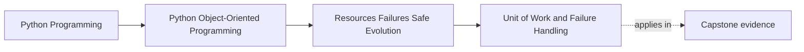

# Unit of Work and Failure Handling

<!-- page-maps:start -->
## Page Maps




<!-- page-maps:end -->

Read the first diagram as a placement map: this page is one concept inside its parent
module, not a detached essay, and the capstone is the pressure test for whether the
idea holds. Read the second diagram as the working rhythm for the page: name the
problem, study the example, identify the boundary, then carry one review question
forward.

## Why this lesson matters

A unit of work exists because many operations are not a single change.

One user action may need to:

- load authoritative state
- apply domain changes
- save the aggregate
- record outgoing events
- update another durable boundary

If one part succeeds and another fails, the system needs a named answer to "what counts
as committed?" Without that answer, partial failure turns into accidental behavior.

## The job of a unit of work

A unit of work groups related changes under one failure policy.

Its responsibility is not simply "call commit at the end." Its real responsibility is to
make these questions explicit:

- what state belongs to the same change boundary?
- when does that boundary become durable?
- what should happen if an exception occurs before durability?
- which side effects must wait until the authoritative write succeeds?

That is why this pattern belongs in a module about design discipline, not just
persistence.

## Authoritative versus provisional state

During an operation, some things are still provisional:

- in-memory object mutations
- queued events not yet stored
- repository changes staged in a session

The unit of work is the place that decides when provisional work becomes authoritative.

Until that boundary is crossed, callers should not behave as if the change is complete.

This distinction matters because many weak designs publish, log, or notify too early and
then pretend rollback can erase what already escaped.

## A useful mental model

Think of a unit of work as an agreement between three surfaces:

- domain objects decide whether a change is valid
- repositories track the state that may be persisted
- the unit of work decides whether that tracked state becomes durable together

That means repositories and aggregates are not replacements for the unit of work. They
solve different parts of the same change path.

## A minimal shape

Most course examples keep the shape small on purpose:

```python
class UnitOfWork:
    def __enter__(self) -> "UnitOfWork":
        ...

    def commit(self) -> None:
        ...

    def rollback(self) -> None:
        ...

    def __exit__(self, exc_type, exc, tb) -> bool:
        if exc_type is not None:
            self.rollback()
        return False
```

The exact implementation may change. The teaching point does not:

- entering begins a controlled change boundary
- committing makes it authoritative
- exceptions trigger the failure policy

## Repositories should live inside the boundary

A unit of work becomes much clearer when repositories are scoped inside it.

```python
with uow:
    policy = uow.policies.get(policy_id)
    policy.retire_rule(rule_id)
    uow.commit()
```

This shape helps students see that repositories are not free-floating data helpers. They
participate in the same ownership story as the commit boundary.

If callers can casually use repositories outside a write boundary, the design invites
partial updates and inconsistent failure handling.

## What happens on failure

The failure policy should answer at least three things:

- which in-progress changes are abandoned?
- which already-escaped side effects cannot be rolled back?
- what must happen next to restore coherence or signal repair?

That third question is usually ignored in shallow material, but it matters the most.
Rollback is only part of the story. If an external effect already escaped, you need a
named follow-up policy, not optimistic silence.

## Events must respect the commit boundary

If your aggregates emit domain events, do not treat those events as if they are ready to
publish the moment they are created.

Usually the safer sequence is:

1. validate and mutate domain state
2. stage the new durable state
3. store or queue the event as part of the same durable boundary
4. publish only after the authoritative write succeeds

That ordering prevents a common design bug: telling the outside world about a change
that never became durable.

## Common mistakes

- treating the unit of work as a database convenience instead of a failure contract
- letting repositories write eagerly before the boundary is complete
- publishing events before durability is established
- assuming rollback solves every escaped side effect
- hiding commit ownership inside deep helper methods so callers cannot reason about it

These mistakes usually come from refusing to name the change boundary honestly.

## Review checklist

| Question | Good sign |
| --- | --- |
| can you name what belongs to one authoritative change boundary? | yes |
| do repositories participate inside that boundary rather than around it? | yes |
| are events and side effects delayed until durability rules allow them? | yes |
| does failure handling say more than "rollback happened"? | yes |

## Capstone connection

The capstone's in-memory unit of work is intentionally small, but the teaching pressure
is real:

- where does a rule change become authoritative?
- when would an alert-side effect be allowed to escape?
- who owns the answer if the operation fails halfway through?

Use that small implementation to practice the reasoning before the persistence module
makes the mechanics more complex.

## Exit check

Leave this lesson only when you can do all of these:

- explain what a unit of work makes authoritative and what it keeps provisional
- describe why repositories and events must respect the same failure boundary
- identify one capstone change path and name where partial failure is handled
