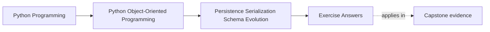
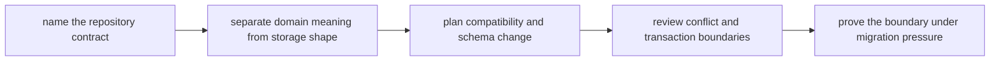

# Exercise Answers

<!-- page-maps:start -->
## Page Maps




<!-- page-maps:end -->

These model answers show what a strong persistence review packet looks like for the
`WorkshopEnrollment` scenario. Read them as one defended design, not as ten isolated
correct responses.

## Running scenario recap

`WorkshopEnrollment` owns:

- workshop identifier
- seat limit
- confirmed attendees
- waitlist order
- version for optimistic concurrency

The persistence boundary must preserve the invariant that confirmed attendees never
exceed capacity, even when data is old, malformed, or written concurrently.

## Answer 1: Repository contract

The contract should stay in aggregate language:

```text
load(workshop_id) -> WorkshopEnrollment | None
save(enrollment, expected_version) -> None
```

Why this is strong:

- callers ask for an authoritative aggregate, not a bag of storage fragments
- callers save one aggregate state transition, not a collection of table updates
- concurrency meaning is explicit through `expected_version`

What callers should not need to know:

- whether attendee entries live in one table or several
- whether waitlist order is normalized rows or a serialized list
- whether the repository writes events, snapshots, or both behind the scenes

If the public API drifts toward "fetch rows," "update attendees table," or "save join
records," the storage model is starting to dictate the application vocabulary.

## Answer 2: Rehydration route

Strong rehydration path:

1. fetch the stored representation
2. decode through one mapper or codec
3. call an aggregate constructor or rehydration factory that still enforces invariants
4. reject or route malformed data to a repair path before it becomes a live object

The key teaching point is this:

stored data is not domain truth merely because it already exists.

The first moment data becomes domain truth again is when it passes through the same
meaningful boundary that present-tense writes must respect.

Weak path:

1. create an empty object
2. assign fields from rows or payloads
3. hope the persisted state happened to be valid

That path teaches the wrong lesson: that persistence may bypass rules that all ordinary
domain behavior must obey.

## Answer 3: Meaning versus storage convenience

A useful split looks like this:

| Stored value | Boundary role | Why |
| --- | --- | --- |
| `seat_limit` | domain meaning | capacity depends on it |
| ordered waitlist ids | domain meaning | promotion order changes behavior |
| attendee membership | domain meaning | who is confirmed affects invariants |
| row `updated_at` | storage convenience | operationally useful, not central to the aggregate contract |
| surrogate row ids | storage convenience | persistence mechanics only |
| version number | persistence boundary meaning | not domain behavior itself, but part of honest conflict handling |

The crucial reasoning move is to notice that some values matter operationally without
belonging in the public domain contract.

One good design rule is:

> If a field exists only to help storage, indexing, or transport, no domain method
> should need to mention it by name.

## Answer 4: Codec boundary

Suppose the path is aggregate to database row set.

The codec or mapper may know:

- table layout
- column names
- serialization format details
- historical aliases such as `confirmed_attendees_csv`

The aggregate should remain ignorant of:

- whether older rows stored attendees as CSV
- whether joins or denormalized payloads were used
- whether the write path stores snapshots, events, or both

Why this matters:

- if storage shape changes, most of the blast radius stays at the edge
- if codec logic spreads inward, changing one schema detail forces the domain to learn
  persistence trivia

That is how a good model slowly turns into an accidental schema wrapper.

## Answer 5: Session and identity-map pressure

Reasonable caller assumption:

- within one unit of work, repeated loads of the same workshop refer to one logical
  aggregate state

Unreasonable surprise:

- attribute access silently lazy-loads additional state and changes the apparent object
  contract

The important distinction is:

- caching and identity reuse are allowed implementation choices
- changing what the aggregate appears to contain is not

One good proof route is a contract test that loads an aggregate through the repository
and verifies that the caller can inspect invariant-relevant state without hidden
persistence behavior surfacing halfway through the interaction.

## Answer 6: Snapshot versus event storage

For this aggregate, a hybrid is often the strongest teaching choice:

- current-state snapshot for straightforward load and save
- optional event history for audit or rebuild questions

Why not events only?

- rebuild cost and operational complexity may outweigh the benefit for a modest
  aggregate

Why not snapshots only?

- you may lose reviewable history for promotion, rejection, or reopening behavior

The decision is not about which pattern sounds more advanced. It is about which history
future readers will actually need and which compatibility burden the team can carry.

## Answer 7: Schema evolution path

Old shape:

- `confirmed_attendees_csv`
- no explicit waitlist order

Current shape:

- normalized attendee rows
- explicit waitlist order
- version number

Strong compatibility story:

1. detect schema version at read time
2. decode old CSV carefully at the persistence edge
3. reconstruct the current in-memory representation
4. run a durable migration when operationally ready

What should fail first if compatibility breaks:

- fixture-based rehydration tests using historical records

What should not happen:

- aggregate code branches on old CSV parsing internally

That would teach the present-tense model historical storage trivia that belongs at the
edge.

## Answer 8: Conflict and publication boundaries

Race:

- two administrators confirm different waitlisted attendees at nearly the same time

Strong handling:

- repository save includes `expected_version`
- stored version mismatch raises an explicit concurrency conflict

What the caller learns:

- "your update was based on stale state; reload and decide again"

What the system can still claim if publication lags after a successful durable write:

- the aggregate truth changed successfully
- downstream notification or projection is now a delivery concern, not a truth concern

That split is essential. If durability and downstream publication blur together, runtime
failures become hard to diagnose and business truth becomes hard to name.

## Answer 9: Migration rehearsal

A safe migration route:

1. identify records by schema version
2. decode each record through compatibility logic
3. rebuild the aggregate through an honest constructor or rehydration factory
4. write the new shape only after invariants are validated
5. verify the change on fixtures and rehearsal data before production rollout

Good proof:

- fixture replay across multiple historical shapes
- round-trip reconstruction tests
- rerun story showing the migration can be repeated safely or resumed deliberately

Bad pattern:

- writing transitional rows directly because "the data is already trusted"

That shortcut is exactly how migrations create durable states the domain would never
permit during ordinary operation.

## Answer 10: Final persistence review packet

A compact strong packet might read:

> `WorkshopEnrollmentRepository` promises aggregate-language load and save only. Stored
> rows, snapshots, and historical CSV shapes are absorbed by persistence-edge codecs and
> mappers, never by the aggregate itself. Rehydration always passes through an
> invariant-enforcing boundary. Stale writes fail through versioned saves instead of
> silent overwrite. Historical compatibility is proven through replay fixtures and
> migration rehearsal, not assumed from current rows.

That packet is strong because another maintainer can answer:

- what the repository protects
- where translation lives
- how old data survives
- where conflict becomes explicit

## Self-check

Your own answer packet is ready when another reader can answer all of these from it:

- what the repository contract is in domain language
- which data belongs to meaning versus storage convenience
- where historical schema burden is absorbed
- how stale writes fail before truth is silently overwritten

If any answer still depends on "you know what I meant," tighten the packet before moving
on.
