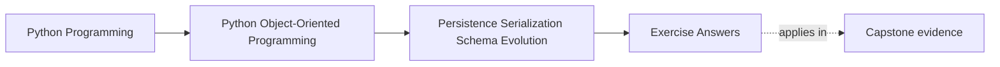
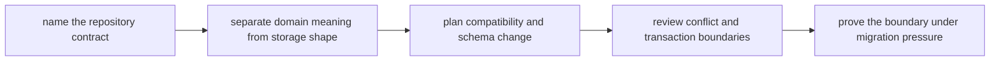

# Exercise Answers

<!-- page-maps:start -->
## Page Maps

<!-- page-maps:end -->

These answers are model explanations, not the only acceptable wording.

## How to use the answer page well

Do not read the model answers first and then reduce Module 06 to "keep storage separate
from the domain."

A better rhythm is:

1. finish the exercise with your own translation packet
2. name the repository promise, storage representation, and compatibility burden
3. compare your reasoning with the model answer
4. revise anywhere your answer still lets stored shape or session behavior redefine the
   model

What matters is whether the reasoning protects domain meaning while data moves across
time, backends, and serialized forms.

Strong Module 06 answers usually do five things:

- they keep repository contracts narrow and domain-shaped
- they distinguish domain meaning from storage convenience explicitly
- they use codecs and rehydration paths instead of leaking wire or ORM shapes inward
- they plan compatibility before schema change reaches production data
- they review conflicts, transactions, and migrations as part of persistence semantics

The strongest self-study packets also leave behind six concrete artifacts:

- one repository-contract note
- one mapping table
- one codec-boundary review
- one compatibility and upcast plan
- one conflict and transaction note
- one migration-safe persistence recommendation

If your answers rely mostly on "the repository hides the database," the reasoning is
still too thin.

## Answer 1: Define one repository contract

A strong answer identifies:

- the domain operations callers actually need
- the translation freedom the repository may keep internally
- the storage details that must never become caller assumptions

What goes wrong when the contract is too wide:

- callers start depending on query mechanics, storage identifiers, or nullability rules
  that should remain replaceable

## Answer 2: Rehydrate one aggregate honestly

The important pieces are:

- which constructor or rehydration path recreates the object
- which invariants still apply at load time
- which malformed states must be rejected or repaired before object creation

The main lesson is:

- reading old data does not suspend domain rules

## Answer 3: Separate domain fields from storage convenience

A strong answer distinguishes:

- fields that carry domain meaning
- fields that exist for indexing, joins, sorting, batching, or other storage concerns

The danger of blurring them is:

- storage convenience starts leaking into public APIs and decision logic

## Answer 4: Draw a real codec boundary

A strong answer explains:

- where encoding and decoding belong
- what format-specific details the codec may absorb
- what the domain object must stay ignorant of

The key review question is:

- if the wire format changed tomorrow, how much domain code would notice

## Answer 5: Review session and identity-map pressure

Good answers usually show:

- what identity caching or lazy loading changes for object behavior
- which surprises are acceptable and which would violate the apparent contract
- where that behavior should be made explicit to callers

The main lesson is that:

- persistence convenience must not quietly redefine what an object means when it is read

## Answer 6: Compare snapshot and event storage choices

A strong answer names:

- the audit or rebuild need that justifies event history
- the simplicity or speed case that makes snapshots enough
- the migration and compatibility costs attached to each choice

The main lesson is that persistence strategy commits future readers to a shape of history.

## Answer 7: Plan one schema evolution path

A strong answer identifies:

- the old representation that still exists in the world
- the new shape the code now expects
- whether to use migration, upcast, fallback decode, or a mix
- the proof surface that should catch compatibility drift first

The weakness to avoid is:

- assuming all stored data changes at the same time as the code

## Answer 8: Review conflict and transaction boundaries

The important pieces are:

- what counts as a conflicting write
- where concurrency detection belongs
- what should happen if persistence and downstream publication diverge
- what coherent outcome the transaction boundary promises

The main lesson is that:

- write success is not enough if the surrounding boundary tells a contradictory story

## Answer 9: Migrate stored data without domain corruption

A strong answer explains:

- how old records or events are identified
- how invalid intermediate states are avoided
- what tests or rehearsal surface prove the migration is safe
- what rollback, replay, or recovery plan exists if assumptions fail

Migration is strong when:

- it preserves domain discipline while acknowledging historical data reality

## Answer 10: Produce a persistence translation packet

The packet is strong when another maintainer can answer:

- what the repository promises
- where translation lives
- which stored shapes are still supported
- how conflicting writes are detected
- how the next schema or backend change can land without flattening the model

If different readers infer different compatibility promises, the packet is still too
ambiguous.

## Self-check

If your answers consistently explain:

- how one repository contract protects the model
- which parts of a shape are meaning versus storage convenience
- where one codec or rehydration boundary stops
- how old data remains readable under new code
- how conflict, transaction, and migration pressure stay reviewable

then you are using Module 06 correctly.
