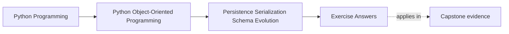
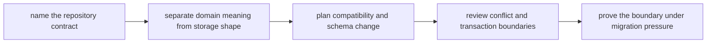

# Exercise Answers

<!-- page-maps:start -->
## Page Maps




<!-- page-maps:end -->

These are model answers for the `WorkshopEnrollment` persistence scenario from the
exercise page. They are meant to show how one aggregate can cross storage, schema
history, and conflict pressure without letting persistence details quietly become domain
truth.

## Running scenario recap

`WorkshopEnrollment` owns:

- workshop identifier
- seat limit
- confirmed attendees
- waitlist order
- version for optimistic concurrency

The repository boundary must preserve the invariant that confirmed attendees never exceed
capacity, even when records are old, partially migrated, or written concurrently.

## Answer 1: Repository contract

A good repository contract speaks domain language:

```text
load(workshop_id) -> WorkshopEnrollment | None
save(enrollment, expected_version) -> None
```

What callers should not need to know:

- whether the data lives in one table or several
- whether waitlist entries are normalized rows or serialized arrays
- how indexes support queries

If the contract grows into "fetch rows," "save relation list," or "update join table,"
storage convenience has leaked through the boundary.

## Answer 2: Rehydration

The repository must rebuild the aggregate through an honest boundary, not by mutating a
half-constructed object.

Strong path:

- fetch stored shape
- decode through codec or mapper
- call an aggregate constructor or rehydration factory that still enforces invariants

Weak path:

- instantiate an empty object
- set fields directly
- hope historical data was valid

Loading old data does not suspend the domain contract. It only means the rehydration path
may need compatibility logic before the aggregate is created.

## Answer 3: Domain meaning versus storage convenience

Example split:

| Stored value | Domain meaning or storage convenience | Why |
| --- | --- | --- |
| `seat_limit` | domain meaning | affects capacity invariant |
| ordered waitlist ids | domain meaning | promotion order changes behavior |
| row `updated_at` | storage convenience | useful operationally but not central to the model |
| join-table surrogate ids | storage convenience | internal persistence mechanics only |
| version number | boundary meaning | not domain behavior itself, but part of persistence contract |

The main rule is:

- fields that exist only to help the database must not widen the public object model

## Answer 4: Codec boundary

A clean codec may know:

- table layout
- column names
- JSON shape details
- historical field aliases

The aggregate should remain ignorant of:

- whether attendees were stored as CSV in an old version
- whether rows came from a join table
- whether a snapshot or event stream was the source

If the wire or row shape changes tomorrow, the codec should absorb most of the change. If
the aggregate must change just to understand column trivia, the boundary is too weak.

## Answer 5: Session and identity-map pressure

Callers may reasonably assume:

- loading the same workshop twice inside one unit of work refers to one logical
  enrollment state

Callers should not be surprised by:

- lazy loading that mutates visible behavior when a property is first read
- hidden round-trips triggered by innocent attribute access

If the persistence stack offers identity caching or lazy loading, the boundary should
either:

- hide it completely
- or document where it changes observable behavior

Unexpected storage-driven behavior is a contract bug, not just an ORM quirk.

## Answer 6: Snapshot versus event storage

For this aggregate, a hybrid is often sensible:

- current-state snapshot for the main write path
- optional event records for audit or rebuild needs

Why not events only?

- rebuilding simple enrollment state may add unnecessary operational complexity

Why not snapshots only?

- you may lose useful audit detail about promotion, rejection, or reopening paths

The choice is not ideological. It is about how much history future readers need and how
much compatibility burden the team is willing to carry.

## Answer 7: Schema evolution path

Old shape:

- `confirmed_attendees_csv`
- no explicit waitlist order

New shape:

- normalized attendee rows
- ordered waitlist records
- explicit version

Strong compatibility plan:

- detect old version at read time
- decode old CSV carefully
- construct normalized in-memory representation
- optionally run a forward migration for durable cleanup

Proof surface:

- fixtures for old records
- rehydration tests that compare loaded aggregate behavior, not just row counts

If old records only "mostly load," the contract is not good enough.

## Answer 8: Conflict and transaction boundaries

Race:

- two administrators confirm different waitlisted attendees at the same time

Conflict handling:

- repository save includes `expected_version`
- if stored version has changed, save fails with a concurrency conflict

Caller meaning:

- "your update was based on stale state; reload and decide again"

If persistence succeeds but publication lags, the boundary promise should still be
coherent:

- authoritative aggregate write succeeded
- downstream publication is now a delivery concern, not a truth concern

That split must be visible in logs and recovery procedure.

## Answer 9: Migration without corruption

A safe migration plan:

1. identify records by schema version
2. decode old representations through compatibility logic
3. reconstruct aggregates through honest constructors
4. re-encode into the new shape
5. verify invariants during rehearsal and on migration runs

Bad migration pattern:

- writing transitional rows directly because "the data is already trusted"

Good migration proof:

- fixture replay
- round-trip tests
- sample rollback or rerun story

The migration is only safe if invalid intermediate states never become durable truth.

## Answer 10: Translation packet

A compact final packet might read:

> `WorkshopEnrollmentRepository` promises load and save in domain language only. The
> codec isolates table and serialization details, including historical CSV-based attendee
> storage. The aggregate is always rebuilt through an invariant-enforcing path. Write
> conflicts surface via optimistic concurrency on versioned saves. The main remaining
> pressure is compatibility around older waitlist records, so replay fixtures and schema
> version tests must stay in the verification path.

That note is strong because it tells the next maintainer:

- what the repository promises
- where translation lives
- how old data survives
- where conflict becomes explicit

## Self-check

You are using Module 06 correctly when another maintainer can answer all of these from
your packet:

- what the repository contract protects
- which data belongs to domain meaning versus storage convenience
- where schema history is absorbed
- how stale writes fail instead of silently overwriting truth
