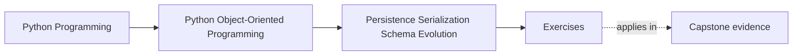
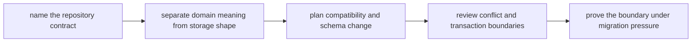

# Exercises

<!-- page-maps:start -->
## Page Maps

<!-- page-maps:end -->

Use these exercises as one full lab on meaning-preserving persistence. The goal is not
to list storage patterns. The goal is to prove that a learner studying alone can follow
one aggregate from domain state to stored shape, through schema change, and back into the
model without letting the database quietly redefine what the object means.

## Running lab scenario

Continue the `WorkshopEnrollment` scenario from Module 04.

Persist:

- workshop identifier
- seat limit
- confirmed attendee ids
- waitlist order
- version number for optimistic concurrency
- optional event records for audit or rebuild

The persistence challenge is:

- the stored shape may need indexes or separate tables the domain does not care about
- older records may exist from earlier schema versions
- concurrent writes may race
- projections or outbound publication may follow a successful write

If you choose your own scenario, keep the same pressure: one aggregate with real
invariants, a stored representation, versioned history, and at least one change path that
could race.

## What to keep open while you work

Build one translation packet as you go. By the end it should contain:

- one repository-contract note
- one domain-to-storage mapping table
- one codec-boundary review
- one compatibility plan
- one conflict and transaction note
- one migration recommendation

Useful tables:

| Domain concept | Repository contract surface | Storage representation | What must never leak inward |
| --- | --- | --- | --- |

| Stored shape or event | Current code expects | Risk if loaded naively | Upgrade or fallback plan |
| --- | --- | --- | --- |

## Exercise 1: Define one repository contract

For `WorkshopEnrollment`, decide what the repository should promise.

At minimum answer:

- what callers need to load
- what callers need to save
- what callers must never know about tables, joins, rows, or transport details

Write one small repository API that speaks domain language rather than storage language.

## Exercise 2: Rehydrate the aggregate honestly

Explain:

- what constructor or rehydration path rebuilds `WorkshopEnrollment`
- which invariants must still hold when loading old data
- which malformed rows or payloads must be rejected instead of silently tolerated
- what bug appears if repository code bypasses the real object boundary

This is where many designs quietly start trusting storage more than the model.

## Exercise 3: Separate domain meaning from storage convenience

Map the aggregate into stored shape and mark:

- which fields belong to domain meaning
- which fields exist only for storage convenience, indexing, or query support
- which stored values must not become public API assumptions

End with one sentence explaining how you will keep that distinction visible in code.

## Exercise 4: Draw one codec boundary

Choose one serialization path, such as:

- aggregate to database row set
- aggregate to JSON snapshot
- event record to domain event object

Then explain:

- where the translation code lives
- what the codec is allowed to know
- what the domain object must remain ignorant of
- what becomes brittle if the codec leaks inward

## Exercise 5: Review session and identity-map pressure

Assume the persistence stack may cache objects or lazily load related state.

Explain:

- what identity guarantees callers may assume
- what lazy-loading behavior would be misleading
- where the boundary should make such behavior explicit
- what test or review artifact would catch accidental contract drift

This is the exercise that protects the object model from storage convenience.

## Exercise 6: Compare snapshot and event storage choices

Decide whether the aggregate should store:

- current-state snapshots only
- event history plus rebuild
- or a hybrid

Explain:

- what audit or rebuild need justifies the choice
- what compatibility burden the choice creates
- what future migration problem it makes easier or harder

## Exercise 7: Plan one schema evolution path

Assume an older schema stored:

- `confirmed_count`
- `confirmed_attendees_csv`

and the new schema stores:

- normalized attendee entries
- explicit waitlist order
- version number

Explain:

- how old data remains readable
- whether you would use migration, upcasting, fallback decoding, or a mix
- what proof should fail first if compatibility breaks

## Exercise 8: Review conflict and transaction boundaries

Take one race:

- two administrators confirm two different waitlisted attendees at the same time

Explain:

- what counts as a conflicting write
- where optimistic concurrency belongs
- what callers should be told after conflict
- what coherent boundary promise exists if persistence succeeds but publication lags

## Exercise 9: Migrate without domain corruption

Write one migration plan that explains:

- how old records are identified
- how invalid intermediate states are avoided
- what tests or rehearsal data should prove the migration
- what rollback or replay plan makes the change safer

The migration is weak if it requires bypassing domain constructors "just this once."

## Exercise 10: Produce the translation packet

Finish the lab by assembling:

- one repository contract
- one mapping table
- one codec review
- one compatibility plan
- one conflict note
- one migration recommendation

The packet is done only when another maintainer can answer:

- what the repository promises
- what the storage shape is allowed to do
- how old data remains readable
- where conflicts are detected

## Done means the stored shape serves the model

You are done with the exercise day when your packet can survive these review questions:

- "What would break if the database shape changed tomorrow?"
- "How do old records become valid domain objects again?"
- "Where does write conflict become an explicit contract instead of a silent overwrite?"

If those answers are still fuzzy, keep tightening the packet before you open the answer
page.
