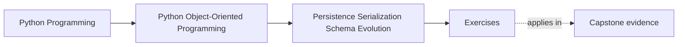
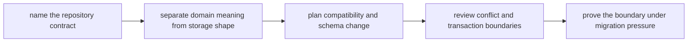

# Exercises

<!-- page-maps:start -->
## Page Maps

<!-- page-maps:end -->

Use this exercise day as one full persistence design lab. The point is not to list
storage patterns from memory. The point is to show that one aggregate can cross process
boundaries, historical schema drift, and concurrent writes without letting storage shape
quietly become the object model.

If you are studying alone, treat the whole page as a packet-building workshop. Do not
race through the prompts. Build one artifact that a teammate could review without your
voice in the room.

## Running lab scenario

Continue the `WorkshopEnrollment` aggregate from Module 04.

The aggregate owns:

- workshop identifier
- seat limit
- confirmed attendee ids
- waitlist order
- version for optimistic concurrency
- optional event history or snapshots for audit and rebuild

The persistence pressure is deliberately realistic:

- the database wants indexes and split tables the domain does not care about
- an older release stored attendee data in a weaker shape
- concurrent updates may race on the same workshop
- a successful write may need downstream publication or projection updates

If you substitute your own scenario, keep the same weight: one invariant-heavy
aggregate, one stored representation, one history problem, and one race you cannot
ignore.

## What you are building by the end

Build one persistence review packet as you go. It should contain:

- one repository contract note
- one rehydration route
- one mapping table
- one codec-boundary explanation
- one schema-compatibility plan
- one conflict and publication note
- one migration rehearsal note

If your answers are scattered across many pages with no final packet, the lab is not
done yet.

## Working tables

Keep these two tables open and fill them as you go.

| Domain concept | Repository contract surface | Storage representation | What must never leak inward |
| --- | --- | --- | --- |

| Stored shape or historical record | Current code expects | Failure if loaded naively | Upgrade, migration, or rejection plan |
| --- | --- | --- | --- |

The first table protects the present-tense boundary. The second protects the system from
quiet historical corruption.

## Exercise 1: Write the repository contract in domain language

For `WorkshopEnrollment`, decide what the repository should promise to callers.

Answer all of these:

- what callers need in order to load an authoritative aggregate
- what callers need in order to save one honest modification
- what callers must never know about tables, joins, row ordering, or transport details
- what persistence concern belongs somewhere else, such as a unit of work or read model

Finish with one short contract sketch in aggregate language only.

## Exercise 2: Draw the rehydration route

Explain how stored representation becomes a valid `WorkshopEnrollment` again.

Cover:

- the constructor or factory that should own re-entry into the domain
- which invariants must still be checked during load
- which stored defects should fail loudly instead of being normalized
- what bug appears if repository code sets fields directly on a half-built object

End with one sentence answering: "What is the first moment this data becomes domain
truth again?"

## Exercise 3: Separate meaning from storage convenience

Map the aggregate into stored shape and mark:

- which values are domain meaning
- which values exist only for indexing, joins, denormalization, or query convenience
- which stored fields callers must never start relying on as if they were domain API
- which value looks harmless but would become dangerous if it leaked inward

Add one design rule that keeps the distinction visible in code.

## Exercise 4: Place the codec boundary

Choose one translation path:

- aggregate to database row set
- aggregate to JSON snapshot
- event record to domain event

Then answer:

- where the codec or mapper lives
- what that codec is allowed to know about storage trivia
- what the aggregate must remain ignorant of
- what becomes brittle if decoding logic spreads into many call sites

Do not answer with library names alone. State the boundary and the allowed knowledge.

## Exercise 5: Review session and identity-map pressure

Assume the persistence stack may cache objects, reuse identities, or lazy-load related
state.

Explain:

- what object identity guarantee a caller may actually assume
- what lazy-loading behavior would make the object contract misleading
- what state should still appear complete at the aggregate boundary
- what proof or review drill would catch accidental contract drift

This is the point where storage convenience often starts impersonating model semantics.

## Exercise 6: Compare snapshot and event storage choices

Decide whether this aggregate should store:

- snapshots only
- event history only
- or a hybrid

Explain:

- what operational or audit need justifies the choice
- what compatibility burden the choice creates
- what rebuild, replay, or migration problem becomes easier
- what new risk the choice introduces for future maintainers

The answer is weak if it only says one pattern is "more advanced."

## Exercise 7: Plan one schema evolution path

Assume an older release stored:

- `confirmed_count`
- `confirmed_attendees_csv`

and the current release stores:

- normalized attendee entries
- explicit waitlist order
- version number

Decide:

- how old data stays readable today
- whether you need migration, upcasting, fallback decoding, or a mix
- what bad behavior would appear if old data were loaded naively
- which test fixture or proof route should fail first if compatibility breaks

Write the answer as if you were warning a future maintainer not to "just parse the CSV
one more time" inside the aggregate.

## Exercise 8: Review conflict and publication boundaries

Take one race:

- two administrators confirm different waitlisted attendees at nearly the same time

Explain:

- what counts as a conflicting write
- where optimistic concurrency should live
- what the caller should learn after conflict
- what truth the system can still claim if persistence succeeds but downstream
  publication lags

Make the write boundary and the delivery boundary sound different on purpose.

## Exercise 9: Rehearse one migration route

Write one migration plan that explains:

- how old records are identified safely
- how invalid intermediate states are avoided
- how the aggregate is rebuilt honestly during rehearsal or migration
- what tests, fixtures, or replay data prove the migration
- what rerun, rollback, or repair path makes the change safer

The plan is weak if it depends on bypassing constructors "just during migration."

## Exercise 10: Assemble the persistence review packet

Finish the lab by assembling all prior work into one short review packet.

A strong packet lets another maintainer answer all of these without seeing your draft
notes:

- what the repository promises
- how stored data becomes a valid aggregate again
- what the stored shape is allowed to do without changing domain meaning
- how old records remain readable or are rejected honestly
- where stale writes fail instead of silently overwriting truth

## Final review drill

Before opening the answer page, ask your packet these questions:

- "What would break first if the storage schema changed tomorrow?"
- "Which historical record shape is most dangerous to load naively?"
- "Where does concurrency become an explicit contract instead of accidental last write wins?"
- "Which proof would make me trust this boundary after a risky refactor?"

If those answers are still vague, tighten the packet. The exercise day is complete only
when the persistence boundary is reviewable, not merely familiar.
