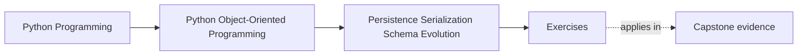
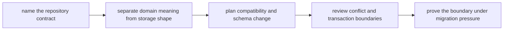
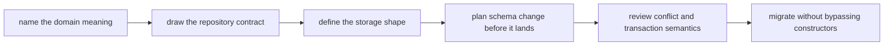

# Exercises


<!-- page-maps:start -->
## Page Maps




<!-- page-maps:end -->

Use these exercises to make persistence translation explicit instead of letting storage
quietly become the model.

The day is not about listing database patterns. It is about proving that repositories,
codecs, session state, snapshots, and migrations preserve domain meaning rather than
flattening it.

## How to work through this set

Treat the ten exercises as one full lab day on persistence boundaries and schema
evolution.

Before each answer:

1. name the domain concept under review
2. name the storage representation or boundary around it
3. state what must remain true when old data and new code meet

Do the exercises in order. The day is one progression:

- Exercises 1-3 define repository contract, rehydration, and mapping discipline
- Exercises 4-6 separate codecs, session concerns, and persistence strategies
- Exercises 7-8 review schema evolution, conflict detection, and publication boundaries
- Exercises 9-10 test migration and backend change without domain corruption

Keep one translation packet as you go. By the end of the day it should contain:

- one repository-contract note
- one domain-to-storage mapping table
- one codec boundary review
- one compatibility and upcast plan
- one conflict and transaction note
- one migration-safe persistence recommendation

If those six artifacts are missing, you are probably still naming tools instead of
governing meaning.

## Recommended working layout

If you want one lab tree that can support the whole day, use something like:

```text
module06-lab/
├── artifacts/
├── notes/
├── scratch/
└── tests/
```

Keep one mapping table while you work:

| Domain concept | Repository contract surface | Storage representation | What must never leak inward |
| --- | --- | --- | --- |

Keep one compatibility table:

| Stored shape or event | Current reader expectation | Compatibility risk | Upgrade or fallback plan |
| --- | --- | --- | --- |



Use that route on purpose. It keeps the day centered on meaning-preserving translation
instead of storage convenience.

## Exercise 1: Define one repository contract

Take one aggregate or domain object and explain:

- what repository operations callers actually need
- what the repository may translate internally
- what the repository must never expose from storage shape
- what confusion appears if the contract is too wide

Study note:
Repository contracts should preserve domain language, not mirror a database API.

## Exercise 2: Rehydrate one aggregate honestly

Choose one persisted object and explain:

- which constructor or rehydration path should recreate it
- which invariants must still hold on load
- what partial or malformed data must be rejected
- what bug appears if repository code bypasses the real boundary

Study note:
Loading old state does not justify skipping domain discipline.

## Exercise 3: Separate domain fields from storage convenience

Map one aggregate into storage and list:

- which fields carry domain meaning
- which fields exist only for indexing, joining, or operational convenience
- which storage field should never become part of the domain API
- how you would keep that distinction visible in code

Study note:
Storage convenience is not an invitation to widen the model.

## Exercise 4: Draw a real codec boundary

Take one serialized shape and explain:

- where encoding and decoding belong
- what the codec may translate
- what the domain object must stay ignorant of
- what becomes fragile if JSON, ORM, or wire format details leak inward

Study note:
Codecs protect meaning by making translation deliberate.

## Exercise 5: Review session and identity-map pressure

Pick one persistence stack and explain:

- what session state or identity caching might change for callers
- what object identity guarantees remain acceptable
- what lazy-loading surprise would weaken the domain contract
- where the boundary should make that behavior explicit

Study note:
Convenience caches are dangerous when they silently redefine object behavior.

## Exercise 6: Compare snapshot and event storage choices

Choose one persistence strategy and explain:

- when snapshots are enough
- when event history matters
- what rebuild cost or audit requirement drives the choice
- what compatibility problem appears if the strategy changes later

Study note:
Storage strategy is a contract with future readers and migrations.

## Midday self-check

Before moving into schema change and migration pressure, make sure your packet already
answers these questions clearly:

- what one repository contract promises callers
- which data is domain meaning and which is storage convenience
- where one codec boundary stops
- how one loaded object still preserves invariants

If you cannot answer those four questions in plain language, return to Exercises 1-6 and
make the packet more explicit before continuing.

## Exercise 7: Plan one schema evolution path

Take one persisted shape that must change and explain:

- what changed in the model
- which old representations must still load
- whether an upcaster, migration, or fallback reader is appropriate
- what evidence would show the compatibility plan is working

Study note:
Schema evolution is where past readers meet present code.

## Exercise 8: Review conflict and transaction boundaries

Choose one write path and explain:

- what counts as a conflicting write
- where optimistic concurrency or another guard belongs
- what should happen if persistence succeeds but publication does not
- what promise the transaction boundary makes to callers

Study note:
Persistence is not finished when bytes are written; it is finished when the whole
boundary outcome is coherent.

## Exercise 9: Migrate stored data without domain corruption

Take one migration and explain:

- which old data shapes need repair
- how the migration avoids inventing invalid domain objects
- what tests or proof surface should fail first if the migration is wrong
- what rollback or replay plan makes the change safer

Study note:
Migrations are object-model changes with history attached.

## Exercise 10: Produce a persistence translation packet

Assemble:

- one repository-contract note
- one mapping table
- one codec-boundary review
- one compatibility plan
- one conflict and transaction paragraph
- one migration recommendation

The packet is strong when another maintainer can answer:

- what the repository promises
- what the storage shape is allowed to do
- how old data stays readable
- where conflicts are detected
- how the system can change backends or schemas without flattening the model

## Done means more than finishing the page

You are done with the exercise day when your packet can survive three kinds of review:

- a design review asking whether storage details leaked into the model
- a compatibility review asking how old data survives new code
- an incident review asking where conflict or publication boundaries should have failed

If the packet cannot survive those reviews, keep tightening the translation language.
