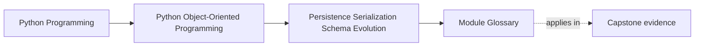

# Module Glossary

<!-- page-maps:start -->
## Page Maps

<!-- page-maps:end -->

This glossary belongs to **Module 06: Persistence, Serialization, and Schema Evolution**
in **Python Object-Oriented Programming**. Use it when your in-memory model has to cross
storage, wire, or version boundaries without letting persistence concerns leak back into
the domain.

## How to use this glossary

Return here when it becomes unclear whether a field belongs to the domain, the storage
shape, or the migration path. The core lesson in this module is that persistence is a
boundary, not the center of the model.

## Terms that matter in this module

| Term | Meaning in this module | Review question |
| --- | --- | --- |
| Repository | A boundary object that loads and saves aggregates without exposing storage mechanics to callers. | Does this API speak domain language, or is it leaking SQL rows, ORM sessions, or transport payloads? |
| Rehydration | Reconstructing a domain object from stored data while restoring its invariants and structure. | When data comes back from storage, where do you rebuild honest domain objects? |
| Storage model | The shape that fits the database or external persistence layer. | Have you kept this shape separate from the richer in-memory domain model? |
| Codec | Explicit logic that translates between domain objects and serialized or stored representations. | Can a reader find the translation rules in one place instead of across several ad hoc helpers? |
| Serialization boundary | The line where objects turn into bytes, dicts, rows, or messages. | Are you treating this conversion as a real boundary with design consequences? |
| Schema version | A named version of persisted data structure that lets readers interpret older and newer records safely. | How does the code know which meaning to apply to older stored data? |
| Upcaster | A transformation that moves old stored data into the newer shape expected by the current model. | Can you upgrade old records without teaching the core domain model every historical detail? |
| Optimistic concurrency | Conflict detection based on "fail if someone changed this since I read it." | If two writers race, where does the conflict surface and how is it reported? |
| Identity map | A mechanism that ensures one logical record is represented by one in-memory object per session or unit of work. | Could this code accidentally create several live objects for the same underlying record? |
| Transaction boundary | The scope inside which persistence changes succeed or fail together. | What related writes must remain atomic for the domain to stay truthful? |
| Snapshot | A stored representation of current state used to avoid rebuilding everything from scratch. | Are you storing the right amount of history versus current convenience? |
| Outbox thinking | Recording durable follow-up messages alongside data changes so publication does not drift from persistence. | If state commits but notification fails, what design keeps those facts from diverging? |

## Fast distinctions

- A **repository** is a domain-facing contract, not a generic data bag.
- A **codec** translates representations; it should not decide business rules.
- An **upcaster** carries historical compatibility so the core model can stay current.
- A **transaction boundary** is about truth-preserving atomicity, not just performance.

## Exit check

Leave this glossary only when you can do all of these:

- explain why storage models and domain models should not be casually merged
- identify where schema history should live so the main domain logic does not absorb it
- explain when optimistic concurrency is enough and what it is protecting against
