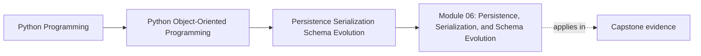
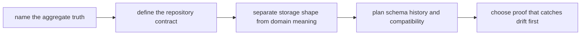

# Module 06: Persistence, Serialization, and Schema Evolution

<!-- page-maps:start -->
## Page Maps

<!-- page-maps:end -->

Read the first diagram as a placement map: this module sits between the ownership work
from Modules 04 and 05 and the runtime pressure work in Module 07. Read the second
diagram as the working route for the whole session: identify what the aggregate means,
decide what the repository is allowed to promise, separate storage shape from domain
meaning, then prove the boundary under old-data pressure.

This module exists because many object-oriented systems stop protecting the model the
moment persistence appears. A good aggregate turns into a bag of rows. A careful
transition contract turns into whatever JSON the last adapter happened to write. Old
records become "special cases" that constructors quietly tolerate.

The central question for the entire module is:

> Which parts of this representation are domain truth, and which parts are only
> persistence machinery that should remain replaceable?

If that line stays visible, storage remains a boundary. If that line disappears,
persistence starts redesigning the model without permission.

## Preflight

Before you start, make sure you can already do all of these:

- describe which aggregate owns one invariant-heavy state surface
- explain why a unit of work is not the same thing as a repository
- tell the difference between authoritative state and downstream projections

If those still blur together, revisit Modules 04 and 05 first. Module 06 assumes you
already know who owns the state before asking how it survives process and time.

## What you are learning to protect

By the end of this module, you should be able to:

- define repository contracts that speak in aggregate language instead of table language
- rebuild valid aggregates from stored data without bypassing invariant checks
- keep codecs, mappers, snapshots, and event shapes at the persistence edge
- design schema evolution that keeps old data readable without teaching the domain old
  storage trivia
- explain where conflict detection, publication ordering, and migration proof belong

These are not separate topics. They are one continuity problem: the system must keep its
meaning while the stored representation changes around it.

## Why this module matters

Persistence pressure arrives in predictable ways:

- an aggregate needs to be saved quickly, so raw storage rows leak outward
- a new field appears, so old records load through silent coercion
- a serializer changes shape, so the domain starts speaking transport language
- concurrent writes race, so versioning is bolted on after a data loss incident

This module teaches the earlier fix: make storage translation explicit before production
history and operational pressure force it on you.

## The full session route

Treat Module 06 as one serious study day with one running review question:

1. what is the authoritative aggregate contract?
2. how does stored shape become that aggregate again?
3. what historical data must still remain loadable?
4. which proof should fail first if the persistence boundary drifts?

If you can answer those four questions at the end of the day for one concrete scenario,
the module worked.

## Decision table: keep the boundary visible

| Design question | Strong answer | Weak answer |
| --- | --- | --- |
| what should the repository return? | authoritative aggregate or explicit absence | rows, ORM entities, or half-built fragments |
| where should storage translation live? | mapper or codec at the persistence edge | scattered ad hoc serialization |
| how should old shapes load? | deliberate compatibility path, migration, or rejection | silent coercion inside the domain |
| where should write conflict surface? | explicit persistence contract | accidental last-write-wins behavior |
| what proves the boundary still holds? | round-trip, compatibility, and conflict tests | "the save method still ran" |

Keep this table open while reading. It is the fastest way to spot when a persistence
design sounds tidy but is already leaking storage concerns inward.

## Reading path

Use the lesson pages in this order:

1. repository contracts and honest aggregate rehydration
2. mapping and serialization boundaries
3. sessions, snapshots, and rebuild trade-offs
4. schema evolution and conflict handling
5. transactional publication and persistence proof
6. the refactor page
7. the exercise day and answer packet

That order matters. If you start with schema evolution or ORMs before the repository
contract is clear, everything later feels more tool-specific and less architectural than
it really is.

## Lesson map

- [Repository Contracts and Aggregate Rehydration](repository-contracts-and-aggregate-rehydration.md)
- [Mapping Domain Objects to Storage Models](mapping-domain-objects-to-storage-models.md)
- [Serialization Boundaries and Explicit Codecs](serialization-boundaries-and-explicit-codecs.md)
- [ORMs, Identity Maps, and Session Boundaries](orms-identity-map-and-session-boundaries.md)
- [Snapshots, Events, and Rebuild Trade-Offs](snapshots-events-and-rebuild-trade-offs.md)
- [Schema Versioning and Upcasters](schema-versioning-and-upcasters.md)
- [Optimistic Concurrency and Conflict Detection](optimistic-concurrency-and-conflict-detection.md)
- [Transactional Boundaries and Outbox Thinking](transactional-boundaries-and-outbox-thinking.md)
- [Persistence Tests and Backend Swappability](persistence-tests-and-backend-swappability.md)
- [Migrating Stored Data without Domain Corruption](migrating-stored-data-without-domain-corruption.md)
- [Refactor: Repositories, Codecs, and Schema Evolution](refactor-repositories-codecs-and-schema-evolution.md)
- [Glossary](glossary.md)

## Run one audit route while you read

Keep one aggregate in view for the whole module. The `WorkshopEnrollment` scenario from
the exercises works well because it has:

- invariant-heavy state
- waitlist order that must survive storage round trips
- version pressure under concurrent writes
- plausible old-data shapes that no longer match the present model

For that one aggregate, keep answering:

- what the repository promises
- which values are domain meaning
- which values exist only for storage convenience
- how old data becomes a valid aggregate again

This turns the module into a single review route rather than ten disconnected lesson
notes.

## Keep these support surfaces open

- `../guides/proof-matrix.md` when you want every persistence claim tied to one proof
  route
- `../capstone/capstone-map.md` when you want repository and verification surfaces kept
  explicit
- `../reference/self-review-prompts.md` when you want to test whether storage language
  is leaking into the model

## Capstone study route

If the module feels abstract, use this route through the capstone:

1. inspect the current repository and unit-of-work surfaces
2. ask what contract the aggregate-facing caller thinks it has
3. ask how malformed or old stored data would be detected today
4. ask which proof would fail first if serialization drifted from domain meaning
5. compare that answer with the exercise packet and refactor page

That route turns persistence into a reviewable object-design problem instead of a data
plumbing topic.

## What independent learners should produce

By the end of the module, produce one persistence review packet containing:

- one repository contract note
- one mapping table that separates meaning from storage convenience
- one codec or serialization boundary note
- one schema compatibility plan
- one conflict and publication note
- one migration proof route

If you cannot assemble that packet without rereading half the module, you probably still
understand the pieces separately but not the persistence boundary as one design surface.

## Honest completion signal

You are ready to move on when you can take one persistence change and explain all of
these at once:

- what the aggregate contract is
- what the stored representation is allowed to do
- how old data remains readable or is rejected honestly
- what test, rehearsal, or proof should fail first if the two drift apart

## Closing criteria

You should finish this module able to add storage, serialization, compatibility, and
conflict handling to an object-oriented Python system without letting those concerns
rewrite who owns meaning.

## Directory glossary

Use [Glossary](glossary.md) when you want the recurring persistence vocabulary kept
stable while you move between lessons, lab work, and capstone review.
