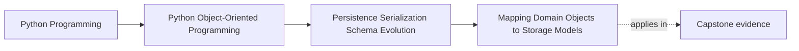

# Mapping Domain Objects to Storage Models

<!-- page-maps:start -->
## Page Maps

<!-- page-maps:end -->

Read the first diagram as a placement map: this page is one concept inside its parent
module, not a detached essay, and the capstone is the pressure test for whether the
idea holds. Read the second diagram as the working rhythm for the page: name the
problem, study the example, identify the boundary, then carry one review question
forward.

## Why this lesson matters

Persistence pressure often teaches the wrong lesson: because storage wants rows, maps,
and primitive columns, students start believing the domain should look like rows, maps,
and primitive columns too.

That is backwards.

The storage model exists to serve persistence concerns such as:

- indexing
- null handling
- denormalization
- query efficiency
- external format constraints

The domain object exists to preserve meaning, invariants, and behavior. Mapping is what
lets those two shapes differ without dissolving into each other.

## Domain shape and storage shape have different jobs

A domain object may use:

- semantic value types
- invariants across fields
- explicit ownership boundaries
- behavior attached to state

A storage shape may use:

- nullable columns
- flattened or duplicated fields
- surrogate identifiers
- representations optimized for retrieval rather than domain clarity

These are both valid, but they are valid for different reasons. Trouble begins when the
storage reason is allowed to redefine the domain reason.

## Mapping is translation, not copying

When you map between domain and storage, you are not simply transferring fields. You are
translating between two contracts.

That translation can include:

- collapsing semantic types into primitives for persistence
- re-expanding primitives into semantic types on load
- handling storage-only fields such as version counters or timestamps
- rejecting or normalizing representations that the domain should not see directly

If the mapping layer is missing or too implicit, that translation still happens, but it
happens everywhere and without reviewable ownership.

## Semantic types should survive in the domain

One common failure mode is widening every meaningful value to a string or integer
because the database stores strings or integers.

For example:

- a `RuleId` may persist as text
- a `MetricName` may persist as text
- a `Severity` may persist as text or small integer

That does not mean the whole application should start treating them as interchangeable
primitives.

The mapping boundary is exactly where you convert between:

- storage-friendly representation
- domain-meaningful type

Once that boundary is crossed, the domain should recover its richer vocabulary.

## Nullability belongs to the edge unless the domain truly owns it

Storage models often allow null because:

- old rows may be incomplete
- a migration is in progress
- a query shape is broader than the domain type

That does not automatically mean the domain object should accept missing data in the same
places.

If the domain truly requires a value, the mapping layer should enforce that rather than
teaching the rest of the system to normalize around accidental `None` values.

## Prefer explicit mapping over hidden magic

Heavy ORM reflection and automatic field mirroring can feel efficient, but they often
hide the most important questions:

- where did a field change meaning?
- where was nullability introduced or removed?
- where was a semantic type widened or narrowed?

Explicit mapping code makes those decisions visible.

That visibility matters more in teaching material than cleverness does, because the goal
is to help the reader reason about boundary meaning, not just reduce lines of code.

## Storage-only fields should stay storage-only

Some persisted data belongs to the persistence story rather than the domain story:

- row version tokens
- migration markers
- index helpers
- session or ORM tracking metadata

Do not let these become accidental domain fields just because they exist in storage.

The mapping layer should know about them when necessary without teaching the whole model
to depend on them as if they were business meaning.

## Common mistakes

- returning storage rows directly to the application layer
- widening domain value types into primitives across the whole system
- treating nullable storage fields as if they define the domain contract
- relying on hidden ORM magic where meaning changes are no longer reviewable
- copying storage-only metadata into domain objects unnecessarily

These mistakes all weaken the same thing: the separation between storage convenience and
domain meaning.

## Review checklist

| Question | Good sign |
| --- | --- |
| is there a clear translation boundary between domain and storage shapes? | yes |
| do semantic types reappear after crossing that boundary? | yes |
| is storage nullability prevented from silently redefining the domain? | yes |
| are storage-only concerns kept from polluting the core model? | yes |

## Capstone connection

Use the capstone repository and record-like shapes to ask:

- which fields are pure domain meaning?
- which fields are storage convenience or coordination detail?
- where would a schema change be absorbed if the domain meaning stayed the same?

Those questions turn mapping from boilerplate into one of the most important teaching
surfaces in the module.

## Exit check

Leave this lesson only when you can do all of these:

- explain why domain and storage shapes should often differ
- identify one semantic type that should reappear after persistence translation
- describe one place where storage nullability must not silently become domain meaning
