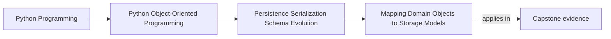
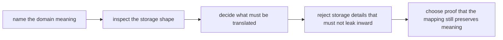

# Mapping Domain Objects to Storage Models

<!-- page-maps:start -->
## Page Maps

<!-- page-maps:end -->

Read the first diagram as a placement map: this page sits near the center of Module 06
because it explains how storage can differ from the model without redefining it. Read
the second diagram as the lesson route: start from domain meaning, inspect the stored
shape, decide what translation is required, then prove that the mapping preserved the
important invariants.

## Why this lesson matters

Persistence pressure often teaches the wrong lesson. Because storage wants rows,
primitive columns, nullable fields, and denormalized records, learners start believing
the domain should want those same things.

That is backwards.

The storage model exists to serve:

- indexing
- query shape
- denormalization
- migration convenience
- transport or file-format constraints

The domain object exists to serve:

- meaning
- invariants
- behavior
- ownership boundaries

Mapping is the boundary that lets both shapes do their jobs without collapsing into each
other.

## Start with the aggregate, not the row

When a mapping design feels confusing, ask this first:

> What state and rules does the aggregate actually need in order to stay honest?

For `WorkshopEnrollment`, that includes:

- workshop identifier
- seat limit
- confirmed attendees
- waitlist order
- version used to detect stale writes

Only after that should you ask how the stored representation wants to arrange those
facts.

If you begin with the row shape instead, the mapping layer quickly becomes a one-way
flattening step instead of a translation boundary.

## Domain shape and storage shape have different jobs

A domain object may use:

- value objects
- invariants across several fields
- explicit ownership boundaries
- methods that attach behavior to state

A storage representation may use:

- surrogate keys
- flattened primitives
- nullable columns
- denormalized lists or join rows
- helper fields for indexing or migration

These are both valid. They are valid for different reasons.

The design mistake is not "having two shapes." The design mistake is forgetting which
shape exists for which reason.

## Mapping is translation, not copying

When you map between the domain and storage, you are not merely transferring fields.
You are translating between two contracts.

That translation may include:

- collapsing semantic types into primitive storage values
- rebuilding semantic types on load
- handling storage-only fields such as `updated_at` or revision counters
- rejecting shapes that the domain must not see directly
- normalizing multiple stored fragments into one aggregate state surface

If the mapping layer is weak or missing, the translation still happens. It simply
happens everywhere, with unclear ownership, and with much less reviewability.

## Worked comparison: one aggregate, two shapes

For `WorkshopEnrollment`, a useful comparison might look like this:

| Concern | Domain shape | Storage shape |
| --- | --- | --- |
| workshop id | value with domain meaning | string or UUID column |
| confirmed attendees | set or owned collection with invariant rules | join rows or normalized attendee table |
| waitlist order | ordered collection with promotion meaning | ordered rows or stored sequence value |
| version | persistence boundary signal | integer revision column |
| last updated timestamp | often absent from domain | operational storage field |

This table matters because it shows that one stored shape may contain fields the domain
should never treat as central meaning, while one domain rule may span several stored
rows.

## Semantic types should disappear and then reappear

One of the most common mistakes is widening every meaningful value to a primitive because
the database stores primitives.

For example:

- `WorkshopId` becomes plain text everywhere
- `SeatLimit` becomes "just an int"
- waitlist position becomes an accidental array offset

That may simplify the mapper in the short term, but it impoverishes the model.

The healthier rule is:

- persistence may flatten rich meaning at the boundary
- the domain should regain that meaning as soon as the boundary is crossed

If primitives leak all the way inward, the mapping layer stopped protecting the language
of the model.

## Nullability belongs at the edge unless the domain owns the absence

Storage often allows `NULL` because:

- an old record predates a new field
- a migration is incomplete
- a query or export shape is broader than the real domain type

That does not automatically mean the domain should accept absence in the same places.

Ask two separate questions:

1. can storage contain a missing value?
2. can the present-tense domain meaningfully accept a missing value?

If the answer to the second question is no, the mapper should reject or translate
deliberately instead of teaching the whole system to normalize around `None`.

## Storage-only fields should stay storage-only

Some stored fields belong to the persistence story, not the business story:

- revision counters
- migration markers
- projection helpers
- ORM tracking metadata
- indexing convenience fields

The mapper may need to know about them. The aggregate usually should not.

One good review question is:

> If this field vanished from the business problem tomorrow, would the domain become
> harder to explain?

If the answer is no, the field is probably a storage concern and should stay near the
edge.

## Prefer explicit mapping over hidden magic when meaning changes

Automatic ORM mirroring feels convenient when the shapes happen to align. But the most
important mapping moments are exactly the ones where alignment breaks:

- a semantic type must be rebuilt
- several rows become one aggregate
- nullability tightens
- a historical shape needs translation

Those are not the moments to hide the design inside reflection or magic defaults.

Explicit mapping code is valuable here because it makes boundary meaning reviewable.

## Review drill

For any mapper, ask these four questions:

1. which fields are domain meaning?
2. which fields exist only for storage convenience?
3. where does a primitive become a semantic type again?
4. what malformed stored shape must be rejected rather than normalized?

If those answers are fuzzy, the mapping layer is still too implicit.

## Common mistakes

- returning storage rows directly to application code
- widening domain value types into primitives across the whole system
- treating nullable storage fields as if they define the domain contract
- relying on hidden reflection where meaning changes are no longer reviewable
- copying storage-only metadata into aggregates without a real business reason

All of these mistakes weaken the same boundary: storage convenience starts dictating the
language of the model.

## Capstone connection

Use the capstone repository path to ask:

- which fields are pure domain meaning?
- which stored helpers are there only for persistence or coordination?
- where would a schema change be absorbed if domain meaning stayed the same?
- which semantic type should reappear immediately after load?

Those questions turn mapping from boilerplate into one of the most important teaching
surfaces in the module.

## Exit check

Leave this lesson only when you can do all of these:

- explain why domain and storage shapes should often differ
- identify one semantic type that should disappear at the edge and reappear after load
- describe one place where storage nullability must not silently redefine the domain
