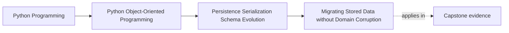

# Migrating Stored Data without Domain Corruption

<!-- page-maps:start -->
## Page Maps

<!-- page-maps:end -->

Read the first diagram as a placement map: this page is one concept inside its parent
module, not a detached essay, and the capstone is the pressure test for whether the
idea holds. Read the second diagram as the working rhythm for the page: name the
problem, study the example, identify the boundary, then carry one review question
forward.

## Why this lesson matters

Migration work is where many systems silently corrupt their own meaning.

A team wants a new representation, a stricter invariant, or a cleaner schema, and the
temptation is to treat old data as if it were merely an inconvenience. That leads to:

- silent coercion
- guessed defaults
- rewritten history with unclear meaning

Migration is not just data shuffling. It is domain preservation under change.

## Start with the domain meaning, not the storage shape

Before writing migration code, ask:

- what does this stored field mean in domain terms?
- what invariant does the current model now expect?
- which old shapes are merely older, and which are genuinely invalid?

If migration starts with storage mechanics alone, it can produce a technically neat
shape that no longer means what the domain thinks it means.

## Migration is different from ordinary loading

Ordinary loading reads a supported shape into a current object model.

Migration handles a historical representation that:

- may no longer match the current schema
- may need field renames or restructuring
- may require explicit interpretation before it becomes current state

That is why migration code deserves its own boundary and tests. It is doing historical
translation, not routine load logic.

## Preserve meaning before preserving convenience

When migrating stored data, the highest priority is preserving valid meaning.

That may require:

- rebuilding values through current constructors
- rejecting states that can no longer be interpreted honestly
- splitting one old field into several clearer current fields
- assigning defaults only where the old meaning genuinely supports them

The wrong priority order is:

1. make it load somehow
2. assume the meaning is close enough

That is exactly how domain corruption enters through persistence.

## Some old data needs repair, not silent import

Students should learn to recognize that not all legacy data deserves automatic runtime
acceptance.

Sometimes the honest answer is:

- this record is incomplete
- this old meaning cannot be mapped safely
- this state must be repaired offline or reviewed manually

That answer is healthier than silently creating a current object whose invariants are
only cosmetically satisfied.

## Migration boundaries should stay visible

Good migration design usually keeps the work concentrated in one place such as:

- explicit migration scripts
- versioned upgrade steps
- dedicated translation helpers near the persistence boundary

It should not leak historical branching across:

- aggregate methods
- unrelated services
- random application code paths

The more migration logic spreads, the more the present-tense model is forced to carry
historical baggage indefinitely.

## Test migrations against real historical shapes

Migration proof should answer:

- can code on Monday, July 27, 2026 still interpret data written on April 12, 2026?
- does the migrated result satisfy current invariants?
- do unsupported or corrupt records fail in a readable way?

These are stronger questions than "did the script run without crashing?"

## Common mistakes

- assigning defaults without proving they preserve old meaning
- mixing migration logic into normal runtime domain behavior
- treating corrupt data as if it were merely older data
- validating only structure instead of current domain invariants
- deleting the historical context that would explain why the translation was safe

These mistakes all trade long-term trust for short-term convenience.

## Review checklist

| Question | Good sign |
| --- | --- |
| does the migration start from preserved domain meaning rather than raw shape? | yes |
| are older and corrupt representations distinguished honestly? | yes |
| is historical translation kept near the persistence boundary? | yes |
| do migrated objects satisfy current invariants through real reconstruction? | yes |

## Capstone connection

Imagine the capstone had already persisted policy data earlier in 2026 and the current
model now tightened one invariant.

Ask:

- which old records are still safely interpretable?
- which should be upcast automatically?
- which would need offline repair before being accepted by the current model?

That is the pressure this lesson is meant to prepare students for.

## Exit check

Leave this lesson only when you can do all of these:

- explain why migration is a domain-preservation problem rather than only a storage problem
- identify one case where automatic loading should be rejected in favor of explicit repair
- describe how migration code should stay separate from ordinary current-state behavior
