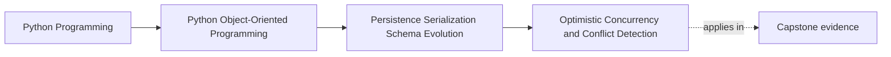
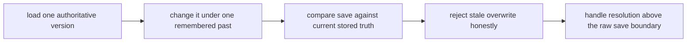

# Optimistic Concurrency and Conflict Detection

<!-- page-maps:start -->
## Page Maps

<!-- page-maps:end -->

Read the first diagram as a placement map: this page closes the Module 06 persistence
story by showing what happens when two writers act on the same aggregate. Read the
second diagram as the lesson route: load one remembered past, compare the save against
current truth, reject stale overwrite, then let workflow logic decide what to do next.

## Why this lesson matters

The moment two writers can act on the same persisted aggregate, the system faces one
dangerous question:

> What if both of them are acting from different remembered pasts?

If the system has no answer, one write may silently erase the meaning of the other.

Students often meet this topic as "stale write" or "last write wins," but the deeper
lesson is about protecting authoritative state from accidental overwrite.

## Optimistic concurrency does not ignore conflict

Optimistic concurrency assumes most writes will not collide, but collisions are still
possible and must be detected.

The common route is:

1. load the aggregate with its current version
2. modify it
3. save only if the stored version still matches what was loaded

If the stored version changed first, the write is stale and must not overwrite silently.

This design is optimistic not because it denies conflict, but because it does not lock
preemptively.

## Start with the meaning of a conflict

A conflict is not merely "the database complained."

A conflict means:

- the writer's view of authoritative state is outdated
- the meaning of the proposed write may no longer hold in the same way

Two edits may both be individually sensible and still be mutually unsafe when applied
without awareness of each other.

That is why conflict detection belongs in an object-integrity course, not only in a
database chapter.

## Version tokens are change-boundary markers

A version token, revision field, or compare-and-swap value exists to answer one narrow
question:

- am I still saving against the same authoritative state I loaded?

That token does not solve resolution by itself. It makes silent overwrite visible.

This distinction matters:

- detection says the write is stale
- resolution says what the workflow should do next

If those responsibilities blur together, conflict handling becomes harder to explain and
harder to test.

## Worked contrast: honest rejection versus silent overwrite

Weak path:

1. reader A loads version 5
2. reader B loads version 5
3. reader A saves version 6
4. reader B saves blindly and overwrites version 6 with its own changes

Strong path:

1. reader A loads version 5
2. reader B loads version 5
3. reader A saves successfully, producing version 6
4. reader B attempts to save against expected version 5
5. repository rejects the stale write

The strong path is not only more technical. It is more honest about who currently owns
truth.

## Last-write-wins is a policy, not a default accident

Many systems get last-write-wins accidentally because conflict is never made explicit.

That is dangerous because it turns one specific resolution policy into an invisible
default.

Sometimes last-write-wins may be acceptable. If so, it should be a deliberate choice
with clear reasoning:

- what meaning can safely be overwritten?
- who accepted that tradeoff?
- what proof shows the loss is acceptable?

If the system never asked those questions, last-write-wins is not a policy. It is a
gap.

## Resolution belongs above the raw persistence primitive

Once a conflict is detected, the system still needs to choose how to respond:

- reload and retry
- merge explicitly
- surface a conflict to the caller
- route the case to manual review

That decision usually belongs above the raw repository save operation because it depends
on workflow meaning, not only storage mechanics.

The repository's job is to expose the conflict clearly. The application boundary's job
is to decide what recovery or resolution makes sense.

## Test the real danger, not only the exception

A weak concurrency test stops at:

- "an exception was raised"

A stronger proof route demonstrates:

- two readers loaded the same earlier version
- one save succeeded first
- the later stale save was rejected
- authoritative state was preserved rather than overwritten silently

That is the educational proof readers actually need.

## Use conflict language the caller can understand

One useful design move is to translate persistence conflict into caller language:

- "your change was based on stale state"
- "reload and review the current truth before trying again"

This keeps conflict from sounding like a mysterious infrastructure glitch when it is
really a meaningful integrity signal.

## Review drill

For any save path that may face concurrent writers, ask:

1. how does the save know whether its view is stale?
2. what would silent overwrite destroy here?
3. where is the resolution policy chosen?
4. what test proves authoritative state survives a collision?

If those answers are unclear, conflict handling is still too accidental.

## Common mistakes

- assuming "one user at a time" means no future concurrency pressure
- using version tokens inconsistently across repository paths
- treating conflict as an infrastructure nuisance instead of an integrity issue
- letting stale writes overwrite silently because the tests never model collision
- confusing conflict detection with full conflict resolution policy

All of these mistakes weaken trust in persisted authority.

## Capstone connection

The capstone is small, but you can still model the real pressure:

- load one aggregate twice
- mutate both copies differently
- save one first
- prove the second stale write is rejected explicitly

That makes conflict detection teachable before real production traffic exists.

## Exit check

Leave this lesson only when you can do all of these:

- explain why optimistic concurrency still takes conflict seriously
- describe why last-write-wins should be deliberate if used at all
- identify one path where a stale write should be rejected rather than silently applied
