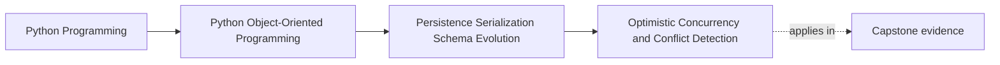

# Optimistic Concurrency and Conflict Detection

<!-- page-maps:start -->
## Page Maps

<!-- page-maps:end -->

Read the first diagram as a placement map: this page is one concept inside its parent
module, not a detached essay, and the capstone is the pressure test for whether the
idea holds. Read the second diagram as the working rhythm for the page: name the
problem, study the example, identify the boundary, then carry one review question
forward.

## Why this lesson matters

The moment two writers can act on the same persisted aggregate, you need an answer to a
dangerous question:

what if both of them are working from a different remembered past?

If the system has no answer, one write may silently erase the meaning of the other.
Students often meet this as "stale write" or "last write wins," but the deeper lesson
is about protecting authoritative state from accidental overwrite.

## What optimistic concurrency assumes

Optimistic concurrency assumes that most writes will not collide, but collisions are
still possible and must be detected.

The common pattern is:

- load aggregate with its current version
- modify it
- save only if the stored version still matches what was loaded

If the stored version changed first, the write is now stale and must not overwrite
silently.

This is optimistic not because it ignores conflict, but because it does not lock first.

## A conflict is not just a technical error

A conflict means:

- the writer's view of authoritative state is outdated
- the meaning of the new write may no longer be valid in the same way

That is why conflict detection belongs in a course about object integrity, not only in a
database chapter.

Two writes may both be individually sensible and still be mutually unsafe when applied
without awareness of each other.

## Version tokens are about change boundaries

A version token or revision field is a simple way to make conflict visible.

Its purpose is to let the save path ask:

- am I still saving against the same authoritative state I loaded?

This does not tell you how to resolve the conflict. It only tells you that silent
overwrite would be dishonest.

That distinction is important. Detection and resolution are separate responsibilities.

## Last-write-wins is a policy, not a default

Many systems end up with last-write-wins accidentally because conflict is never made
explicit.

That is dangerous because it turns one specific resolution policy into an invisible
default.

Sometimes last-write-wins may be acceptable. If so, it should be a deliberate policy
with clear reasoning. It should not appear only because stale state was never checked.

## Resolution belongs above the storage primitive

Once a conflict is detected, the system still needs to decide what happens next:

- retry after reload
- merge explicitly
- surface a conflict to the caller
- escalate for manual repair

That decision usually belongs above the raw repository save operation, because it depends
on workflow meaning rather than only on storage mechanics.

The repository should help expose the conflict clearly. The application boundary usually
chooses how to respond.

## Conflict tests should prove the real danger

Good concurrency tests do more than assert "an exception was raised." They prove that:

- two readers can load the same earlier version
- one save succeeds
- the later stale save is rejected
- authoritative state is preserved rather than overwritten silently

That is the educational proof route students actually need.

## Common mistakes

- assuming one user at a time means no future concurrency pressure
- using version tokens inconsistently across repository paths
- treating conflict as an infrastructure nuisance instead of an integrity issue
- letting stale writes overwrite silently because the test suite never modeled collision
- confusing conflict detection with full conflict resolution policy

These mistakes all weaken trust in persisted authority.

## Review checklist

| Question | Good sign |
| --- | --- |
| can the save path detect whether the writer's view is stale? | yes |
| does the system reject silent overwrite? | yes |
| is conflict response owned above raw persistence mechanics? | yes |
| do tests prove preservation of authoritative state under collision? | yes |

## Capstone connection

The capstone is small, but you can still model the pressure:

- load one policy twice
- mutate both in different ways
- save one first
- prove the second stale write is not accepted as if nothing changed

That makes conflict detection a teachable behavior before real traffic exists.

## Exit check

Leave this lesson only when you can do all of these:

- explain why optimistic concurrency still takes conflict seriously
- describe why last-write-wins should be a deliberate policy if used at all
- identify one capstone path where a stale write should be rejected explicitly
