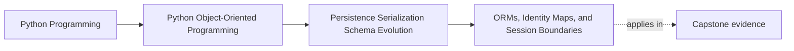

# ORMs, Identity Maps, and Session Boundaries

<!-- page-maps:start -->
## Page Maps

<!-- page-maps:end -->

Read the first diagram as a placement map: this page is one concept inside its parent
module, not a detached essay, and the capstone is the pressure test for whether the
idea holds. Read the second diagram as the working rhythm for the page: name the
problem, study the example, identify the boundary, then carry one review question
forward.

## Why this lesson matters

ORMs are useful, but they teach dangerous habits when students mistake framework session
behavior for domain truth.

An ORM may provide:

- identity tracking
- lazy loading
- change detection
- session-scoped caching

Those can be helpful implementation tools. They should not silently redefine:

- what object identity means in the domain
- when state is authoritative
- which boundaries own lifetime and mutation

This lesson exists to keep framework behavior from becoming accidental business meaning.

## What an identity map does

An identity map is a session-level mechanism that ensures one in-memory representation is
used for one persisted identity within that session.

That can help with:

- avoiding duplicate loads of the same row
- tracking changes coherently inside one persistence boundary

But it is still a persistence mechanism, not a universal statement about object
identity.

Students need to understand that "the ORM returned the same Python object" is not the
same claim as "the domain defines identity this way."

## Session lifetime is a boundary, not a convenience detail

A session often owns:

- database conversation state
- loaded entity tracking
- pending writes
- lazy-loading context

That means session lifetime changes what code can do safely.

If the session is too broad:

- hidden coupling grows
- stale state lives longer
- accidental write boundaries blur

If the session is too implicit:

- callers may not know when objects are still attached
- lazy loads may appear far from the original boundary
- mutation may occur outside the intended unit of work

That is why session boundaries must stay explicit in teaching material.

## ORM identity is not domain identity

A domain may define identity through:

- a stable rule identifier
- a policy identifier
- a semantic aggregate boundary

An ORM may define session attachment through internal object identity and tracking rules.

Those are different layers of meaning.

Confusing them leads to design mistakes such as:

- assuming attached objects are authoritative outside the session
- treating ORM attachment as if it were the domain's lifecycle rule
- letting session presence determine how the domain API is used

## Lazy loading changes apparent behavior

Lazy loading is one of the biggest sources of hidden persistence behavior.

From the caller's point of view, it may look like an ordinary attribute access. In
reality it may:

- trigger I/O
- fail because the session is closed
- return different behavior depending on attachment state

That hidden cost and hidden failure path can make a supposedly pure domain interaction
depend on persistence timing.

Students should learn to treat lazy loading as a boundary decision, not as harmless
magic.

## Keep persistence mechanics from leaking inward

A strong design tries to prevent the domain model from depending directly on:

- session attachment state
- lazy-loaded incidental relationships
- ORM-specific mutation semantics
- implicit flush timing

The repository or mapping boundary should absorb as much of that persistence machinery as
possible before domain code sees the object again.

## Session boundaries should align with work boundaries

A useful default is to align session lifetime with the same kind of boundary that owns
the unit of work:

- start a bounded persistence conversation
- load and modify authoritative aggregates
- commit or rollback deliberately
- end the session

This keeps persistence lifetime, change lifetime, and failure lifetime closer together.

The exact tooling can differ, but the principle is what students need to keep.

## Common mistakes

- treating ORM-managed instances as if they were safe to use anywhere
- letting lazy loading hide I/O in domain behavior
- holding sessions open too broadly because it seemed convenient
- equating session identity with domain identity
- letting implicit flush or attachment rules decide business-facing behavior

These mistakes make persistence mechanics look like object semantics.

## Review checklist

| Question | Good sign |
| --- | --- |
| is session lifetime explicit and bounded? | yes |
| is ORM identity kept distinct from domain identity? | yes |
| are lazy-loading costs and failure modes kept visible? | yes |
| does the design stop persistence mechanics from redefining domain behavior? | yes |

## Capstone connection

The capstone's in-memory model does not use a full ORM, which is a teaching advantage.

Use that simplicity to ask:

- if an ORM were introduced, which boundaries should still remain explicit?
- where would identity tracking help, and where would it distort the design?
- which behaviors must stay pure domain decisions instead of becoming session side effects?

Those questions make the future persistence upgrade safer before the framework is even
added.

## Exit check

Leave this lesson only when you can do all of these:

- explain what an identity map solves without confusing it with domain identity
- describe why session lifetime is part of the design contract
- identify one way lazy loading can distort the apparent object model if left unchecked
